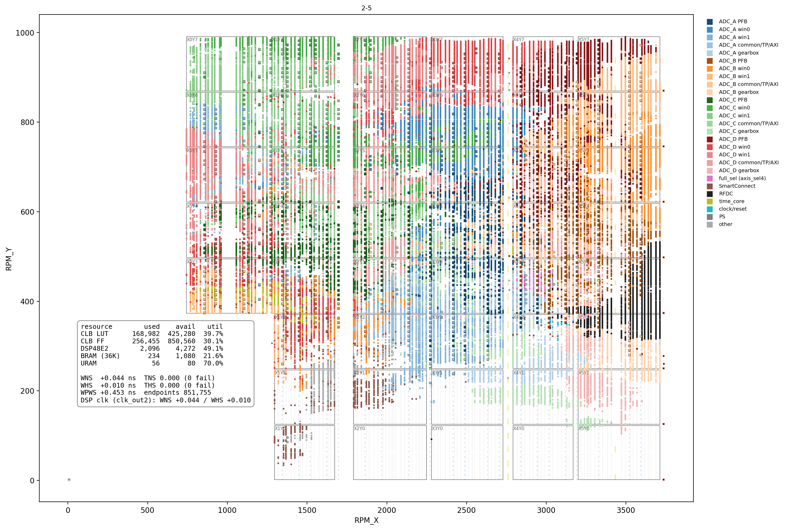

# proj021 — インターフェース v2 を SAM45-Fine の上で（手順 0 測る・1 群 C・2 v2）

日付: 2026-10-08（起こし）
状態: 進行中（手順 0・1a・1b・2（2-1〜2-5）通過、F-2・P-5・P-8 通過。残りは文書の片付け・A4・B2）

## 目的

**リポジトリの根元の [`INTERFACE.md`](../INTERFACE.md)（v2、2026-10-08 決定）を SAM45-Fine（proj020 = PFB T = 4 の窓）の上で作り、9 本の bit で使い回せる PL ↔ PS ↔ 制御 PC の約束が実機で成り立つことを確かめる。**

- 作るもの: 流れとコア・自己記述（INTERFACE の 2.・3.）、PL が書くリングと尾の CRC（4.）、TP と SNAP のレコード（4.6）、PL のダンプ 10.24 ms・specd の束ねと時刻（5.1・5.2）、LOAD、s45proto v2（float32）
- **proj021 の最後の形を、製品リポジトリへの移植の土台にする**（2026-10-08 の相談。proj020 からは移さない）。製品リポジトリへの移植では構成替えだけを行い、合否は「proj021 と同じものができること」（sim の bit 単位の一致・CDC の分類ごとの件数・BRAM・DSP。WNS では見ない）

経緯: 2026-10-08 の決定「次の proj021 はインターフェース v2 を SAM45-Fine の上で作る」（リポジトリ外の作業記録）・INTERFACE.md の 2.〜5. の決定・同日の相談（リポジトリを 2 つに分ける・変更は一度に一つ）

## 手順（変更は一度に一つ。手順ごとに commit を分ける）

| 手順 | 中身 | PL | 確かめること |
|---|---|---|---|
| **0** | PL を変えずに、PS とネットワークの量を測る（proj020.bit のまま） | 変えない | M-1〜M-5（下）。リングの大きさ・CRC を全部確かめるか間引くか・HP0 か HPC0 か・予算を決める |
| **1a** | ソースを共通部分と bit 個別に分ける（構成替えだけ。ID も変えない） | 同じ RTL | **build-PE の WNS・WHS が proj020 と小数 6 桁まで同じ**（+0.047121 / +0.009645）・CDC の分類ごとの件数・BRAM・DSP。実機には載せない |
| **1b** | 群 C を直す（gb_fifo と gb_gate の間に AXI4-Stream のレジスタスライス） | ギアボックスだけ | G-1〜G-4（下） |
| **2** | v2 | 流れ・リング・自己記述 | 判定 V2-a〜V2-g（下）・F-2 |

手順 1b と 2 で `-1` が閉じなかったとき、原因をその手順の変更だけに絞れるよう、1b のビルドと確かめを 2 の RTL より先に終える。

## 手順 0 — 測る（PL は proj020.bit のまま）

ボードの手順は **root のシェル**で、ボードのアドレスを `$B`、ダウンロード PC のアドレスを `$S` に入れて書く（2026-10-08 から）。

**測る前に予言を書く。** 外れた予言は残す。

| 判定 | 何を | 道具 | 予言（2026-10-08） | 決まること |
|---|---|---|---|---|
| M-1 | 1 GbE の実効（ボード → ダウンロード PC、TCP） | iperf3 30 s × 5 回（`-R` も） | 110〜117 MB/s（940 Mbit/s 前後） | 予算 = 実測の 70 %（INTERFACE 4.5）。SpW6（76.8 MB/s）が入るか |
| M-2 | ボードの CMA の大きさと、allocate で取れる最大 | `grep Cma /proc/meminfo`・allocate を倍々に | 未知（見当なし） | リングの大きさ（目安: 1 s 以上の止まりを吸収。SAM45-Fine 32 MiB・256M 256 MiB） |
| M-3 | allocate したバッファを numpy で読む速さ（キャッシュあり＋invalidate / キャッシュなし） | `pynq/bench_ps.py`（新規） | キャッシュありは 1 GB/s 以上、キャッシュなしは数百 MB/s 以下 | HP0（キャッシュあり＋invalidate）か HPC0（一方向のコヒーレンシ）か。205 MB/s を読めるか |
| M-4 | CRC-32（zlib.crc32）の速さ | 同上 | 300〜600 MB/s（A53 で zlib は CRC 命令を使わない見当） | 全部のレコードで確かめるか、間引くか（INTERFACE 4.6） |
| M-5 | 束ね（u64 の和）＋ float32 への丸め ＋ 送り出しの 1 周 | 同上（SAM45-Fine の 8 流れ × 4096 ch と、256M の 4 流れ × 65536 ch を模して） | SAM45-Fine は 10.24 ms に対して 1 ms 以下、256M は 3〜6 ms | specd の取得を Python のまま行けるか（proj018 の「C に移す基準」と同じ考え方） |

- M-3〜M-5 は PL を使わない（allocate したバッファに試験の値を書いて読む）。ボードで specd を止めて測る
- 結果の書き方は判定の表の形（下の「判定の書き方」）

### 手順 0 の測り方（2026-10-08）

ボードは PL を変えない（proj020 の Overlay が載っていてもいなくてもよい。M-2〜M-5 は PL に触らない）。

**0. 前準備**

```bash
# Mac
scp proj021/pynq/bench_ps.py xilinx@$B:~/proj021/

# 制御 PC: specd を止める（同じ A53 を取り合うと数が意味を持たない）
python3 specctl.py --host $B SHUTDOWN confirm=1

# ボード: 止まったこと・測るときの状態を残す
pgrep -af 'specd|s45acq' || echo "止まっている"
mkdir -p ~/proj021/runs && cd ~/proj021
{ uname -a; grep -i cma /proc/meminfo; free -m
  cat /sys/devices/system/cpu/cpu0/cpufreq/scaling_governor /sys/devices/system/cpu/cpu0/cpufreq/scaling_cur_freq
  pip list 2>/dev/null | grep -i -E '^pynq|^numpy'; } > runs/m0_env.txt 2>&1
```

**1. M-1（1 GbE の実効）** — 運転と同じ経路（同じスイッチ・ケーブル・ダウンロード PC の NIC）で測る

```bash
# ダウンロード PC
iperf3 -s

# ボード（iperf3 が無ければ apt install iperf3）
for i in 1 2 3 4 5; do iperf3 -c <PC> -t 30 -J > runs/m1_tx_$i.json; done       # ボード → PC（送り出しの向き。これが予算）
for i in 1 2 3 4 5; do iperf3 -c <PC> -t 30 -R -J > runs/m1_rx_$i.json; done    # PC → ボード（参考）
for f in runs/m1_*.json; do python3 -c "import json,sys; d=json.load(open(sys.argv[1])); print(sys.argv[1], round(d['end']['sum_received']['bits_per_second']/8e6,1), 'MB/s')" $f; done
```

**2. M-2〜M-5（1 回目）**

```bash
python3 bench_ps.py --out runs/bench_ps_1.json 2>&1 | tee runs/bench_ps_1.log
```

**3. 陽性対照（CRC の見張りが働くこと）**

```bash
python3 bench_ps.py --only m5 --corrupt --m5-rep 3 --out runs/bench_ps_corrupt.json 2>&1 | tee runs/bench_ps_corrupt.log
```

合格: どの構成でも「不一致 3」（壊したレコード 1 つ × 3 周）。0 なら見張りが壊れている（他の結果も読まない）

**4. リングを大きくしたとき（invalidate がバッファ全体にかかる重さ）**

```bash
# 2026-10-08: 256 は CMA（128 MiB）を越えて落ちた（手順の誤り）。invalidate の重さは M-3 から読む
python3 bench_ps.py --only m3 m5 --buf-mib 256 --out runs/bench_ps_256m.json 2>&1 | tee runs/bench_ps_256m.log
```

**5. 間引いたときの見当と、2 回目（揺れを見る）**

```bash
python3 bench_ps.py --only m5 --no-crc --out runs/bench_ps_nocrc.json 2>&1 | tee runs/bench_ps_nocrc.log
python3 bench_ps.py --out runs/bench_ps_2.json 2>&1 | tee runs/bench_ps_2.log
```

**6. 後片付け**: 制御 PC から specd を起動し直す（`python3 specd.py --clkin 0 --ref 10`）。runs/ を Mac へ持ち帰り、下の決め方で結果の表を埋める

**決め方（測る前に書く、2026-10-08）**

| 決めること | 規則 |
|---|---|
| ネットワークの予算 | M-1 のボード → PC の 5 回の中央値 × 0.7。SpW6（float32 で 76.8 MB/s）が入らなければ、BITS.md の制限に SpW6 を足す |
| リングの大きさ | 1 s 以上の止まりを吸収（SAM45-Fine 32 MiB・256M 256 MiB）。M-2 の allocate の最大がそれに届かなければ、CMA を広げる（ボードの設定）か目安を下げる |
| HP0 か HPC0 か | 4. の 256 MiB で M-5 の 256m の p99 が 5 ms（BASE の半分）以下なら HP0（キャッシュあり＋invalidate）。超えるなら HPC0（一方向のコヒーレンシで invalidate を要らなくする）か、範囲を絞った invalidate を自分で書く |
| CRC を全部で確かめるか | 2. の M-5 で全構成の p99 が 5 ms 以下なら全部。超える構成は間引き、5. の --no-crc との差で間引きの率を決める |
| 取得を Python のままにするか | M-5 で全構成の平均が 10.24 ms の 50 % 以下・最大が 10.24 ms 未満なら Python のまま（proj018 の「C に移す基準」と同じ考え方）。超えるなら取得の環を C に |
| 陽性対照 | 3. で不一致 3 が出なければ、ほかの結果を使わない |

**記録**: runs/m0_env.txt・m1_*.json・bench_ps_*.json / .log。README の結果に、M-1〜M-5 の値と上の決め方で決まったことを書く

## 手順 1a — ソースの分け方

製品リポジトリへほぼ機械的に写せるように、proj021 の中で分けて置く。**proj021 の自己完結は保つ**（上の階層を参照しない）。

| 置き場 | 中身 | 理由 |
|---|---|---|
| `src/common/` | time_core・dstamp・adc_ev・gb_adc・gb_gate・tp_core・spec_core（cmul・dft16・tw_rom）・win_core・pfb_core・ddc_core（hb2・hb2s・pair2・nco_rom）・**win_coef.vh**（粗い PFB と DDC の係数。pfb_core・ddc_core が include する）・wspec_core・axis_sel4、v2 で足すもの（流れのブロック・リングの司令・切り替え器） | どの bit も使う、または使いうる |
| `src/sam45fine/` | **pfb4_rom.v**（窓の精細 PFB T = 4 の係数。4096 点に結びつく）・**fft_cfg.tcl**、v2 で足すこの bit の組み立て（コアごとの流れの並び・BIT_KIND = 2） | bit ごとに変わる |
| `src/board/` | timing.xdc・pps.xdc・ps_preset.tcl | ボード（RFSoC4x2）に固有で、bit に依らない |

- 境目の決め方: **「別の bit で中身が変わるか」**。迷ったら sam45fine に置き、2 本目の bit（SAM45-Wide）で共通に上げる
- 2026-10-08 に分けた（commit 8264e62。`git mv` とパスの書き換え。RTL の中の変更はコメントの中のパスだけ。include の場所は `src/common`）。build.tcl の `set proj proj020` は変えていない（出力は proj020.bit のまま。1a は実機に載せない）
- 1a は構成替えだけなので、**ID・BUILD_TAG・係数も含めて RTL は proj020 と同じ**。**予言: build-PE の WNS・WHS が proj020 と小数 6 桁まで同じ（+0.047121 / +0.009645）**。同じなら、構成替えで何も変わっていない（同じ RTL の作り直しは WNS まで再現する、の規約）

### 1a の確かめ方

クラウドの iverilog で: Makefile・build.tcl・tools・pynq が指す `src/…` の 26 個がすべて在ること、sim の 25 ターゲットが iverilog でコンパイルできること、`make sim-gb`（全部通過）・`sim-time`（全部通過）・`sim-time-p`（陽性対照が落ちる）・`sim-tp`（全部通過）を確かめた（2026-10-08）。

Vivado サーバで（proj020 の build-PE/ と比べる。**実機には載せない**）:

```bash
cd ~/git/rfsoc && git pull && cd proj021 && pwd       # proj021 にいることを確かめる
make IMPL=Performance_Explore > /dev/null 2>&1 &       # → build-PE/
make > /dev/null 2>&1 &                                # → build/（既定の戦略。proj020 は −0.063）
wait
key() { grep -E 'TIMING \(確定\)|DSP48E2 全体|BRAM|URAM|^  (Unsafe|Unknown|Safely|No Common|Total)|CRITICAL WARNING' "$1" ; }
diff <(key ../proj020/build-PE/vivado.log) <(key build-PE/vivado.log) && echo "build-PE: 同じ"
diff <(key ../proj020/build/vivado.log)    <(key build/vivado.log)    && echo "build: 同じ"
```

合格: `diff` が何も出さない（WNS・WHS・CDC の分類ごとの件数・DSP・BRAM・URAM・CRITICAL WARNING が proj020 と同じ）。違ったら、どの行がどう違うかを残す（構成替えで何かが変わった証拠）

## 手順 1b — 群 C

proj020 の README「ビルド rev1」: 群 C = gb_gate の armed → `armed & gb_dn の tready` → gb_fifo（XPM の FIFO）の読み出しの許可 enb、**ファンアウト 780**（768 bit の出口レジスタ）。

**直し方（2026-10-08、commit dc69360）**: BD に IP を足すのではなく、**gb_gate.v の入口に 2 語のスキッドバッファ**（全部をレジスタで受ける AXI4-Stream のスライスと同じ働き）を書いた。
gb_fifo の m_axis_tready = `~v1`（FF そのもの）、armed は出口の valid にだけ効く、データの出口も FF。BD・build.tcl の配線は変えていない（gb_gate のポートは同じ）。
RTL に書いたので、起動の試験（sim-gb）がそのまま新しい形を通る。

- gb_stat[15:0]（空振り）は「出口（スキッド）が空なのに下流が欲しい」で数える（proj020 までは「FIFO が空」。どちらも下流の空振り）
- ID: win_core 0x0021_0100 / 0x0021_A100、spec_core 0x0021_01xx、time_core 0x0021_7101（中身は proj020 と同じ）。proj の名前も proj021（出力は proj021.bit）
- PS: spectrometer・window・timebase・specd の ID と .bit の名前を 0x0021 系に。**timebase.CAL 0x0021_7101 は未較正**（F-2 で測る）。tp_cal.json に 00210100 は足していない（specd は TP の dBm を出さない。TP の経路の利得は同じなので、確かめてから足す）
- sim の ID の照合（tb_time・tb_t4adc・tb_tsys・tb_top・check・check_top・check_win4）を 0x0021 系に。Makefile の `DCP` の既定が `proj016.runs` のままだったのを、proj の名前に依らない形に直した（`make worst-paths` で群 C を見るのに要る）

**予言（2026-10-08、1b の RTL を書く前）**: (1) 群 C は `-1`・既定の戦略で上位 200 本から消えるか、残っても最悪 slack ≧ +0.05 ns (2) 全体の WNS は既定で −0.07〜+0.05 ns（壁は残る u_pfb・u_ws、配置の運 ±0.1）、PE で 0〜+0.1 ns (3) CDC の分類ごとの件数は proj020 と同じ (4) FF が ≒ +6,100（768 bit × 2 段 × 4 ch）、LUT・BRAM・DSP・URAM は同じ (5) sim-gearbox の起動の試験は K ≧ 2 で途切れた起動 0（K 0 は今と同じく起きる） (6) ギアボックスの遅れ +2 語（+6 ビート ≒ +23 ns）、FIFO の余裕（残量の最小）は同じ

**sim（クラウドの iverilog 12、2026-10-08）**:

| sim | 結果 |
|---|---|
| sim-gb（K 0 / 2 / 4。K 2 を足した） | **全部通過**。K 0 の陽性対照は proj020 と同じ数（bit 2 +800 ps で 5 / 12、+1800 ps で 7 / 12、ばらばらで 5 / 12、途切れる語はどれも語 3）、K 2・4 は 0 / 12。古い gb_gate（proj020）でも同じ表（K 2 を足した tb で） |
| 遅れと余裕（tb に表示を足した一時の試験、同じ遅延の組） | 出口の遅れ（書き込みの通し番号 − 出口の通し番号）: K 0 / 2 / 4 で **3 / 6 / 8 語**（proj020 の gb_gate は 2 / 4 / 6）→ 運転の K 2 で **+2 語 = +6 ビート ≒ +23 ns**（予言 (6) どおり）。FIFO の残量の最小: **2 / 4（proj020 は 1 / 3）＝ 余裕が 1 語増えた**（予言 (6) の「同じ」は外れ、良い向き。スキッドが FIFO から先に 1 語引くぶん、FIFO の中に語が残る） |
| sim-time・sim-time-p | 通過・陽性対照が落ちる（ID 0x0021_7101） |
| sim-t4adc | **全部通過**（8 窓・TP 4 本が同じクロックに RUN、ID 0x0021_0100・0x0021_7101。9 分 22 秒） |
| `make sim-all`（Vivado サーバ、2026-10-08） | **全部通過**。「失敗」の 3 行はどれも陽性対照で、落ちるべきところで落ちた: tb_time の失敗 6 件（sim-time-p）・`[n2] wstamp` の失敗 8 件と `build-sim-wstamp-posctl` の「失敗（通過 0 / 1）」（sim-wstamp-p。Makefile の約束で「成否は結果: 失敗」）。sim-wstamp 本体は 4 変種とも通過、sim-t4adc・sim-wgrid とその陽性対照、spec_core の変種・sim-gb・sim-tp も通過（ID の照合 check.py を含む） |
| sim-top・sim-win4・sim-tsys | **まだ**（sim-all に入っていない。ID の照合を 0x0021 に直したので回す） |

| 判定 | 何を | 合格 |
|---|---|---|
| G-1 | `make sim-gb` | 上の表（**通過**） |
| G-2 | ビルド（`-1`、既定と PE）・`make worst-paths` | 予言 (1)〜(4) |
| G-3 | 実機: Overlay の読み込み直し 50 回（`pynq/gbboot.py`。**proj015 から GRST は無い**ので、起動は Overlay でしか起こせない） | 全部の回・4 ADC で armed・空振り 0・dwell の間に増えない・RFDC の valid の落ち 0・GB_K 2 |
| G-4 | 実機の陽性対照: `make GB_K=0` のビルドで同じく 50 回（**proj020 の README の G-4「INJ」は spec_core の入口に注入するもので、gb_gate を通らないのでやめた**） | 空振りのある起動が 1 回以上（proj011〜012 の K 0 と同じ形）。出なければ G-3 を「起動の途切れが無い」とは読まない |

**ビルド（Vivado サーバ、2026-10-08、dc69360）**:

| 戦略 | WNS | WHS | 予言 | 読み |
|---|---|---|---|---|
| 既定（build/） | **+0.007796** | +0.009534 | −0.07〜+0.05 | 当たり。**既定の戦略で `-1` が閉じた**（proj020 は −0.063186） |
| Performance_Explore（build-PE/） | **−0.128548** | +0.005292 | 0〜+0.1 | **外れ**。proj020 では PE が既定より +0.11 良かったが、今回は −0.14 悪い。戦略の良し悪しは配置の運の幅（±0.1）の中で入れ替わる → PE を「良い戦略」として固定しない |

- 実機には **build/（既定）** を載せる（閉じたほう）。群 C が消えたかは `make worst-paths` で見る（WNS は構造の指紋にならない）
- **worst-paths（1b の dcp、`proj021.runs` を読んだことを確かめた）**:
  - 既定（build/、WNS +0.008）: **群 C（gb_gate → gb_fifo）は最悪の 14 群（slack ≦ +0.080）に出てこない** → 予言 (1)「消えるか ≧ +0.05」どおり。いちばん際どいのは win_core_1 の窓 1 の wspec（u_ws、+0.008、21 本。proj020 からある電力・積分の経路）、次に gb_dn_0 → full_sel（+0.023、8 本）・spec_core_0 の g_bin[7] の m_re（+0.045）
  - PE（build-PE/、WNS −0.129）: **群 C ではない**。最悪は **win_core_0 の上の階層 → 窓 1 の ddc（u_ddc）146 本・−0.129**、ほかに win_core_3 の ddc・u_pfb・u_ws が −0.09〜−0.13。win_core の上の階層から ddc へのファンアウトの経路が、この配置では伸びた。**手順 2 で資源を足したときの次の壁の候補**として残す（PE は実機に載せない）
  - G-2: **通過**（群 C は消えた。CDC-3 105 / CDC-6 5 / CDC-15 3137 は proj020 と同じ = 新しい乗り換えなし。スキッドは同じクロックの中）
- FF（CLB Registers）: 329,546（proj020 322,408 から **+7,138**。予言 +6,100 より 1,000 多い。enb を駆動する FF の複製の分か → worst-paths で見る）。BUILD_TAG 0x50a00000（spec_core_0、プリセットあり・`-1`）
- **手順の誤り（2026-10-08）**: 1 回目の `make worst-paths` は、Makefile の `DCP` の既定を `*.runs` で拾う形に直していたため、同じ build/ に残っていた **1a の proj020.runs の dcp を読んだ**（出力の WNS −0.063・`gb_gate_3/armed_reg → gb_fifo_3 … enb（780）` は proj020 / 1a のもの。1b の結果ではない）。
  `DCP` は build.tcl の `set proj` の名前で指定し、dcp がちょうど 1 個であることを確かめる形に直した。**ビルドのディレクトリに古い proj の成果物を残さない**（1a の build/・build-PE/ の proj020.* と vivado/proj020.runs は消す。結果は上に残してある）

**実機（2026-10-08、`gbboot.py`、Overlay の読み込み 50 回ずつ、各 ≒ 9 分）**:

| 判定 | bit | 結果 | 読み |
|---|---|---|---|
| **G-3** | build/ の proj021.bit（K 2） | **50 / 50 回とも 4 ADC で OK**: armed・GB_K 2・開始のときの FIFO の残量 2・その後の最小 2（sim の残量の最小 2 と同じ）・空振り 0（dwell 5 s の後も 0）・RFDC の valid の落ち 0・ID 0x0021_A100 | **通過** |
| **G-4**（陽性対照） | build-k0-PE/ の proj021_k0.bit（K 0） | **50 回のうち 13 回で空振り**。13 回とも **ADC_A だけ・ちょうど 1 回**で、dwell の間に増えない（1 → 1）。残量の最小は 0 | **見張りは働いている**。「起動の直後に 1 回だけ途切れる」は proj011 rev6 の見立て（gray の遅いビット）と同じ形。ADC_A だけなのは、この配置で ADC_A の gray のどれかのビットの配線が遅いと読む（配置ごとに変わる） |

- G-3 の 0 / 50 は、同じ回数の G-4 の 13 / 50（ADC_A）と並べて読む。率 0.26 の事象が 50 回で 0 回になる確率は 0.74^50 ≒ 3 × 10⁻⁷。**ただし G-3 と G-4 は別の配置**なので、「K 2 の bit の ADC_A にも同じ遅いビットがある」ことまでは言えない（言えるのは、K 2 の bit で 200 回の起動に途切れが無いこと）
- **1b 通過**（G-1〜G-4）。残り: sim-top・sim-win4・sim-tsys（ID の照合を 0x0021 に直した長い sim）

### 1b のビルドと実機

```bash
# Vivado サーバ
cd ~/git/rfsoc && git pull && cd proj021 && pwd
make IMPL=Performance_Explore > /dev/null 2>&1 &        # → build-PE/（実機に載せる候補）
make > /dev/null 2>&1 &                                 # → build/（既定。群 C の比べ）
wait
grep BUILD_TAG build-PE/vivado.log | head -2            # 今の RTL が焼けたこと
grep -E 'TIMING \(確定\)' build/vivado.log build-PE/vivado.log
make worst-paths                                        # build/ の上位 200 本 → build/worst_paths/（群 C が残るか）
make GB_K=0 IMPL=Performance_Explore > /dev/null 2>&1 & # → build-k0-PE/（G-4 の陽性対照。実機の測定には使わない）

# Vivado サーバ → ボード（**build/（既定）** を載せる。glob で送らず名前を指定する）
scp build/proj021.bit build/proj021.hwh xilinx@$B:~/proj021/
scp build-k0-PE/proj021.bit xilinx@$B:~/proj021/proj021_k0.bit
scp build-k0-PE/proj021.hwh xilinx@$B:~/proj021/proj021_k0.hwh
scp pynq/*.py pynq/tp_cal.json xilinx@$B:~/proj021/

# ボード（root。specd を止めてから）
cd ~/proj021
python3 gbboot.py --loads 50 --clkin 0 --ref 10 --out runs/g3
python3 gbboot.py --loads 50 --clkin 0 --ref 10 --bitfile proj021_k0.bit --expect-k 0 --out runs/g4
```

## 手順 2 — v2 の判定

### 手順 2 の見取り図（行った順。2026-10-13 現在）

各手順の中は「設計と予言 → 実装 → sim（PL なしの確かめ）→ ビルド → 実機の結果 → 判定 → コマンド」の見出しで並べる。

| 手順 | 中身 | PL | 判定 | 状態 |
|---|---|---|---|---|
| 2-1 | 流れのブロックと自己記述（INTERFACE 2.4・2.5。番地だけ） | 変える | S21-1〜4 | 通過（2026-10-09） |
| 2-2a | PL が書くリングと SPEC のレコード・尾の CRC | 変える | S22a-1〜4（V2-g） | 通過（2026-10-10） |
| 2-2b | TP のレコード | 変える | S22b（**V2-e**） | 通過（2026-10-10） |
| 2-2c | SNAP のレコード | 変える | S22c（**V2-c** の W-G） | 通過（2026-10-11） |
| 2-3 | （2-3a〜d の分け方） | — | — | — |
| 2-3a | specd の取得の読み口をリングに | 2-2c のまま | S23a | 通過（P-5 は配線の条件で保留） |
| 2-3b | PL のダンプ 10.24 ms・specd の束ね | 同じ | S23b（**V2-a**） | 通過（2026-10-13） |
| 2-3c | s45proto v2（float32・utc_ns の補正） | 同じ | S23c（**V2-b**） | 通過（2026-10-13） |
| 2-3d | LOAD と bits.json | 同じ | S23d（**V2-d**） | 通過（2026-10-13） |
| 2-2d | 仮の読み窓を外して 64 KiB に・FULL の TP をレコードで・道具の読みを全部レコードに | 変える | S22d-1〜3 | 通過（2026-10-13） |
| 2-4 | V2-f（5.1 の見張りを FULL・DDC の NS 1〜8 の全部の流れで） | 2-2d のまま | S24-1〜4（**V2-f**） | 通過（2026-10-13） |
| 2-5 | FULL（spec_core）を生サンプルの流れ（KIND 4 RAW）に替える（B1） | 変える | S25-1〜3 | **通過** |

残り: P-5（配線）・INTERFACE 8. の 8（F0 を格子に）と 9（sim-wdelay を PFB 入りで）・F-2。**V2-a〜g は全部通過**

### V2 の判定の表

INTERFACE.md の 9. の (a)〜(g) を、製品リポジトリの `test/acceptance/` にそのまま移せる形で書く（下の「判定の書き方」）。中身は手順 2 に着手するときに埋める。

| 判定 | 中身（INTERFACE 9.） |
|---|---|
| V2-a | 同じ設定の 2 窓（PL で 10.24 ms と 40.96 ms）で、specd が束ねた 4 個 = PL の 1 個が整数で一致 |
| V2-b | F-4 を 10.24 ms で 30 分: 読み落とし 0・DROP_CNT 0・CRC の不一致 0・PEAK・PS の負荷 |
| V2-c | proj020 の P-1・P-2（W-G を REC_CTRL の ONE \| SNAP で）・P-5 の回帰 |
| V2-d | LOAD で proj020.bit ↔ proj021.bit を往復し、錨・CAL が切り替わる |
| V2-e | TP のレコードと AXI4-Lite の TP のリングが、同じ区切りで bit 単位で一致 |
| V2-f | 5.1 の見張り（DUMP_T − m·BASE が一定）が FULL・DDC の全部の流れで通る |
| V2-g | 陽性対照: PS の読みをわざと止めて溢れさせ、DROP_CNT と SEQ の飛びが一致する／キャッシュを捨てずに読む変種で CRC の不一致が立つ |

同時にやること（INTERFACE 8.）: spec_core（FULL）の F0 を時刻の格子に寄せる（8. の 8）・sim-wdelay を PFB 入りの RTL で出し直す（8. の 9）・F-2

**proj022（SAM45-Wide の模型）から返ってきたこと（2026-10-09）**:
1. SLICE に要る点数 N と最初の ch → **INTERFACE に書いた**: コアの共通部 0x80 FFT_N（コアの SLICE の流れで共通、WRST で効く）、流れのブロック 0x100 S0・0x104 S0_CUR・0x108 S0_STEP、
   レコードの頭の語 7 の上位 = S0_CUR（予約だった場所。rec_ver・IF_VER は上げない）。**SAM45-Fine の RTL は変えない**（SLICE が無い。0x80 は 0、語 7 の上位は 0 のまま）
2. KIND は 1 つの bit の間で変わらない → **INTERFACE 2.1 に書いた**。SAM45-Wide は 3 モードとも SLICE、出すものの無い流れは NCH = 0 の「空の流れ」
3. フレームの頭のビートを 4 ADC で T の格子に揃える（係数・ひねり係数を 4 ADC で共有するため）→ **8. の 8（F0 を格子に寄せる）の作り方として、その手順の設計で扱う**: 案はフレームの頭 = T ≡ 0（mod FRAME_BEATS）で FFT の入口を開け、
   フレームの頭の T mod FRAME_BEATS を読めるレジスタで sim・実機とも 0 を確かめる。揃えられない構成のために、ADC ごとのずれ（ビート）を読める道も残す
4. 量は SAM45-Fine と同じ（4 ADC × 2 × 4096 ch / 40.96 ms）。リングと rec_fr はそのまま使える

### 手順 2-1 — 流れのブロックと自己記述

#### 設計と予言（2026-10-09。RTL を書く前）

**変えるのは番地と自己記述だけ**。窓・全帯域の中身（スペクトル・帳簿・時刻・TP）は変えない。読み出しは AXI4-Lite のまま。

**決めたこと（2026-10-09 の相談）**:
- **仮の読み窓を残す**: 2-1 ではコアの番地を 1 MiB のままにし、`0x80000`〜 に今のスペクトル・スナップショットの記憶を**約束の外**として残す（2-1 だけで実機の回帰まで確かめるため）。2-2（リング）で外し、64 KiB に縮める
- **FULL は包むモジュールに入れる**: 新しい `s45_core.v` が今の `win_core`（コアの共通 ＋ DDC の流れ）と、`FULL = 1` のときだけ `spec_core`（FULL の流れ）を中に持つ。中に 1 → 2 の AXI4-Lite の振り分け（応答 1 つずつ、全部レジスタで受ける）。BD のセルは `s45_core_0`〜`3` の 4 個（`spec_core_0` のセルは無くなる）。axis_sel4 は外のまま、選んだ流れを `s45_core_0` の 2 本目の入力へ。選ぶのは FULL の流れの SRC（今の FULL_SEL）

**コアの番地（2-1。1 MiB）**:

| 範囲 | 中身 |
|---|---|
| 0x00000–0x000FF | コアの共通（INTERFACE 2.4）。0x20〜 は今の表 A を **+0x10 ずらしたもの**（0x30 の FULL_SEL は SRC に移ったので予約） |
| 0x00100–0x001FF | TP のレジスタ（今と同じ並び） |
| 0x02000–0x03FFF | TP のリング（今と同じ） |
| 0x04000 + 0x400·s | 流れ s のブロック（INTERFACE 2.5）。DDC が s = 0, 1、FULL が s = 2（コア 0 だけ） |
| **0x80000 + 0x20000·s**（s = 0, 1） | **仮の読み窓（約束の外。2-2 で外す）**: 今の win_core の窓 s と同じ中の並び（+0x08000 スナップショット・+0x10000 スペクトル） |
| **0xC0000–0xCFFFF**（コア 0） | **仮の読み窓**: 今の spec_core と同じ中の並び（+0x2000 全帯域の TP のリング・+0x4000 スナップショット・+0x8000 スペクトル）。全帯域の TP のレジスタは +0x1100 |
| **0xE0000** | **仮**: SNAP_SEL（窓のスナップショットを書く流れ。2-2 で REC_CTRL の SNAP に替わる） |
| ほか | 約束の範囲（0x00000–0x0FFFF）の予約は 0 を返す。仮の範囲の空きは 0xDEADBEEF（今と同じ） |

**コアの共通部の値（SAM45-Fine）**: IF_ID = 0x0202_0101（IF_VER 2・BIT_KIND 2 = SAM45-Fine・BIT_REV 1・CORE_KIND 1）／PROJ = 0x0021_0200（手順 2 の rev）／NSTREAM = 3（コア 0）・2（コア 1〜3）／CAPS = 0（レコードはまだ無い）／BASE_BEATS = 2,621,440／BUILD は今の BUILD_TAG／CORE_PORT = ADC の番号・タイル（0..3）・スライス（build.tcl の chans から）。time_core も IF_ID 0x0202_0102（CORE_KIND 2）・PROJ 0x0021_0200（0x5C）

**流れのブロックへの移し方**（今の番地 → INTERFACE 2.5 の番地。意味は変えない）:

| 2.5 | DDC（今の win_core の窓） | FULL（今の spec_core） |
|---|---|---|
| 0x00 SID | 新（KIND 3・s） | 新（KIND 1・s = 2） |
| 0x04 PARAM | [7:0] 12 / [11:8] 今の WNS / [15:12] 今の G（種類に固有）/ [23:16] 64 / [31:24] 0 | [7:0] 13 / [15:8] FFT_CFG（旧 ID の下位 8 bit）/ [23:16] 64 / [31:24] 0 |
| 0x08〜0x1C CTRL・N_ACC・N_DUMP・SHIFT・FLAGS・SEQ | 同じ番地 | 同じ番地。CTRL の [9]〜[11]（診断を消す・SRST・GRST）は FULL の診断として残す。[12] WRST・[13] ARM_WRST は **SRC と CFG_ID を取り込むだけ**（FULL にはリセットする窓の経路が無い） |
| 0x20 NCH・0x24 FRAME_BEATS | 4096・2048 << WNS（今効いている） | 4096・512 |
| 0x28 SRC | [3:0] = コアの ADC、[31] = 0 | [3:0] 今効いている入力 / [31] = 1。書いた値は次の WRST で効く（**今の FULL_SEL は書いた瞬間に効く。ここだけ振る舞いが変わる**） |
| 0x2C CFG_ID・0x30 RUN_CFG・0x34 WRST_CFG・0x38 RUN_SHIFT | 0x94・0x98・0x9C・0xB8 | 0xC0・0xC4・新（WRST で取り込んだ CFG_ID）・0xE0 |
| 0x3C DUMP_K・0x40/44 DUMP_F0・0x48 DUMP_N・0x4C DUMP_SAT | 0x30・0x38/3C・0x34・0x40 | 同じ |
| 0x50/54 DUMP_T・0x58 DUMP_H・0x5C DUMP_CFG・0x60/64 RUN_T | 0xA0/A4・0xA8・0xAC・0xB0/B4 | 0xC8/CC・0xD0・0xD4・0xD8/DC |
| 0x68/6C RUN_F0・0x70/74 FIN・0x78/7C FOUT | 0x50/54・0x20/24・0x28/2C | 同じ |
| 0x80 NFFT_MIN_MAX | [7:0] 最小 12 / [15:8] 最大 12 | 13 / 13 |
| 0x84 REC_CTRL・0x88 REC_LATE | 0（2-2 で） | 0 |
| 0x100〜（種類に固有） | WK・WDPHI・WNS・WCUR・WCUR_DPHI・WSTART・NS_MIN_MAX（新、1..8）・WRST_T = 0x100 から 4 バイトずつ（今の 0x58・0x5C・0x60・0x64・0x68・0x8C・新・0x78） | なし |
| 0x200〜（診断、約束の外） | PFB_SAT・DDC_SAT・WS_STALL・WS_RDY0・DDC_OVR・WRST_CNT・SNAP_F_LO/HI・BANK | 今の 0x58〜0xB4 を 0x200〜0x25C に（DIAG_*・BUILD・SRST_*・ST_*・GB_K・ST_N・INJ・GRST_*・RAW_*・GB_STAT・ADC_STAT・INJ_CNT）、SNAP_F_LO/HI・BANK を 0x260〜 |

- 消すもの（INTERFACE 2.5）: 窓ごとの ID・BUILD・WIDX（SID・コアの共通へ）、表 A の ID・NW・BUILD（IF_ID・NSTREAM・BUILD へ）、FULL_SEL（FULL の SRC へ）。SNAP_SEL・SNAP_F・BANK は 2-2 まで仮に残す（上）
- **PS**: `pynq/s45core.py`（新）が .hwh の `s45_core_i`・`time_core_0` を名前で引き、IF_ID・CORE_PORT・NSTREAM・SID を読んで流れの表を作る（PORT の重複・IF_VER の不一致で止まる）。window・timetest・s45acq・spectrometer の TP と全帯域はこの表の番地で動く形に。**timebase.CAL の鍵は time_core の PROJ（0x0021_0200）に**（IF_ID は bit の種類と版しか持たないので）。照合を ID の数値でしていた道具（winsweep など、specd と判定に使わないもの）は 2-1 では直さず、古い bit 用として残す（README に一覧）

**予言**:
1. sim: 窓・全帯域のスペクトル・帳簿・時刻は **bit 単位で 1b と同じ**。長い sim（sim-top・sim-win4・sim-tsys・sim-t4adc・sim の spec_core）は tb の番地を直しただけで通る
2. 新しい sim-regmap（コア 0 と 1 の全部の約束のレジスタを読み、表どおりの値・書けるものは書いて読み返す・予約は 0）が通る。陽性対照: 番地を 1 つずらした変種で落ちる
3. 資源: DSP・BRAM・URAM は同じ。LUT +500〜+2,000（番地の振り分けと SID・定数の読み）、FF +300〜+1,000（振り分けのレジスタ）。spec_core_0 の 1 個ぶんの SmartConnect の M が減るので、SmartConnect は少し減る
4. 時間: 既定で WNS −0.10〜+0.05（壁は今の u_ws・ddc のまま。振り分けは全部レジスタで受けるので新しい壁にしない）。**s45_core_0 の読みの選びが 1 段増える経路が上位に出たら、その段を足す**
5. CDC の分類ごとの件数は 1b と同じ（乗り換えは足さない）
6. 実機: P-1・P-2（W-G）・全帯域の golden・P-5 が 1b と同じに通る（PS は自己記述で番地を引く）。AXI4-Lite の読み 1 回は 3〜4 クロック遅い（≒ 20 クロックのうち。振り分けは全部のコアの入口にあるので、窓も同じ）

**判定（2-1）**:

| ID | 何を | 合格 |
|---|---|---|
| S21-1 | `make sim-regmap`（新）と陽性対照 | 予言 2 |
| S21-2 | `make sim-all`・sim-top・sim-win4・sim-tsys（番地を直した tb） | 全部通過（予言 1） |
| S21-3 | ビルド（既定・PE）・`make worst-paths`・CDC | 予言 3〜5 |
| S21-4 | 実機: `s45core.py --list`（自己記述の表）・P-1・P-2・全帯域の golden・P-5（specd 経由） | 表が上と同じ・P-* が 1b と同じ |

#### 実装

**実装（2026-10-09）**:

- RTL: `src/common/s45_core.v`（新。振り分け・win_core・FULL = 1 で spec_core）、`win_core.v`（番地・自己記述。full_sel の出口は s45_core へ）、`spec_core.v`（番地・SRC・WRST・ARM_WRST、src_sel の出口）、`time_core.v`（IF_ID・PROJ）。窓・全帯域・TP の中身の論理には触っていない
  - **FULL = 1 は NW ≦ 2 のときだけ**（0xC0000 は窓 2 の仮の読み窓と重なる。s45_core の initial で止める。2-2 で仮の読み窓が無くなれば外れる）
- build.tcl: セル s45_core_i・CORE_PORT・BIT_KIND・PROJ、spec_core_0 のセルと SmartConnect の M を 1 本減らす、結線と番地の照合・資源の数え（`s45_core_0/inst/g_full.u_full`・`s45_core_i/inst/u_win`）。`tools/worst_paths.tcl` の束ねの深さ 4 → 5（u_win の 1 段）
- sim: **sim-regmap（新、S21-1）**と陽性対照 sim-regmap-p、tb_regmap の読みを `pynq/test_regmap.py` に通して PS の定数を確かめる。tb_t4adc・tb_top・tb_win4 は s45_core 越しに v2 の番地で、tb_tsys は s45_core（FULL = 1）1 個に旧番地 → v2 の表（xa）で、tb_spec_core は spec_core の中の番地の表（xs）で。check.py・check_top.py・check_win4.py の ID の照合を SID・IF_ID に。sim-t-all に sim-regmap を足した
- PS: `pynq/s45core.py`（新。discover・表・`--list`）。window・spectrometer（Spec に base・lbase、open_full_stream）・timetest（open_all・select_full）・timebase（IF_ID・CAL の鍵 = PROJ）・s45acq・s45cal（PROJ で照らす）・fine・gbboot（.hwh の名前で旧と v2 を見分ける）・winwrst を v2 の番地に。**直していないもの**: win16.py（proj015 の 4 ADC × 4 窓専用。SAM45-Fine では使わない）

#### sim

**sim（クラウドの iverilog 12、2026-10-09）**:

| sim | 結果 |
|---|---|
| **sim-regmap（S21-1）** | **全部通過（176 項目）**。陽性対照 sim-regmap-p（tb の流れのブロックの番地を 4 バイトずらす）は **95 件で落ちた**。tb の読みを `pynq/test_regmap.py` に通して **PS の定数（s45core・window・spectrometer・timetest・timebase）も通過（76 項目）**。1 回目は tb の CORE_PORT の書き間違い（ADC_B を 0x2001 と書いた。正は 0x0201 = タイル 2・スライス 0）を test_regmap が拾った（RTL・build.tcl の式は正しい） |
| sim-t4adc・sim-t4adc-p | 通過・陽性対照が落ちた（s45_core × 4 越し、v2 の番地。8 窓・TP 4 本が同じクロックに RUN） |
| sim-top | **全部通過**（s45_core 越し、仮の読み窓で 3 ダンプ × 4096 ch を読み、**模型と bit 単位で一致**・スナップショット = PFB の模型。予言 1 どおり） |
| sim-win4 | **全部通過**（NW 4・FULL 0 の s45_core。SID・WIDX・SNAP_SEL・TP、無い流れは 0） |
| sim-tsys | **全部通過**（s45_core（FULL = 1）1 個に窓と全帯域、旧番地 → v2 の表で。同時開始・DUMP_T・SHIFT と CFG の取り込み・健全性・TANCH・予約の WRST） |
| sim（spec_core、7-0-0・7-0-1） | 全部通過（spec_core の中の番地の表で。FULL の診断の SRST・GRST・INJ・起動の見張り） |
| sim-time・sim-time-p | 通過（IF_ID 0x0202_0102・PROJ）・陽性対照が落ちた（6 件） |
| `make sim-all`（Vivado サーバ、2026-10-09） | **全部通過**。spec_core の 5 変種・sim-gb・sim-tp と陽性対照・sim-win-all（pfb・ddc・win・hb2s・wspec と陽性対照）・sim-t-all（sim-regmap と test_regmap・sim-t4adc・sim-time・sim-wstamp・sim-wgrid と陽性対照）。「失敗」の行は陽性対照（sim-time-p 6 件・sim-wstamp-p 8 件）だけ |
| sim-tsys-p | 落ちるべきところで落ちた（NG 1 件 = RUN の間の SHIFT が RUN の値でない。窓 0・全帯域とも） |
| **sim-win-ts（陽性対照）の判定の道具の誤り** | 陽性対照の RTL で NS 6 の出力が 0 個になり、`check_win.py` が空のファイルで落ちて（IndexError）「結果:」の行を出していなかった。**proj020 から持ってきた道具の誤りで、2-1 の変更とは関係ない**（pfb・ddc は触っていない）。空のときに列を揃えるよう直し、同じ出力を判定し直して **落ちた NS [3..8] = 期待どおり → 通過** |

- 気にしておくこと（ビルド）: s45_core_1〜3 の FULL の入口（s_axis_full・full_gb_stat・full_adc_stat）はつながない。IP Integrator が 0 に結ぶはずだが、**CRITICAL WARNING が出たら定数のセルで結ぶ**（1b までは CRITICAL WARNING なし）

#### ビルド

**ビルド（Vivado サーバ、2026-10-09、5bce26e）**:

| 戦略 | WNS | WHS | 予言 4（−0.10〜+0.05） | 読み |
|---|---|---|---|---|
| 既定（build/） | **−0.001950** | +0.005200 | 当たり | `-1` で 2 ps 足りない（1b の既定は +0.008） |
| Performance_Explore（build-PE/） | **+0.002742** | +0.006773 | 当たり | **閉じた** → 実機には build-PE/ を載せる（1b の PE は −0.129） |

- 戦略の良し悪しが 1b と入れ替わった（1b: 既定 +0.008・PE −0.129 → 2-1: 既定 −0.002・PE +0.003）。どちらも配置の運の幅（±0.1）の中。**余裕はほぼ 0** のまま
- 資源（予言 3）: DSP 2600・BRAM 305・URAM 56 は 1b と同じ（当たり）。LUT 206,787 / 206,905（1b 206,593 から +194 / +312。予言 +500〜+2,000 より少ない）、FF 328,177 / 329,780（1b 329,546 から −1,369 / +234。予言 +300〜+1,000 は既定で外れ。SmartConnect の M が 1 本減った分と配置ごとの複製の差と読む）。DSP の内訳は FULL 504・u_win 524 × 4・u_pfb 272・ddc 72・ws 42・tp 24
- CDC（予言 5）: CDC-6 5・CDC-15 3137 は 1b と同じ。**CDC-3 は 105 → 91（−14）**。1b の SmartConnect の CDC-3 は M ごとにちょうど 14 本（m01〜m06）で、2-1 は spec_core_0 の M が無くなった分だけ減った（smc_ctrl の CDC-3 86 → 72）。新しい乗り換えは無い → 予言 5 の「同じ」は外れだが、理由は構造で説明できる
- 結線の照合: 照合した行 101 / 問題 0 件 / 陽性対照 OK（spec_core_* のセルが無い、を含む）
- **worst-paths（2026-10-09）**: 振り分け（s45_core の q_* と 1 → 2 の口）は既定・PE とも上位 200 本に無い → **予言 4「新しい壁にしない」は当たり**。上位は前からある壁:
  - 既定（−0.002）: ADC_A の u_pfb の中（CARRY8 を含む 10 段、32 本）・ADC_C の u_ws の URAM の読み（−0.001）・**ADC_A 窓 1 の `c_ns` → u_ddc の DSP の CEA2（ファンアウト 1830、+0.000）**（1b の PE の −0.129 と同じ「win_core の上の階層 → ddc」）。仮の読み窓の `ax_ch` → `rq_w`（+0.005）・`snap_sel` → `swd2`（+0.010）も出る（1b からある経路。2-2 で仮の読み窓と一緒に消える）
  - PE（+0.003）: **ADC ドメインの gb_up_1（axis_dwidth_converter）の state_reg → r0_data（ファンアウト 195、段 0・配線 96 %、16 本）**。次に FULL の fin → snap_mem（+0.017）・`c_ns` → u_ddc（+0.017）・u_pfb・u_ws（+0.019〜）
  - 200 本とも slack < 0.3 ns（壁の厚さは WP_N を増やして数える）
  - **2-2 の候補**: `c_ns`（WRST でしか変わらない）を ddc の側で 1 段受けて複製する（値は変わらない）。u_pfb の段は遅れが変わるので sim-wdelay の出し直し（INTERFACE 8. の 9）と一緒に
- **CRITICAL WARNING [BD 41-759] × 3**（予言どおりの気にしておくこと）: s45_core_1〜3 の s_axis_full_tvalid・full_gb_stat・full_adc_stat がつながっておらず、Vivado が 0 に結んだ。働きは正しい（FULL = 0 のコアはこの入口を使わない）が、「CRITICAL WARNING なし」の規約から外れる → **2-2 で定数のセルで結ぶ**（今ビルドし直すと配置が組み替わり、閉じた PE を失うので直さない）。ほかの CRITICAL WARNING は既定の Timing 38-282（WNS が負）だけ

#### 実機の結果と判定

**実機（2026-10-09、build-PE/ の proj021.bit）**:

**2-1 の実機の判定（S21-4）は全部通過**（自己記述の表・P-0〜P-5・全帯域の golden）。残り: Vivado サーバの `make sim-all`・sim-tsys-p（予言 1・2 の残りの sim）

| 判定 | 結果 | 読み |
|---|---|---|
| S21-4 `s45core.py --list` | **表どおり**: IF_ID 0x0202_0101（4 コア）・time_core 0x0202_0102・PROJ 0x0021_0200・NSTREAM 3 / 2 / 2 / 2・CAPS 0・BASE_BEATS 2,621,440・CORE_PORT（A タイル 2 スライス 2 / B 2・0 / C 0・2 / D 0・0 = VERSIONS.md の実測）・SID 0x0203_0s00（DDC）・0x0201_0200（FULL）・FRAME_BEATS 4096（NS 1）/ 512・SRC 0〜3 と FULL 0x8000_0000・FULL の PARAM の FFT_CFG 0x07 | 通過 |
| P-0 `timetest.py --t0 --seconds 30` | TRIG 30 個 ±0 ビート・COMP ±1（平均 +0.033）・GLITCH / BAD / MISS 0 | 通過（open_all の自己記述・time_core の IF_ID・CAL の鍵 PROJ の道） |
| P-1 `window.py --probe`（A0 W 256・D1 W 8） | z が流れる・飽和 0・ダンプ 3 個。FLAGS は A0 0、D1 は [4] だけ（1 フレームに 1 クロック待たされる。proj014 からの性質） | 通過（D1 は s45_core_3 の流れ 1 を CORE_PORT で引いた） |
| P-2 `window.py --golden`（W 256・8） | 超えた ch 0、最悪の差 1.3 / 1.4（proj020 は 1.4）、SNAP_F = DUMP_F0 | 通過（仮の読み窓のスペクトル・スナップショット） |
| 全帯域の golden `spectrometer.py --ch A --golden` | SNAP_F = DUMP_F0・差/許容の最大 0.40・起動の見張りの途切れ 0・gb_gate K 2 空振り 0 | 通過（**FULL の流れの SRC → WRST → SRST の道を初めて実機で**） |
| P-3 `window.py --tone 3010.5 --w6 --w 256`（−20 dBm、SHIFT 11 / 全帯域 8） | W-1 ch 3928（予言 3928）・W-1b 窓と全帯域の推定 IF の差 −0.59 kHz・**W-6 −0.054 dB（予言 −0.043、許容 ±0.1。proj020 は −0.046）**・隣の ch −59.0・−51.0・−51.0・−59.1 dB（proj020 −59.8・−51.4・−51.5・−59.8） | 通過 |
| P-4 `timetest.py --t1 --seconds 120` | **13 コアとも RUN_T = START_AT + 1**（FULL の ARM を含む）・9 流れ × 2930 ダンプで DUMP_T の k·N·L からのずれ 0・健全性なし | 通過 |
| P-5 `s45resp.py`（specd 経由、`--dbm -0.9 --span 0 --kch 1 --nsub 32`、`runs/resp_p21.resp.{json,npz,chan.png,band.png}`） | 8 窓とも **半 ch −2.998〜−3.001 dB・−3 dB 幅 0.9998〜0.9999 ch・ref 0.99139〜0.99146**（proj020 の resp_p20c: −2.999〜−3.001・0.9999・0.99141〜0.99150）。隣の ch −44.9〜−53.4 dB・≧ 1.5 ch −44.5〜−56.8 dB は proj020 と 0.4 dB 以内（試験音の裾が床、proj020 と同じ読み） | 通過（specd の取得 s45acq の新しい読み口で、8 窓の対応も中身も 1b と同じ） |

- P-3 の 1 回目は CW が来ていなかった（ADC に 1PPS を配線したまま。窓の最大は IF 3072 MHz の k·fs/8 の線）、2 回目は −1 dBm・SHIFT 4 で窓の山が 6250 / 6250 フレーム飽和（proj020 の P-3 1 回目と同じ。隣の ch も 0.1 dB 以内で同じ）。3 回目を proj020 の 2 回目と同じ条件で通した
- **手順の誤り（2026-10-09）**: 1 回目の `s45core.py --list` は Overlay の直後にコアを読み、PS ごと止まった（再起動）。コアは DSP ドメイン（RFDC のタイルのクロック → Clocking Wizard）にあり、MMCM のロック・rst_dsp の明けの前に AXI4-Lite を読むと SmartConnect が応答を待ち続ける。window.py などは `check_tiles` と待ち（--settle）の後に読むが、s45core.py の `--list` だけ抜けていた → 同じ手順を入れた（6061fb6）。**DSP ドメインのコアを読む道具は、必ず check_tiles と待ちの後に読む**

#### ビルドと実機のコマンド

```bash
# Vivado サーバ（1b の build/・build-PE/ は比べるために名前を変えて残す。同じ proj021 の名前なので、残すと worst-paths が混ざる）
cd ~/git/rfsoc && git pull && cd proj021 && pwd
mv build build-1b; mv build-PE build-1b-PE
make sim-all > sim-all.log 2>&1 &                       # 残りの sim（成否は各ログの「結果:」）
make sim-tsys-p > /dev/null 2>&1 &                      # → build-sim-tsys-posctl/check.log が「失敗」になること（陽性対照）
make IMPL=Performance_Explore > /dev/null 2>&1 &        # → build-PE/
make > /dev/null 2>&1 &                                 # → build/（既定）
wait
grep -E 'TIMING \(確定\)' build/vivado.log build-PE/vivado.log
grep -c 'CRITICAL WARNING' build/vivado.log build-PE/vivado.log
grep -E 's45_core_|FULL の流れ|DSP48E2' build/vivado.log | head -20   # CORE_PORT・FULL・資源の数え（FULL 504・u_win 520）
grep -E '照合した行|陽性対照' build/vivado.log                       # 結線の照合（spec_core_* のセルが無い、を含む）
make worst-paths                                                       # 束ねの深さ 5（s45_core_i/inst/u_win/…）

# Vivado サーバ → ボード（WNS の良い方。glob で送らず名前を指定する）
scp build/proj021.bit build/proj021.hwh xilinx@$B:~/proj021/
scp pynq/*.py pynq/tp_cal.json xilinx@$B:~/proj021/

# ボード（root。specd を止めてから）。S21-4
cd ~/proj021
python3 s45core.py --list --clkin 0 --ref 10                           # 自己記述の表（上の「コアの共通部の値」と同じこと）
python3 timetest.py --clkin 0 --ref 10 --t0 --seconds 30               # P-0: IF_ID・PROJ・PPS
python3 window.py --clkin 0 --ref 10 --probe --adc 0 --win 0           # P-1（A0）
python3 window.py --clkin 0 --ref 10 --probe --adc 3 --win 1 --w 8     # P-1（D1）
python3 window.py --clkin 0 --ref 10 --golden --w 256                  # P-2（W-G）
python3 window.py --clkin 0 --ref 10 --golden --w 8
python3 spectrometer.py --clkin 0 --ref 10 --ch A --golden             # 全帯域の golden（FULL の SRC → WRST → SRST の道）
python3 window.py --clkin 0 --ref 10 --tone 3010.5 --w6 --w 256        # P-3（W-6: 窓 / 全帯域。FULL を窓の ADC に選ぶ道）
python3 timetest.py --clkin 0 --ref 10 --t1 --seconds 120              # P-4（F-1: 13 コアが START_AT + 1 で RUN）
# P-5: specd を proj021.bit で起こし、s45resp.py（proj020 の P-5 と同じ配置・レベル）
```


### 手順 2-2a — リングと SPEC のレコード

#### 設計と予言（2026-10-09。RTL を書く前）

**変えるのは「スペクトルを PS へ運ぶ道」を足すことだけ**。窓・全帯域の中身（スペクトル・帳簿・時刻・TP）は変えない。今の AXI4-Lite の読み（仮の読み窓）は残し、**同じ SEQ のスペクトルをレコードと AXI4-Lite の両方で読んで bit 単位で比べる**のが 2-2a の判定の芯。

**決めたこと（2026-10-09 の相談）**:
- **2-2 を 3 つに分ける**: 2-2a リングの芯 ＋ 書き手 ＋ SPEC のレコード（このページ）／2-2b TP のレコード（V2-e）／2-2c SNAP のレコード ＋ 仮の読み窓を外して 64 KiB に
- **書き手は自作**（Verilog の AXI4 の書き手。iverilog で sim できる。DataMover は使わない）
- **持ち越しの 2 つは 2-2a と同じビルドで**（commit は分ける。sim は bit 単位で同じ）: (1) s45_core_1〜3 の FULL の入力（s_axis_full_tvalid・full_gb_stat・full_adc_stat）を定数で縛る（CRITICAL WARNING BD 41-759 を消す）／(2) c_ns（ファンアウト 1,830）を 1 段のレジスタの複製で ddc に配る（max_fanout）

**全体の形**:

```
s45_core_i ─┬─ u_win（DDC の流れ 0, 1）──┐ 読みの口を借りる
            ├─ g_full.u_full（FULL、コア 0）┤
            └─ u_rec（レコードの組み立て）──── m_axis_rec（64 bit、tlast・tuser = 捨てる）──┐
                                                                                              │ ×4（コア 0〜3）
s45_ring_0（新、CORE_KIND 3）: 4 本の入口 → レコード単位の順番回し → CRC-32 → 自作 AXI4 の書き手（128 bit）→ PS の S_AXI_HP0 → DDR
```

**レコードの組み立て（u_rec。コアに 1 個、s45_core.v の中）**:
- 流れ s ごとに **SEQ が進んだ（バンクが切り替わった）**ことを見る。REC_CTRL（流れのブロック 0x84）の [0] ALL が立っていれば毎回、[1] ONE が立っていれば 1 回だけ（出したら PL が [1] を 0 に戻す）「出す予定」にする。[2] SNAP は 2-2c まで書けるが効かない
- 予定のある流れを順番に回し（コアの中の順番回し）、1 本ずつ **凍ったバンク**を ch の順（0〜4095）に読んで 64 bit の AXIS に流す。ヘッダ 8 語（下）→ 本体 4096 語、最後の語で tlast
  - DDC（wspec_core）: 凍ったバンクの読みの口（rd_ch）を借りる。今の AXI4-Lite の読みと同じ口なので、**u_rec が読んでいる間は仮の読み窓の AXI4-Lite の読みを待たせる**（arready を下げる。最長 4096 + 数十クロック ≈ 16 µs）。逆に AXI4-Lite の読みの途中では u_rec は始めない
  - FULL（spec_core）: `acc_rd[ar_bank][k2]` の番地 axi_k1 を借りる（ch k = k2·512 + k1。k2 が外、k1 が内の順に回す）。待たせ方は同じ
  - 読みの番地はレジスタで受けてから口に入れる（u_ws の読みの口の選びを新しい壁にしない）
- **ヘッダは SEQ が進んでから数クロック待って**、その流れの DUMP_*（DUMP_K・F0・T・N・SAT・H・CFG）・RUN_SHIFT などを取り込む（今の AXI4-Lite で読める値と同じもの）
- **読み終わる前に同じ流れの SEQ がもう一度進んだら**（凍ったバンクが上書きされた）、最後の語に tuser = 1（捨てる）を立てて REC_LATE（0x88）を +1。予定が立ったまま次の切り替わりまでに読み始められなかったときも REC_LATE を +1（古い予定は捨て、新しい切り替わりの予定に置き換える）。**リングの DROP_CNT も +1**（読み始めなかった方は 1 クロックの知らせ rec_late で、読みかけの方は tuser = 1 で数える。1 回の捨てで 1 回だけ）（INTERFACE 4.1 の「出し切り」: REC_LATE と DROP_CNT の両方を増やす。PS から見て DROP_CNT ＝ SEQ の飛びの合計になる）。**出たレコードは必ず 1 つの SEQ の、壊れていないスペクトル**
- 時間の見積り: 1 本の読みは 4096 クロック ＝ 16 µs（256 MHz）。コア 0 は 3 本なので最悪 48 µs、リングの入口で 4 コアを待つと最悪 ≈ 9 本 × 16 µs ≈ 150 µs。10.24 ms のダンプには十分。N_ACC が小さくダンプが ≈ 150 µs より短い設定では REC_LATE が増える（それは約束どおり。PS は SEQ の飛びで分かる）

**レコード（INTERFACE 3. のとおり。u64 の little endian）**:

| 語 | 中身 |
|---|---|
| ヘッダ w0 | magic "S45R"（0x52353453）／rec_ver 1／type（1 SPEC）／core（CORE_PORT の ADC 番号）／s |
| w1 | SEQ（32 bit）\| DUMP_K（32 bit） |
| w2 | DUMP_F0（64 bit） |
| w3 | DUMP_T（64 bit） |
| w4 | log2NFFT \| NS \| SHIFT \| G \| fmt \| src \| DUMP_H16 |
| w5 | DUMP_N \| DUMP_SAT |
| w6 | DUMP_CFG \| FLAGS |
| w7 | 本体のバイト数（32,768）／予約 0 |
| 本体 | 4096 × u64（ch の順。今の AXI4-Lite の LO・HI と同じ 64 bit） |
| しっぽ w0 | magic "S45E"（0x45353453）\| SEQ |
| w1 | CRC-32（zlib と同じ式。ヘッダ ＋ 本体の 32,832 バイト）|
| w2〜w7 | 0 |

1 レコード = 64 + 32,768 + 64 = **32,896 バイト**（64 の倍数）。しっぽはリングの書き手が付ける（u_rec は送らない）。

**リング（s45_ring_0。新しい `src/common/s45_ring.v`）**:
- クロックは DSP（clk_out2 = 256 MHz）。PS の S_AXI_HP0_FPD（128 bit）の saxihp0_fpd_aclk も clk_out2。**ファブリックの中の乗り換えは足さない**（HP0 の乗り換えは PS の中）
- 入口 4 本（コア 0〜3 の m_axis_rec）を **レコード単位で順番に回す**（レコードの途中で入口を替えない）
- レコードの頭で空きを見る: `SIZE − (W − R) ≥ 32,896 ＋（リングの端までに入らなければ、端までの PAD）`。足りなければ **そのレコードを丸ごと捨てる**（入口からは読み切る）→ DROP_CNT +1。PAD は type 0 のヘッダ 1 個（w7 = 端までのバイト数。INTERFACE 4.4）で、端までを埋めて先頭に戻る（PAD には尾を付けない。端までの残りは読み飛ばす）
- 書き手: 128 bit の AXI4（INCR、awcache 0011、awprot 000）。バーストは最長 16 拍（256 バイト）で、**4 KiB の境を越えない**（レコードは 64 バイト境から始まるので、最初のバーストは次の 256 バイト境まで）。入口の 64 bit を 2 語ずつ束ね、FIFO（BRAM、512 × 128 bit）にためてからバーストを出す。書き終わり（しっぽまで）を **BRESP が全部 OKAY で返ってから W を進める**（W はレコードの頭の位置から 32,896 だけ一度に進む。途中の W は PS に見せない）
- tuser = 1（捨てる）で終わったレコードは、書いたぶんを無かったことにする（W を進めない。REC_CNT は数えず DROP_CNT を +1）
- BRESP が OKAY でなければ ERR_STAT に記録して CTRL の [2] ERR を立て、書くのを止める（EN を 0 → 1 で戻す）
- CRC-32 は入口の 64 bit を 1 クロック 1 語で計算（反転入力・反転出力の zlib と同じ式、レジスタで 1 段受ける）
- レジスタ（AXI4-Lite、4 KiB）:

| 番地 | 名前 | 中身 |
|---|---|---|
| 0x00 | IF_ID | {2, BIT_KIND, BIT_REV, 3}（CORE_KIND 3 = リング） |
| 0x04 | CTRL | W: [0] EN・[1] RST（EN = 0 のときだけ。W・R・数を 0 に）／R: [0] EN・[1] busy・[2] ERR（粘着） |
| 0x08/0C | BASE_LO/HI | リングの物理番地（64 バイト境。PS は 4 KiB 境で取る）。EN = 0 のときだけ書ける |
| 0x10 | SIZE | バイト数（2 の冪、64 KiB〜1 GiB）。EN = 0 のときだけ書ける |
| 0x14 | W | PL が書き終えた位置（32 bit の単調増加のバイト数。番地は BASE + W mod SIZE） |
| 0x18 | R | PS が読み終えた位置（PS が書く。同じ数え方） |
| 0x1C | DROP_CNT | 捨てたレコードの数（空きなし ＋ 出し切れず（rec_late の知らせ・tuser = 1）。飽和） |
| 0x20 | REC_CNT | 書き終えたレコードの数（PAD を除く） |
| 0x24 | PEAK | W − R の最大（RST で 0） |
| 0x28 | ERR_STAT | 最初の誤り: [1:0] BRESP・[31:6] そのレコードの頭の位置（W の [31:6]） |
| 0x2C | PROJ | 0x0021_0200（INTERFACE 4.2 の予約の場所に足す。time_core の 0x5C と同じ） |

- EN = 0 にしたら、今書いているレコードは書き終えてから止まる（busy が 0 になったら止まった）。EN = 0 の間に来たレコードは入口から読み捨てる（数えない）
- **INTERFACE 4.3 の道具（約束の外）は DataMover だったが、自作の書き手に替える**（2026-10-09 の相談。iverilog で sim でき、空きの判定・PAD・W の更新と一体で書ける）。PS から見える約束（4.1・4.2）は変えない
- コアの共通部の CAPS の [0]（DMA のレコード）を 1 に（[1] TP・[2] SNAP は 2-2b・2-2c で）。NSTREAM などは変えない

**PS（2-2a では判定の道具だけ。specd は 2-3）**:
- `pynq/plring.py`（新。**名前は s45ring.py にしない**: proj018 の PS の溜まり `s45ring.py` を specd・s45acq が使っている）: .hwh から `s45_ring_0` を引き、連続した 32 MiB を取って BASE・SIZE・EN。W まで読んだら **その範囲だけキャッシュを捨てて**（HP0 は coherent でない）読み、magic・SEQ・CRC を確かめ、R を書く
- `--compare`: 流れごとに N_ACC を長く（ダンプ ≈ 1 s）し、REC_CTRL の ONE で 1 レコード出させ、**次の切り替わりの前に**同じ流れの仮の読み窓を AXI4-Lite で読んで、SEQ が同じ・本体が bit 単位で同じことを確かめる（全部の流れ: DDC 8 本 ＋ FULL 1 本）
- `--soak`: ALL で 10.24 ms を N 秒。DROP_CNT・CRC の不一致・流れごとの SEQ の飛び・REC_LATE・PEAK を数える

**持ち越しの 2 つ**:
1. build.tcl: s45_core_1〜3 の s_axis_full_tvalid・full_gb_stat・full_adc_stat を xlconstant（0）につなぐ。RTL は変えない（FULL = 0 のコアでは使っていない入口）
2. win_core: `c_ns` を ddc に配るためだけのレジスタ `c_ns_d`（max_fanout = 64）を足し、ddc の ns はそれを使う。**1 クロック遅れる**が、c_ns は WRST の中でしか変わらず、ddc が動き出すのはその後なので、出てくるスペクトルは同じ（sim-top・sim-win4・sim-t4adc が bit 単位で同じことで確かめる）。PARAM・FRAME_BEATS などの読みは今の c_ns のまま

**予言**:
1. sim: 新しい sim-ring（s45_core 2 個（コア 0 は FULL 入り）＋ s45_ring ＋ ランダムに止まる AXI のメモリ）で、出てきたレコードが **同じ SEQ の AXI4-Lite の読みと bit 単位で同じ**（DDC 2 本・FULL 1 本）。Python の zlib.crc32 と CRC が一致、SEQ が流れごとに連続、W − R・REC_CNT・PEAK が数え直しと合う、バーストが 4 KiB の境を越えない・16 拍以下
2. sim の陽性対照（3 つ）: (a) 確かめる側で CRC を 1 bit 反転 → 不一致が立つ／(b) 小さいリング（64 KiB）で R を進めない → DROP_CNT ＝ SEQ の飛びの数／(c) N_ACC = 1 → REC_LATE > 0、REC_LATE の和 ≦ DROP_CNT で、それでも **出たレコードは全部 bit 単位で正しい**
3. 回帰: sim-all（sim-top・sim-win4・sim-t4adc・sim-tsys・sim-regmap ほか）が bit 単位で 2-1 と同じ。sim-regmap は REC_CTRL・REC_LATE・CAPS とリングのレジスタを足す
4. 資源: DSP・URAM は同じ。BRAM +2〜+4（書き手の FIFO）。LUT +3,000〜+6,000（u_rec 4 個・リング・CRC・SmartConnect の M 1 個）、FF +3,000〜+6,000
5. 時間: 既定で WNS −0.10〜+0.05。壁は今の u_pfb・u_ws のまま。**新しく上位に出るなら u_ws の読みの番地の選び（u_rec の番地）か CRC の XOR の木**。出たらその段にレジスタを足す。c_ns の経路（ファンアウト 1,830）は上位から消える
6. CRITICAL WARNING: BD 41-759（s45_core_1〜3 の FULL の入口が空き）が 0 になる
7. CDC: smc_ctrl の M が 1 個増える（リングの AXI4-Lite）ので CDC-3 が 1 個の M ぶん（≈ 14）増えて ≈ 105。ほかの分類は同じ（HP0 はファブリックの乗り換えを足さない）
8. 実機: 全部の流れでレコード ＝ AXI4-Lite（bit 単位）、10.24 ms の ALL を 60 s で DROP_CNT 0・CRC の不一致 0・SEQ の飛び 0・REC_LATE 0。PEAK はリングの数 % 以下。キャッシュを捨てずに読む変種で CRC の不一致が立つ（V2-g の半分）

**判定**:

| 判定 | 中身 |
|---|---|
| S22a-1 | sim-ring が通る（予言 1）。陽性対照 (a)〜(c) が予言どおり落ちる・数が合う（予言 2） |
| S22a-2 | sim-all・sim-tsys-p・sim-regmap が通る（予言 3。持ち越し 2 の c_ns の複製を含めて bit 単位で同じ） |
| S22a-3 | ビルド: WNS ≥ 0（既定か PE の良い方）・WHS ≥ 0・BD 41-759 が 0・結線の照合・CDC の分類（予言 4〜7） |
| S22a-4 | 実機: 2-1 の P-0〜P-3 の回帰（仮の読み窓のまま）＋ `plring.py --compare`（全部の流れ）＋ `--soak`（60 s）＋ キャッシュを捨てない陽性対照（予言 8） |

**commit の順**: README（これ）→ 持ち越し 1（build.tcl）→ 持ち越し 2（c_ns）→ u_rec と REC_CTRL・REC_LATE → s45_ring と sim-ring → build.tcl（リング・HP0）→ PS の道具 → ビルドと実機の結果

#### 実装

**実装（2026-10-09）**:
- `src/common/rec_fr.v`（新）: レコードの組み立て。win_core に 1 個（流れ NW 本）、spec_core に 1 個（FULL）。HOLD = 8 クロック・FIFO 32 語（分散 RAM）。
  読みの口は持ち主の AXI4-Lite の読みと同じ（win_core: `ax_ch`・`ax_bank`、spec_core: `axi_k1`・`ar_bank`）。`fr_gnt` の間は arready を下げる
- `src/common/rec_arb.v`（新）: レコード単位の順番回し（スキッド 2 語）。s45_core（DDC と FULL の 2 本）と s45_ring（コア 4 本）
- `src/common/s45_ring.v`（新）: リング。ヘッダ 8 語を受けてから空きを判定 → [PAD] → 頭 → 本体 → 尾（CRC-32）→ 2 語を 1 拍に束ねて FIFO（512 × 128 bit）→
  バースト（≦ 16 拍、256 バイト境）。W は BRESP を全部受けてから進める。入口の tlast と長さが合わない壊れたレコードも、書き手の拍の数を崩さずに捨てる
- win_core・spec_core: REC_CTRL（0x84）・REC_LATE（0x88）・CAPS = 1・頭の w1..w6 を DUMP_* から組む。s45_core: 2 本を rec_arb で束ねて `m_axis_rec`・`rec_drop`
- build.tcl: `s45_ring_0`（NIN = nch）・PS の S_AXI_HP0_FPD（GP2、128 bit、saxihp0_fpd_aclk = DSP のクロック）・smc_ctrl の M0(2+nch)・
  レコードの道 4 本と rec_drop を shared_nets・sh_intf の表に（照合も同じ表）。アドレス: リングの 4 KiB を重なりの照合に、`s45_ring_0/m_axi` から HP0_DDR_LOW が見えることを確かめる
- PS: `pynq/plring.py`（新）。名前は s45ring.py にしない（proj018 の PS の溜まり `s45ring.py` を specd・s45acq が使っている）

#### sim

**手順の誤り（2026-10-09、sim で見つけた）**:
- rec_fr の読みの遅れ LAT を 4 と数えていた（rd_ch → 番地 → rd1 → rd2 → fr_data は 5）。sim-ring の短い試しで、レコードの本体が凍ったバンクから **1 語ずれて**いた（AXI4-Lite の 16 ch と DUMP_* の照合は通っていた: 照合の相手を「凍ったバンクを直に写したもの」にしていたので見つかった）。LAT = 5 に直した
- sim-ring の late の変種を DDC の N_ACC 1（4096 クロック）にしていて、4096 語の読み出しが 1 本も間に合わず、**レコードが 1 個も出なかった**（REC_LATE だけが増える）。N_ACC 2（8192 クロック、3 本の読み出し 12,300 クロックが追いつかない）にした
- PS の道具を最初 `s45ring.py` の名前で書き、proj018 の同名の溜まり（specd が使う）を上書きしかけた（commit の前に気づいて戻した）

**sim の結果（2026-10-09、クラウドの iverilog 12）**:

| sim | 結果 |
|---|---|
| 持ち越し 2（c_ns の複製）の回帰: sim-top・sim-win4・sim-t4adc・sim-wgrid・sim-wstamp・sim-regmap | 全部通過（bit 単位で 2-1 と同じ） |
| sim-regmap（CAPS = 1・REC_CTRL の書き読み・REC_LATE を足して） | 通過（186 項目）・test_regmap 76 項目 |
| sim-ringu（S22a-1 予言 2 (a)(b)） | base: 92 / 96 レコード（来なかった 4 = 捨てるべき tuser の 4）・PAD 3 個・CRC は zlib と一致 / noread（64 KiB で R を進めない）: DROP_CNT 48 = 来なかった 45 ＋ rec_drop 3 / berr: SLVERR で ERR・ERR_STAT・以後は書かない / flip: 92 件全部 NG（陽性対照）|
| sim-ring all（予言 1） | 12 レコード（流れ 0: 5・流れ 1: ONE で 1・FULL: 6）の**本体が凍ったバンクと、頭が AXI4-Lite の DUMP_* と bit 単位で一致**。AXI4-Lite の仮の読み窓の 16 ch × 16 回も一致（rec_fr が口を持っている間は待たされる道）。REC_LATE 0・DROP 0・SEQ の飛び 0・ONE は 1 個出して 0 に戻る。バースト 1,554 本で 4 KiB の境・16 拍の見張りは 0 件 |
| sim-ring late（予言 2 (c)） | DDC の N_ACC 2（8192 クロック）: REC_LATE 18 = DROP_CNT 18、出た 12 レコード（流れ 0: 1・FULL: 11）は全部正しい。flip: 12 件全部 NG |

- late の偏り（FULL はほぼ全部出て、DDC はほとんど出ない）は、win_core の rec_fr の出口が s45_core の rec_arb で FULL と順番になり、
  FULL のレコード（4,104 語）の間は読みが止まる（FIFO 32 語）ため。読み出しの時間が実質「同じコアの全部の流れの読み出しの和」になる。
  10.24 ms のダンプ（262 万クロック）には全部の流れの和（9 本 × 4,100 ≈ 37,000 クロック）でも十分で、運転には効かない。
  N_ACC = 1 の試験（W-G・golden）は ONE で 1 本ずつ出すので当たらない

#### ビルドの結果と実機のコマンド

**ビルドの結果（2026-10-09〜10、5 回）**: 閉じたのは **5 回目の Performance_ExtraTimingOpt（`build-PETO/`）WNS +0.022 ns・WHS +0.010 ns**。

| 回 | 直したもの（前の回の最悪から） | 既定 | PE | ほか |
|---|---|---|---|---|
| 1 | — | 配線の途中で止めた（WNS −0.7 ns 前後） | 同左 | 上位は全部 s45_ring の CRC（for 文の CRC が 13 段の LUT の鎖） |
| 2 | CRC を展開した XOR の式に・語を 1 段受ける・書き手の番地と長さを 2 段に・空きと PEAK を前もって | −0.223（3,316 終点） | −0.019（39） | 上位に s45_ring は無くなった。既定の最悪は wspec の y → 飽和 → DSP の B、PE は ddc の最終段の 48 bit の丸め |
| 3 | wspec の q_* を DSP に取り込ませない（dont_touch）・hb2 の丸めを木の入口へ | −0.305（3,094） | −0.507（13,676） | PEPRPO −0.495・PETO −0.077（57）。上位 200 本は配線の型が 9 割、u_pfb の 4 項の和 → cmul の DSP が半分、rec_fr の SEQ の比べ（8 段）。PE は rst_dsp → DSP の CE、RFADC → gb_up まで負け、南向きの長い配線の混み 5 |
| 4（5 回目のビルド） | dft16f・dft16 の段 1 を DSP に取り込ませない・rec_fr の比べを 1 段受ける・コアとリングのリセットを中で 3 段受けて配る・仮の読み窓の sn2 を布の FF に | — | −0.013 | **PETO +0.022**（混み 4） |

- **読み**: 2-1 が既定・PE とも ±0.003 ns のぎりぎりで、2-2a の LUT +1 ポイント（206.8k → 209.5k）で配置の当たり外れ（PE で −0.02〜−0.5）に飲まれた。効いたのは (1) Vivado が飽和・和の後のレジスタを DSP に取り込み、論理が DSP の入口（セットアップ ≒ 0.3 ns）へ直に入る形を止めたこと（wspec・u_pfb・FULL の u_dft の 3 か所で同じ型）、(2) 混みを避ける戦略（PETO）。**既定と PE を比べるだけでは足りず、戦略を 3〜4 本並べて回すのを今後の型にする**
- 予言 5（WNS −0.10〜+0.05、新しい壁は u_ws の番地の選びか CRC）: CRC は**当たり**（1 回目）。u_ws の番地の選び（rec_fr の口）は上位に出なかった。代わりに既存の壁（DSP の取り込み）が混みで表に出た
- 予言 4（資源）: DSP・URAM 同じは**当たり**、BRAM +2（305 → 307）は**当たり**、LUT +2.7k（予言 +3〜6k）、FF +8.3k（予言 +3〜6k、リセットの複製と dont_touch で増えた）
- 予言 6: BD 41-759 は 0（**当たり**）。CRITICAL WARNING 5（2-1 は 10 / 8）
- 予言 7（CDC-3 が ≈ 14 増えて ≈ 105）: **105（当たり**、91 → 105）。CDC-6 5・CDC-15 3,137 は 2-1 と同じ
- 結線の照合 115 行・問題 0・陽性対照 OK。RING DMA: `s45_ring_0/m_axi` → HP0_DDR_LOW（2 GiB）、リングのレジスタ 0xA0040000 + 4 KiB
- sim（この版）: sim-ring（all・late・flip）・sim-regmap・sim-win-all・sim-top・sim-tsys・sim-ringu 通過


```bash
# Vivado サーバ（2-1 の build/・build-PE/ は比べるために名前を変えて残す）
cd ~/git/rfsoc && git pull && cd proj021 && pwd
mv build build-2-1; mv build-PE build-2-1-PE
make sim-all > sim-all.log 2>&1 &                       # sim-ringu を含む（成否は各ログの「結果:」・build-sim-ringu/check.log の「総合:」）
make sim-ring > /dev/null 2>&1 &                        # 1〜2 時間 → build-sim-ring/check.log の「総合:」
make sim-tsys > /dev/null 2>&1 &                        # FULL を含む系の回帰（1〜2 時間）
make IMPL=Performance_Explore > /dev/null 2>&1 &        # → build-PE/
make > /dev/null 2>&1 &                                 # → build/（既定）
wait
grep -E 'TIMING \(確定\)' build/vivado.log build-PE/vivado.log
grep -c 'CRITICAL WARNING' build/vivado.log build-PE/vivado.log
grep -c 'BD 41-759' build/vivado.log build-PE/vivado.log              # 0 であること（持ち越し 1）
grep -E 's45_ring_0|RING ADDR|RING DMA' build/vivado.log | head
grep -E '照合した行|陽性対照' build/vivado.log
tail -n 1 build-sim-ringu/check.log build-sim-ring/check.log build-sim-tsys/check.log
make worst-paths

# Vivado サーバ → ボード（WNS の良い方）
scp build-PETO/proj021.bit build-PETO/proj021.hwh xilinx@$B:~/proj021/   # 閉じたのは PETO
scp pynq/*.py pynq/tp_cal.json xilinx@$B:~/proj021/

# ボード（root。specd を止めてから）。S22a-4
cd ~/proj021
grep Cma /proc/meminfo                                                  # 32 MiB のリングが取れること
python3 s45core.py --list --clkin 0 --ref 10                            # CAPS が 0x001 に
python3 timetest.py --clkin 0 --ref 10 --t0 --seconds 30                # P-0
python3 window.py --clkin 0 --ref 10 --probe --adc 0 --win 0            # P-1
python3 window.py --clkin 0 --ref 10 --golden --w 256                   # P-2
python3 window.py --clkin 0 --ref 10 --tone 3010.5 --w6 --w 256 --shift 11 --shift-full 8   # P-3（SG −20 dBm）
python3 plring.py --clkin 0 --ref 10 --compare                          # 9 本: レコード = AXI4-Lite（bit 単位）
python3 plring.py --clkin 0 --ref 10 --soak 60                          # ALL・10.24 ms: DROP 0・CRC 0・SEQ の飛び 0・REC_LATE 0
python3 plring.py --clkin 0 --ref 10 --soak 20 --no-inval               # 陽性対照: CRC の不一致が立つ
python3 plring.py --clkin 0 --ref 10 --soak 20 --pause 3                # 陽性対照: DROP_CNT = SEQ の飛び > 0
```

#### 実機の結果と判定

**実機（2026-10-10、`build-PETO` の bit。S22a-4）**: **全部通過**。入力はノイズソース ＋ SG を分配器で 4 ADC へ（PATT・分配器 3 段）、1PPS あり

| 手順 | 結果 |
|---|---|
| CMA | CmaFree 118 MB（32 MiB のリングが取れる） |
| `s45core.py --list` | 4 コアとも CAPS 0x001。ほかは 2-1 と同じ |
| P-0（`timetest --t0`、30 s） | 通過（TRIG・COMP とも生きていて、間隔 ±1 ビート以内、GLITCH・MISS 0） |
| P-1（`--probe`、ADC_A の窓 0） | 通過（ダンプ 3 個・各 6,250 フレーム、FLAGS 0、pfb・ddc の飽和 0） |
| P-2（`--golden --w 256`） | 通過（numpy の FFT との最悪の差 1.4 / 許容 4.7、スナップショットのフレーム = ダンプの f0） |
| P-3（`--tone 3010.5 --w6`、SG +20 dBm） | 通過: W-1 ch 3928（予言どおり、+0.10 ppm）・W-1b 窓と全帯域の差 +6.55 kHz・**W-6 −0.055 dB**（2-1 は −0.054）。1 回目の −20 dBm は CW がノイズに埋もれて NG（窓の「山」の隣との差 −0.1 dB = 山が無い）。2-1 は SG を ADC に直結、今回は分配器 3 段と PATT を通ってノイズソースと合わさるので、+20 dBm でも ADC の飽和 0 |
| `plring.py --compare` | **通過**: 9 本（DDC 8・FULL 1）とも ONE のレコードの頭 6 語・本体 4096 語が同じ SEQ の AXI4-Lite の読みと bit 単位で一致。ONE は 1 個出して 0 に戻る。REC_CNT 9・DROP 0・ERR 0。BASE 0x78600000・SIZE 32 MiB・範囲の invalidate（pyxrt の bo.sync）が効く |
| `plring.py --soak 60` | **通過**: 9 本とも 5,859 レコード。SEQ の飛び 0・DROP_CNT 0・REC_LATE 0・CRC の不一致 0・尾の不一致 0。PEAK 657,920 B（2.0 %）。1 回の読み（範囲の invalidate ＋ 全部の CRC ＋ 写し）中央 5.4 ms・p99 9.0 ms・最大 9.1 ms（5,500 回、10.24 ms × 9 本に追いつく） |
| `--soak 20 --no-inval`（陽性対照） | 通過: 2 個目のレコードの頭が古い行（初めに書いた 0）のまま見えた（magic 0x0）。**1 回目は道具がこれを例外で止め、REC_CTRL を ALL のままバッファを返して Segmentation fault**（`plring.py` を直した: magic の不一致も「古い行」として数える・閉じるとき REC_CTRL を 0 にし busy が落ちてから返す） |
| `--soak 20 --pause 3`（陽性対照） | 通過: **SEQ の飛び 2,211 = DROP_CNT 2,211**、PEAK 100 %（リングが満ちて丸ごと捨てた）、CRC の不一致 0・REC_LATE 0 |

- 予言 8: 全部**当たり**（PEAK は 2 %）。INTERFACE 8. の 6 の残り（PS が全部のレコードで CRC を確かめられるか）は、SAM45-Fine の量（9 本 × 10.24 ms）で **確かめられる**（1 回の読み 5〜9 ms）
- 判定 S22a-1〜4 は全部通過 → **2-2a 通過**。次は 2-2b（TP のレコード、V2-e）

### 手順 2-2b — TP のレコード

#### 設計と予言（2026-10-10。RTL を書く前）

**足すのは「TP の個をレコード（type 2、INTERFACE 4.6）にしてリングへ出す道」だけ**。TP の区切り・和・FLAGS・AXI4-Lite の TP のリング（0x2000〜）は変えない。
判定の芯は V2-e: **同じ個が、レコードと AXI4-Lite の TP のリングで bit 単位で一致する**。

**作り方（`tp_core` に `REC = 1` で足す。win_core の TP だけ。FULL の流れ（spec_core）の TP は今のまま AXI4-Lite だけ）**:
- 個がリングに書かれるクロック（今の `e_we`）に、個の 16 バイト・その個の番号（TP_WP）・最初のフレームの番号（48 bit）・**その区切りの最初のビートの T** を受ける。
  T は区切りの頭を決めた s0 のクロックの `t_loc` を取っておき、個と一緒に渡す（TANCH の ANCH_T と同じ物差し）
- 区切り方（INTERFACE 4.6 の「細部は proj021」をこう決める）:
  1. 1 レコード = K 個（TP_REC_CTRL の [12:8]、既定 10 = 10.24 ms。1〜16）
  2. **F0 で始まった個（FLAGS[1]）の前で必ず区切る**（RUN の後のレコードは F0 + K·TP_N·m に揃う）
  3. **短い個（FLAGS[0]）の後で必ず区切る**
  → 1・2・3 のどれかで閉じたレコードは K 個未満のことがある（DUMP_N で分かる）
- 頭: w0 = {s 0xFF, core, type 2, ver 1, "S45R"}、w1 = SEQ（最初の個の番号）、w2 = DUMP_F0（最初の個の最初のフレーム、48 bit）、w3 = DUMP_T、w5 = DUMP_N、w7 = 中身のバイト数（16·DUMP_N を 64 の倍数に切り上げ。10 個で 192）、ほかは 0
- 中身: 個をリングと同じ 16 バイト（和 u64・F0 の下位 32・FLAGS | フレーム数）で並べ、64 の倍数まで 0 で詰める
- 溜め: レコード 2 面（分散 RAM）。出口が詰まって 2 面とも埋まっているときに次のレコードが始まったら、**そのレコードは丸ごと捨てて** TP_REC_LATE +1・リングの DROP_CNT +1（rec_drop）。
  PS は SEQ の飛び（前の SEQ ＋ DUMP_N ≠ 次の SEQ）で分かる
- 出口: win_core の中で SPEC のレコード（rec_fr）と rec_arb（2 本）でレコード単位に束ねる。s45_core・s45_ring は変えない
- レジスタ（TP のレジスタの続き。REC = 0 の FULL の TP では今どおり 0xDEADBEEF）: **0x11C TP_REC_CTRL**（RW: [0] EN・[12:8] K。既定 0x0A00）・**0x120 TP_REC_LATE**（R）
- コアの共通の CAPS = 0x003（[1] TP をレコードで）
- PS: `plring.py --tpcompare`（4 ADC の TP のレコードを数秒集め、AXI4-Lite の TP のリング（512 個、TP_WP の seqlock）と個の番号で突き合わせて bit 単位で比べる。SEQ の飛び 0、DUMP_F0 の下位 = 最初の個の F0、
  **DUMP_T = ANCH_T + (DUMP_F0 − ANCH_F)·512**（TANCH で錨を取り、その間に GAP_CNT が増えていなければ厳密）。`--soak` にも TP のレコードを混ぜる

**予言**:
1. sim（新しい sim-tprec: 今の sim-tp の試験台 ＋ REC = 1・出口の止まりをランダムに・途中に長い止まりを 1 回）: 出たレコードの個が、模型（check_tp.py の区切りの模型）と bit 単位で一致。
   区切りの規則 1〜3 のとおりに分かれ、DUMP_F0・DUMP_T（試験台のクロックの番号）が模型と一致。長い止まりで捨てたレコードの数 = TP_REC_LATE = rec_drop の数 = SEQ の飛びから数えた数
2. 陽性対照: 「F0 で始まった個の前で区切らない」変種（-DTP_REC_POSCTL）→ 区切りの照合が落ちる
3. 回帰: sim-tp・sim-tp-p（REC = 0 の tp_core は今と同じ）・sim-regmap（CAPS 3・TP_REC の 2 本）・sim-ring（TP のレコードが混ざっても SPEC のレコードは全部正しい）
4. 資源: LUT +1,000〜+2,000（4 コア）、FF +1,500〜+3,000、BRAM 0（溜めは分散 RAM）、DSP・URAM 同じ
5. 時間: 2-2a の PETO（+0.022）と同じ戦略の組で回し、少なくとも 1 本で閉じる。新しい壁は無い見込み（TP の個は 512 クロックに 1 個より遅い）
6. 実機: `--tpcompare` で 4 ADC とも個が bit 単位で一致・SEQ の飛び 0・DUMP_T の式が ±0 ビート。`--soak 60` で TP のレコード 4 × 5,859 個・DROP 0

**判定**:

| 判定 | 中身 |
|---|---|
| S22b-1 | sim-tprec が通る（予言 1）。陽性対照（予言 2）が落ちる |
| S22b-2 | 回帰（予言 3） |
| S22b-3 | ビルド: どれかの戦略で WNS ≥ 0・WHS ≥ 0・結線の照合・CDC の分類は 2-2a と同じ |
| S22b-4 | 実機（予言 6） = **V2-e** |


#### 実装

**実装（2026-10-10）**: `tp_core` に `REC`（win_core は 1、FULL の spec_core は 0）。個の 16 バイトと番号（TP_WP）・最初のフレーム（48 bit）・区切りの最初のビートの T を受けて、
溜め 2 面（分散 RAM、16 個 × 128 bit × 2）にレコードを組む。win_core で rec_arb（2 本）により SPEC のレコードと束ね、rec_drop は [NW] に足した。
レジスタ 0x11C TP_REC_CTRL・0x120 TP_REC_LATE（REC = 0 では今どおり 0xDEADBEEF）。CAPS 3。PS: `plring.py --tpcompare`、`--soak` に TP のレコードを混ぜた

#### sim

**sim（クラウド、iverilog 12）**:

| sim | 結果 |
|---|---|
| sim-tprec（予言 1） | 通過: TP のレコード 46 個の頭（SEQ・F0・**T**・DUMP_N・バイト数）と中身が模型と bit 単位で一致。長い止まり（60,000 クロック）で捨てた 10 = TP_REC_LATE 10 = rec_drop 10。K 個未満のレコード 2・F0 で始まったレコード 2 |
| sim-tprec-p（予言 2） | 落ちた（F0 の前で区切らない変種で、レコードの頭が模型の区切りとずれる） |
| sim-tp（REC = 0 の回帰） | 通過 |
| sim-regmap | 通過（190 項目: CAPS 3・TP_REC_CTRL の既定 0x0A00・TP_REC_LATE 0 を足した） |
| sim-ring（TP のレコードを混ぜた版） | 通過（Vivado サーバ）: TP のレコード 18 個が模型と一致・SEQ の飛び 0、SPEC のレコードも全部正しい |

#### ビルドの結果と実機のコマンド

```bash
cd ~/git/rfsoc && git pull && cd proj021
mkdir -p old && mv build-PETO old/build-2-2a-PETO; mv build-PE old/build-2-2a-PE 2>/dev/null
make sim-all > sim-all.log 2>&1 &                       # sim-tprec・sim-tprec-p を含む
make sim-ring > /dev/null 2>&1 &                        # TP のレコードを混ぜた版
make IMPL=Performance_ExtraTimingOpt JOBS=14 > /dev/null 2>&1 &
make IMPL=Performance_Explore JOBS=14 > /dev/null 2>&1 &
wait
grep -E 'TIMING \(確定\)' build-PETO/vivado.log build-PE/vivado.log
tail -n 1 build-sim-tprec/check.log build-sim-tprec-posctl/check.log build-sim-ring/check.log

# ボード（閉じた方の bit。specd を止めてから）。S22b-4 = V2-e
python3 s45core.py --list --clkin 0 --ref 10                            # CAPS が 0x003 に
python3 plring.py --clkin 0 --ref 10 --tpcompare                        # 4 ADC: TP のレコードの個 = AXI4-Lite の TP のリング・SEQ の飛び 0・DUMP_T の式
python3 plring.py --clkin 0 --ref 10 --compare                          # 2-2a の回帰
python3 plring.py --clkin 0 --ref 10 --soak 60                          # SPEC 9 本 ＋ TP 4 本: 取りこぼし 0
```

ビルドの結果（2026-10-10）:

| 実装 | WNS | WHS | 備考 |
|---|---|---|---|
| Performance_ExtraTimingOpt（build-PETO） | −0.078 ns（165 端点） | — | 閉じない |
| Performance_Explore（build-PE） | −0.0045 ns（1 端点: gb_dn_1 → u_aev） | — | 閉じない |
| build-PE → `make physopt OUTDIR=build-PE`（build-PE-po） | **+0.011 ns** | **+0.010 ns** | 配線後の phys_opt_design（AggressiveExplore で閉じた）|

- **2-2b の bit は build-PE-po**。`make physopt` は配線の済んだ dcp を開き、`phys_opt_design` を AggressiveExplore → AggressiveFanoutOpt → AlternateReplication → Explore の順に、WNS・WHS がともに 0 以上になるまで掛けて bit を書く（`tools/postroute_physopt.tcl`）。数 ps の残りは作り直しより安い
- RTL は 2-2b の実装のまま（ビルドのための RTL の変更は無し）

```bash
scp build-PE-po/proj021.bit build-PE-po/proj021.hwh xilinx@$B:~/proj021/
scp pynq/*.py xilinx@$B:~/proj021/
```

#### 実機の結果と判定

**実機（2026-10-10、`build-PE-po` の bit。S22b-4 = V2-e）**: **全部通過**。入力は 2-2a と同じ（ノイズソース ＋ SG を分配器で 4 ADC へ）

| 手順 | 結果 |
|---|---|
| `s45core.py --list` | 4 コアとも CAPS **0x003**。NSTREAM・流れの表は 2-1・2-2a と同じ |
| `plring.py --tpcompare`（V2-e） | **通過**: 4 ADC とも TP のレコード 298 個、AXI4-Lite の TP のリング（512 個）と重なった個 509〜511 個が **bit 単位で一致**（不一致 0）。SEQ の飛び 0・**DUMP_T の式（ANCH_T + (F0 − ANCH_F)·512）の外れ 0**（GAP_CNT 0 → 0）・CRC 0。リングの REC_CNT 1,192（= 298 × 4）・DROP 0・ERR 0。「リングの外」は AXI4-Lite のリングが既に上書きした古い個（照らせないだけ） |
| `plring.py --compare`（2-2a の回帰） | 通過: 9 本とも SPEC のレコード = AXI4-Lite（bit 単位）。REC_CNT 9・DROP 0・ERR 0 |
| `plring.py --soak 60` | **通過**: SPEC 9 本は各 5,860、**TP 4 本は各 5,865**。SEQ の飛び 0・DROP_CNT 0・REC_LATE 0・CRC の不一致 0・尾の不一致 0。PEAK 924,928 B（2.8 %）・REC_CNT 76,208・ERR 0 |

- 予言 6: **当たり**。TP のレコードは予言の 5,859 より 6 多い 5,865。SEQ の飛び 0（個は欠けていない）なので、区切りの規則 2・3（F0 で始まった個の前・短い個の後）で閉じた K 個未満のレコードが混ざった分と見る（`--soak` は DUMP_N の分布を出していないので、内訳は未確認）
- **PS の読みの重さ**: 1 回の読み 中央 14.7 ms・p99 14.9 ms・最大 15.1 ms（3,160 回）。60 s のうち読みに使った時間は 2-2a の ≒ 30 s（5,500 × 5.4 ms）から **≒ 46 s（77 %）**に増えた（1 回あたり 2-2a ≒ 10 レコード → ≒ 24 レコード。TP のレコードは小さいが、Python のレコードごとの処理が効く）。追いついてはいるが、2-3（specd）では CRC と写しを C か numpy の一括処理にする
- 判定 S22b-1〜4 は全部通過 → **2-2b 通過**。次は 2-2c（SNAP のレコード ＋ 仮の読み窓を外して 64 KiB に）

### 手順 2-2c — SNAP のレコード

#### 設計と予言（2026-10-10。RTL を書く前）

**足すのは「スナップショットを SPEC のレコードの直後にレコード（type 4、INTERFACE 4.6）で出す道」だけ**。スナップショットの書き方（どのフレームを残すか）・スペクトル・TP は変えない。
判定の芯は 2-2a と同じ型: **同じダンプのスナップショットが、レコードと仮の読み窓（AXI4-Lite）で bit 単位で一致する**。その上で V2-c（W-G をレコードで）。

**計画を 1 つ変える: 仮の読み窓を外して 64 KiB に縮めるのは 2-2c ではなく、specd がリングを読むようになった後（2-3 の後、「2-2d」）にする**。
- 今、仮の読み窓を読んでいる道具: s45acq（specd のスペクトルと SNAP）・window（P-1・P-2・P-3）・spectrometer（全帯域の golden・FULL の TP）・timetest（P-0・P-5）・fine・plring の `--compare`。
  2-2c で外すと **specd が 2-3 まで動かず**、P-* の回帰と「レコード = AXI4-Lite」の照合（2-2a〜2-2c の判定の芯）も同時に失う
- 外すのは「番地を縮める」「SNAP_SEL を消す」「FULL の TP の置き場所を決める」（FULL の TP は今 0xC1100・0xC2000 にしか無い）を含む別の変更で、PS の道具の書き換えとまとめて 1 手順にする方が、変更を一度に一つに保てる

**作り方（rec_fr に「SNAP の相」を足す。win_core・spec_core は読みの口に切り替えを足すだけ）**:
- REC_CTRL の [2] SNAP が立った流れは、**出す SPEC のレコード（ALL でも ONE でも）の直後に、同じダンプのスナップショットを type 4 のレコードで出す**。
  INTERFACE の「ONE で出すダンプに付ける」は使い方（PS は ONE | SNAP = 6 を書く）で、ALL | SNAP は試験に使う。SNAP だけ（ALL・ONE なし）はレコードを出さず、下の「書く流れ」を決めるだけ
- 頭: w0 = {s, core, type 4, ver 1, "S45R"}、w1〜w6 = **組の SPEC と同じ**（SEQ・DUMP_K・DUMP_F0・DUMP_T…）、w7 = 中身のバイト数（DDC 32,768・FULL 16,384）
- 中身（INTERFACE 4.6 の「今の 0x08000・0x4000 と同じ」）:
  - DDC: PFB の出口（FFT の入力）4096 個。u64 の語 i = {im（32 bit に符号拡張）, re（同）}（仮の読み窓の 0x08000 + 8i の re・+4 の im と同じ並び）
  - FULL: ADC の生サンプル 8192 個（16 bit）。u64 の語 j = サンプル 4j〜4j+3（仮の読み窓の 0x4000〜 と同じバイトの並び）
- 読み方: rec_fr は SPEC を出し終えても口（gnt）を返さず、続けて同じ口でスナップショットの記憶を読む（`rd_snap` で切り替え）。
  DDC は今の仮の読み窓と同じく `ax_ch`・`ax_bank` → `sn1` → `sn2`（スペクトルの `sp_data` と同じ遅れ）、FULL は `snap_ra` → `snap_rd1` → `snap_rd2` と 64 bit の選び（スペクトルの k2 と同じ遅れ）。LAT 5 のまま
- **上書きの見張り（ここが SPEC と違う）**: スナップショットはダンプの**最初**のフレームを残すので、ダンプ k の面は、ダンプ k+2 の最初のフレームで上書きされる。
  これは **SEQ が動くより前**（DDC はダンプ k+1 が閉じる前、FULL は FFT の遅れぶんさらに前）なので、SPEC の見張り（SEQ が動いたら捨てる）では拾えない。そこで:
  - 流れの持ち主が `snap_ok`（その流れの読みの面のスナップショットのフレーム番号 = DUMP_F0、DDC は加えて下の「書いた流れ」の札が揃っている）を 1 段のレジスタで出す
  - SNAP の相の**頭**で `snap_ok` を見る（違えば最初から捨てる相: tuser = 1）。**最後の語を取り込んだ 2 クロック後**にもう一度見て、違えば tuser = 1。最後の語はこの見張りが済むまで出口に出さない
  - 上書きは「番号を替える → 書く」の順（DDC は番号から書き込みまで 10 クロック前後、FULL は同じクロック）なので、取り込み終わった後に番号が変わっていなければ、読んだ語は上書きの前
  - 捨てたら REC_LATE +1（SPEC が出たのに SNAP が出なかったとき）。tuser = 1 なのでリングの DROP_CNT +1（INTERFACE 4.1 の「出すべきで出なかったレコードの数」）。SPEC を捨てたダンプの SNAP も同じ相を通して tuser = 1 にする（数えを合わせるため。REC_LATE は SPEC の 1 回だけ）
- **DDC のスナップショットの記憶は ADC（コア）で 1 つ**（今のまま）。書く流れ = **SNAP の立った最も小さい s**、どれも立っていなければ今の仮の SNAP_SEL（今の道具がそのまま動く）。
  記憶の面ごとに「書いた流れ・番地 0 から 4095 まで途切れずに書き切った」の札を持ち、`snap_ok` に入れる（書く流れを途中で替えた面は出さない）。
  **同じコアの 2 本に SNAP を立てると、大きい s の方の SNAP は出ない**（REC_LATE・DROP_CNT。PS は 1 本ずつ立てる）
- CAPS = 0x007（[2] SNAP をレコードで）。番地・レジスタは足さない
- **PS の手順**: SNAP を立ててから 1 ダンプ以上待って ONE を書く（`--snapcompare`）か、RUN の前に ONE | SNAP を書く（`--golden`）。スナップショットはダンプの最初のフレームなので、
  書く流れがそのダンプの頭で決まっていないと札が揃わず出ない（INTERFACE 4.6 に足した）
- PS: `plring.py --snapcompare`（流れごとに ダンプ ≈ 1 s・ONE | SNAP で SPEC と SNAP を 1 組出させ、次の上書きの前に仮の読み窓のスナップショットを AXI4-Lite で読んで bit 単位で比べる。
  頭 w1..w6 = 組の SPEC、SNAP_F（診断）= DUMP_F0）・`--golden`（V2-c: 9 本とも N_ACC 1・N_DUMP 1・ONE | SNAP で 1 組出し、window・spectrometer の W-G・全帯域の golden と同じ判定を**レコードだけで**）

**予言**:
1. sim-ring（新しい MODE = snap。流れ 0 と FULL を ALL | SNAP、流れ 1 に途中で ONE | SNAP を 1 回。ダンプは DDC N_ACC 8・FULL N_ACC 64 で SPEC ＋ SNAP の読みが間に合う長さ）:
   SNAP のレコードが、SEQ が進んだときに記憶から直に写したスナップショット（S 行）と bit 単位で一致、頭 w1..w6 = 同じ SEQ の SPEC、流れ 0・FULL は SPEC の数 = SNAP の数。
   **流れ 1 の ONE | SNAP は SPEC だけ出て SNAP は出ない**（書く流れは 0）→ REC_LATE1 = 1・DROP_CNT = 1。ほかの REC_LATE 0
2. 陽性対照: snap を `-DREC_SNAP_NOCHK`（`snap_ok` を見ない変種）で → 流れ 1 の SNAP（書いていない窓）が出て、写したスナップショットの無い SNAP として照合が落ちる。
   late（DDC N_ACC 2・FULL N_ACC 16）にも流れ 0 と FULL に SNAP を足す: 「出たレコードは全部正しい」のまま（DDC の SNAP は SPEC を読み終える前に上書きが始まるので頭の見張りで捨てる。
   どちらの見張りで捨てたかの数を出す）。**終わりの見張り（読んでいる途中の上書き）が sim で起きるかは筋書き次第**で、起きなければそう書く
3. 回帰: sim-ring all（SNAP を立てない流れのレコードは 2-2b と同じ）・sim-regmap（CAPS 7）・sim-top・sim-win4（SNAP_SEL の道は同じ）・sim-tprec・sim-ringu
4. 資源: LUT +300〜+1,000、FF +300〜+800、BRAM・DSP・URAM 同じ
5. 時間: 新しい経路は rec_fr の相の切り替えと `snap_ok` の 48 bit の比べ（1 段で受ける）。2-2b と同じ戦略の組 ＋ `make physopt`
6. 実機: `--snapcompare` で 9 本とも一致（SNAP_F = DUMP_F0・頭 = SPEC）、`--golden` で 8 窓と全帯域が P-2・全帯域の golden と同じ許容で通る。`--compare`・`--tpcompare`・`--soak 60` と P-2（仮の読み窓の W-G）は 2-2b と同じ

**判定**:

| 判定 | 中身 |
|---|---|
| S22c-1 | sim-ring の snap・late が通る（予言 1・2）。陽性対照 snap-nochk が落ちる |
| S22c-2 | 回帰（予言 3） |
| S22c-3 | ビルド: どれかの戦略（＋ physopt）で WNS ≥ 0・WHS ≥ 0・結線の照合・CDC の分類は 2-2a と同じ |
| S22c-4 | 実機（予言 6）: `--snapcompare`・`--golden`（= **V2-c の W-G**）・回帰 |

#### 実装

**実装（2026-10-10）**: `rec_fr` に SNAP の相（`SNAP`・`NSN`、入力 `rec_snap`・`snap_ok`、出力 `rd_snap`）。win_core はスナップショットの書く窓の選び（SNAP の最も小さい s、無ければ SNAP_SEL）・
面ごとの札（`t_own`・`t_nx`・`t_run`・`t_ok`）・窓ごとの `snok`・`fr_data` の切り替え（`sn2` を {im, re} の 32 bit に符号拡張）。spec_core は `snap_ra` を rec_fr の口にも・64 bit の選び（`fr_sb*`）・`snok`。
CAPS 7。PS: `plring.py --snapcompare`・`--golden`（`window.wg_cmp`・`spectrometer.golden_cmp`・`shift_of_snap` を切り出して共用。window・spectrometer の振る舞いは同じ）

#### sim

**sim（2026-10-10〜11）**:

| sim | 結果 |
|---|---|
| sim-ring snap（予言 1） | **通過**: SNAP のレコード 10（流れ 0: 5・FULL: 5）が記憶から直に写したスナップショットと bit 単位で一致、頭 w1..w6 = 組の SPEC、SPEC の数 = SNAP の数。流れ 1 の ONE \| SNAP は SPEC 1・SNAP 0、REC_LATE1 = 1・DROP_CNT = 1（予言どおり）。SPEC 11・TP 28 も一致・飛び 0 |
| sim-ring snap-nochk（陽性対照） | **落ちた**（予言どおり）: 流れ 1 の SNAP（書いていない窓）が出て「写していないスナップショットの SNAP (0, 1, 3)」、REC_LATE 0・DROP 0 |
| sim-ring late（予言 2） | 出たレコードは全部正しい（SPEC 4・SNAP 2（FULL）・TP 15）、REC_LATE 計 28 ≦ DROP_CNT 38。見張りで捨てた SNAP: 窓の頭 1・終わり 0、FULL 0・0。**終わりの見張り（読んでいる途中の上書き）はこの筋書きでは起きなかった**（DDC の SNAP は SPEC を読み終える前に上書きが始まるので頭で捨てる） |
| sim-ring all | 通過（2-2b と同じ: SPEC 12・TP 18） |
| flip | 落ちた（陽性対照） |
| sim-all（回帰） | 通過（sim-regmap 190 項目・CAPS 7、sim-tprec・sim-tprec-p ほか） |

- **1 回目の sim-ring の「総合」は失敗**: late の「レコードが少なすぎる（4）」。late に SNAP を足したので、SNAP の相が口を持つ間 SPEC がさらに出にくくなった（2-2b の late より SPEC が少ない）。
  late の芯は「出たレコードは全部正しい」なので、**数の下限を SPEC ＋ SNAP で見るように check_ring.py を直し**、sim は走らせ直さずに照合だけやり直して通過（`build-sim-ring/check2.log`）。予言 2 でこの影響を書いていなかった

#### ビルド

**ビルド（2026-10-10〜11）**: **Performance_Explore で 1 回で閉じた: WNS +0.032 ns / WHS +0.010 ns**（build-PE）。CRITICAL WARNING なし、CDC-3 105（2-2a と同じ）。
DSP 2,600（2-2b と同じ）、BRAM タイル 307、URAM 56、LUT 212,795（50.0 %）・FF 339,272（39.9 %）。
Performance_ExtraTimingOpt は IP の OOC 合成（system_gb_adc_3_0）のログで止まったまま進まなかった（2 本を並べて走らせたときの止まり。PE が閉じたので使わない）

#### 実機の結果と判定

**実機（2026-10-11、`build-PE` の bit。S22c-4）**: 入力は 2-2b と同じ（ノイズソース ＋ SG を分配器で 4 ADC へ）

| 手順 | 結果 |
|---|---|
| `s45core.py --list` | 4 コアとも CAPS **0x007**。流れの表は 2-2b と同じ |
| `plring.py --snapcompare` | **通過**: 9 本（DDC 8・FULL 1）とも、ONE \| SNAP の SNAP のレコードの本体 = 同じ SEQ の仮の読み窓のスナップショット（bit 単位）、SNAP_F = DUMP_F0、頭 w1..w6 = 組の SPEC、ONE は 0 に戻る。REC_CNT 18（= 9 組）・DROP 0・ERR 0・REC_LATE 0 |
| `plring.py --golden`（**V2-c の W-G**） | **通過**: 8 窓とも SHIFT 7 で超えた ch 0・最悪の差 1.4 / 許容 4.5〜5.2（2-1 の P-2 は 1.3〜1.4）。全帯域（SHIFT 10、auto と同じ式）は差の平均 0.49・最大 1.38・差/許容の最大 0.64（2-1 は 0.40）。REC_CNT 20・DROP 0。**仮の読み窓を読まずにレコードだけで** |
| `plring.py --compare`（回帰） | 通過: 9 本とも SPEC = AXI4-Lite（bit 単位）。REC_CNT 9・DROP 0 |
| `plring.py --tpcompare`（V2-e の回帰） | 通過: 4 ADC とも TP のレコード 298 個・不一致 0・SEQ の飛び 0・DUMP_T の式の外れ 0 |
| `plring.py --soak 60`（回帰） | 通過: SPEC 9 本は各 5,860・TP 4 本は各 5,865（2-2b と同じ数）。飛び・DROP・REC_LATE・CRC・尾の不一致 0。PEAK 2.8 %、1 回の読み 中央 14.0 ms（2-2b 14.7 ms） |
| `window.py --golden --w 256`（P-2、仮の読み窓・SNAP_SEL の道） | 通過: SNAP_F = DUMP_F0、超えた ch 0・最悪の差 1.4 / 許容 5.1（SNAP の立っていない窓は今までどおり SNAP_SEL で書く） |

- 判定 S22c-1〜4 は全部通過 → **2-2c 通過**。予言 6 は当たり。予言 2 は late の数の下限の書き方を外した（上の sim の注）。次は 2-3（specd がリングを読む）。仮の読み窓を外して 64 KiB にするのは 2-3 の後（2-2d）
- 全帯域のスナップショットは max\|x\| 8191（14 bit の振り切れ）・std 4340: SG が P-3 の +20 dBm のままで、ADC_A が振り切れている。golden はそれでも通る（同じフレームの比べなので）が、W-6 以外の判定には SG を下げてから

#### ビルドと実機のコマンド

```bash
cd ~/git/rfsoc && git pull && cd proj021
mkdir -p old && mv build-PE-po old/build-2-2b-PE-po; mv build-PE old/build-2-2b-PE; mv build-PETO old/build-2-2b-PETO 2>/dev/null
make sim-all > sim-all.log 2>&1 &                       # 回帰（sim-regmap の CAPS 7 を含む）
make sim-ring > /dev/null 2>&1 &                        # all・late・snap・snap-nochk（1〜2 時間）
make IMPL=Performance_ExtraTimingOpt JOBS=14 > /dev/null 2>&1 &
make IMPL=Performance_Explore JOBS=14 > /dev/null 2>&1 &
wait
grep -E 'TIMING \(確定\)' build-PETO/vivado.log build-PE/vivado.log
tail -n 1 sim-all.log; cat build-sim-ring/check.log
# 閉じなかった方が数 ps なら: make physopt OUTDIR=build-PE（→ build-PE-po）

# ボード（閉じた bit。specd を止めてから）。S22c-4
python3 s45core.py --list --clkin 0 --ref 10                            # CAPS が 0x007 に
python3 plring.py --clkin 0 --ref 10 --snapcompare                      # 9 本: SNAP のレコード = 仮の読み窓のスナップショット
python3 plring.py --clkin 0 --ref 10 --golden                           # V2-c: W-G（8 窓）と全帯域の golden をレコードだけで
python3 plring.py --clkin 0 --ref 10 --compare                          # 回帰
python3 plring.py --clkin 0 --ref 10 --tpcompare
python3 plring.py --clkin 0 --ref 10 --soak 60
python3 window.py --clkin 0 --ref 10 --golden --w 256                   # P-2（仮の読み窓の W-G。SNAP_SEL の道）
```

### 手順 2-3 の分け方 — specd がリングを読む（2026-10-11）

INTERFACE 5. の specd の仕事（束ね・時刻の補正・s45proto v2・LOAD）を、**変更を一度に一つ**に分ける:

| 手順 | 中身 | PL | 判定の芯 |
|---|---|---|---|
| **2-3a** | 取得（s45acq）の読み口を仮の読み窓からリングのレコードに替える。PL のダンプ = tint（40.96 ms）・s45proto v1 のまま | 2-2c のまま | specd の記録が今と同じ形で、取りこぼし・説明のない欠け 0。P-5（s45resp）が 2-1 と同じ |
| 2-3b | PL のダンプを BASE（10.24 ms）にし、specd が n_sum 個を束ねる（5.1）。START_AT を tint の倍数に | 同じ | **V2-a**（束ねた 4 個 = PL の 40.96 ms の 1 個、整数で） |
| 2-3c | s45proto v2（float32・utc_ns = 実効の区間の始まり 5.2・頭に nch・n_sum・core・s・src） | 同じ | 受け側が v1・v2 の両方を読む。u64 の試験の形 = PL の値。**V2-b**（10.24 ms で 30 分。u64 のままでは 8 窓 × 32 KiB / 10.24 ms = 25.6 MB/s で、今の経路の予算 17.7 MB/s を越えるので float32 の後） |
| 2-3d | LOAD と bits.json（5.） | 同じ | V2-d |
| 2-2d | 仮の読み窓を外して 64 KiB に（SNAP_SEL・FULL の TP の置き場所も）。設計は下の「手順 2-2d」 | 変える | P-0〜P-4・2-3a〜c の回帰 |

### 手順 2-3a — 取得の読み口をリングに

#### 設計と予言（2026-10-11。コードを書く前）

**変えるのは HwBackend の読み口だけ**。記録の形（s45proto v1）・溜まり（s45ring）・送り・命令・FakeBackend は変えない。
今の道（仮の読み窓を seqlock で読む）は `specd.py --read axi` で残す（2-2d まで。比べと逃げ道）。既定は `--read ring`。

- **起こすとき**: `plring.Ring`（32 MiB、`--ring-mib`）を取り、EN。終わり（quit）で REC_CTRL・TP_REC_CTRL を 0 にし、busy が落ちてからバッファを返す（2-2a の Segmentation fault の型）
- **START**: 窓 8 本の REC_CTRL = ALL、4 ADC の TP_REC_CTRL = EN・K 10。ARM の前にリングに残ったレコードを読み捨てる。**STOP** で REC_CTRL・TP_REC_CTRL を 0
- **1 周**: 頭で 1 回だけリングを読み（`pump`）、レコードを振り分ける:
  - SPEC（type 1、(core, s) → 窓 j）: 頭 w1..w6 から meta（seq・k・f0・t・h・cfg・n・sat・flags）、本体 4096 語（FFT の順）は今の `poll_win` の戻りと同じ形。
    **読み落とし = SEQ の飛び**（今と同じ数え方。リングの DROP_CNT とも合うはず）
  - TP（type 2、s = 0xFF）: 個を今の TpStream（`_take`）にそのまま渡す（個の 16 バイトは AXI4-Lite の TP のリングと同じ: 2-2b の V2-e）。
    **TP の読み落とし = TP のレコードの SEQ（個の番号）の飛び**（今は TP_WP の一巡越え）。区切りの時刻は今と同じく TANCH から
  - CRC・尾の不一致はその記録を使わず、数える（STATUS の `ring_crc`）。magic の不一致（古い行）は ERROR
  - `_loop_once` は窓ごとに **溜まった分を全部**取り出す（今は 1 周に 1 個。リングでは止まりの後に何個も来る）
- **SNAP**（IDLE のとき）: FULL の流れを ADC adc につなぎ、REC_CTRL = ALL | SNAP・N_DUMP = n で RUN し、SNAP のレコード n 個（DUMP_K 0..n−1・SEQ の飛びなし）を集める。
  中身 int16 × 8192 は今の T_SNAP と同じ。今の「SNAP_F = DUMP_F0」の照合は PL の見張り（2-2c の snap_ok）に替わる
- STATUS に足す: `ring`（W・R・DROP_CNT・PEAK・ERR）・`ring_crc`・`tp_rec_lost`（TP のレコードの飛びから数えたレコードの数）
- 陽性対照 `--posctl-ring-stall S`: RUN の 100 周目に 1 回だけ S 秒読まない → リングが満ちて PL が捨てる

**予言**:
1. `test_fake.sh all`（PL なし）は今のまま全部通過（FakeBackend と `_loop_once` の取り出し方の変更の回帰）
2. 実機（`--read ring`、SET A0.bw=256 A1.bw=8 all.shift=9・START n=0・SEND ON・specrecv 10 分）: 欠け 0・説明のない欠け 0・CRC の不一致 0・miss 0・tp_lost 0・ring の DROP 0・ring_crc 0。
   1 周の最大は今（proj020 の 35.9 ms / 40.96 ms）より**下がる**（AXI4-Lite で 8 × 32 KiB を読む代わりに、DDR を範囲の invalidate で読む。2-2a の 1 回の読み 5〜9 ms / 9 本 × 10.24 ms）
3. P-5（`s45resp.py`、2-1 と同じ引数）: 8 窓とも半 ch −2.998〜−3.001 dB・−3 dB 幅 0.9998〜0.9999 ch（2-1 と同じ。中身が bit 単位で同じなので同じ値になるはず）
4. SNAP（`s45snap.py --adc ABCD --n 16 --every 20`）: S-1〜S-4 が proj019 と同じに通る
5. 陽性対照（`--posctl-ring-stall 8`。32 MiB は SPEC 8 本 ＋ TP で ≒ 5 s ぶん）: miss > 0・tp_rec_lost > 0、**ring の DROP_CNT = miss ＋ tp_rec_lost**（± 4: TP のレコードの数は個の飛びを K = 10 で割って切り上げた見積りで、
   区切りの規則で K 個未満のレコードがあるとずれる）、specrecv の説明のない欠け 0（specd の記録の番号は飛ばない。欠けは STATUS の miss で見える）

**判定**:

| 判定 | 中身 |
|---|---|
| S23a-1 | `test_fake.sh all` 全部通過（予言 1） |
| S23a-2 | 実機 10 分（予言 2）。1 周の最大と p99 を `--read axi` の同じ 10 分と並べる |
| S23a-3 | P-5（予言 3）・SNAP（予言 4） |
| S23a-4 | 陽性対照（予言 5） |

#### 実装

**実装（2026-10-11）**: `s45acq.py`（HwBackend に `_open_ring`・`pump`・`ring_stat`・`close`・`_snap_ring`、`poll_win` のリングの道、TpStream に `feed`。
`_loop_once` は頭で `pump`、窓ごとに溜まったぶんを全部取り出す。FakeBackend に何もしない `pump`）、`specd.py`（`--read`・`--ring-mib`・`--posctl-ring-stall`）。
STATUS に `ring`（w・r・drop・rec・peak・err・crc・tp_rec_lost）

#### PL なしの確かめ

**PL なしの確かめ（クラウド、2026-10-11）**: `test_fake.sh all` 全部通過（S23a-1。7 試験）。HwBackend のリングの道は作り物のレコードで: SPEC の頭 → meta・SEQ の飛び = miss・前の RUN の SEQ は捨てる・
TP の個 → TpStream（F0 で始まる・個の番号の飛び 16 個 → lost 16・rec_lost 2）・CRC の不一致は使わず数える

#### 実機の結果

**実機 1 回目（2026-10-11、2-2c の build-PE の bit、`--read ring`、SET A0.bw=256 A1.bw=8 all.shift=9、10 分）**:
- 受け側（`specrecv`）: SPEC 118,377・TP 59,176 記録、CRC の不一致 0・欠け 0・説明のない欠け 0・DUMP_K の飛び 0・TP の飛び 0（health 0x10 = ADC の振り切れ: SG が P-3 の +20 dBm のまま）
- specd: 窓ごとに 15,389 ダンプ・miss 0・kgap 0、TP 4 × 615,580 個・tp_lost 0・tp_bad 0、STOP の錨の照合 4 ADC ともずれ 0・GAP 0
- **1 周: p99 14.5 ms・最大 115.15 ms**（予言 2「proj020 の最大 35.9 ms より下がる」は**外れ**。tint 40.96 ms を越えた周があるが、リングが吸うので取りこぼしは 0）。
  STATUS の行にリングの数（drop・crc・peak）を出していなかった（`ring` は acq の status にあったが specd の STATUS の行に入れ忘れた）
- 直したこと: STATUS に `pl_drop`・`pl_crc`・`pl_peak`・`pl_err`・`tp_rec_lost`・`loops`・`loop_max_at`（最大だった周）・`loop_slow`（tint を越えた周の数）を足し、
  tint を越えた周は最初の 20 回を specd のログに残す（周の番号・その周に読んだレコードの数）。**次の短い実行で、遅い周がいつ・何をしているときかを見る**

**実機 2 回目（2026-10-11、3 分ずつ、同じ SET）**: 遅い周の出どころを見た

| 読み口 | miss・kgap・tp_lost・tp_bad | pl_drop・pl_crc・pl_err | 1 周 p99 | 1 周の最大（周の番号） | tint を越えた周 |
|---|---|---|---|---|---|
| `--read ring` | 0 | 0・0・0（PEAK 808,704 B = 2.4 %） | **15.1 ms** | 115.9 ms（**周 0**） | 3（周 0: レコード 200・115.9 ms / 周 1: 64・62.5 ms / 周 2: 40・42.0 ms） |
| `--read axi`（今までの道） | 0 | — | 26 ms | 32.1 ms（周 11,116） | 0 |

- **遅いのは RUN の最初の 3 周だけ**: START で読み捨ててから RUN になるまで（≒ 0.5 s）に溜まった TP のレコード ≒ 200 個を最初の周で読む。1 レコード ≒ 0.58 ms。
  リングの読み（`plring.Ring.read`）が**レコードごとにキャッシュを 2 回捨てていた**（頭 64 バイトと全体。bo.sync の呼び出しが 400 回）のが効いていると読む
- **ふだんの周はリングの方が軽い**（p99 15.1 ms 対 26 ms）。予言 2 の「下がる」は、最初の追いつきを除けば当たり
- 直したこと: `Ring.read` は [R, W) を**まとめて 1 回**（端をまたぐときは 2 回）捨ててから読む（W はレコードを書き終えてから進むので、まとめて捨てても同じ）。
  予言: 周 0 は 200 レコードでも 40 ms を切る。plring の `--soak 60`・`--soak 20 --no-inval`（陽性対照）は 2-2b と同じ

**plring の回帰（2026-10-11、Ring.read をまとめて捨てる形にした後）**:
- `--soak 60`: 通過（SPEC 9 本 各 5,860・TP 4 本 各 5,865、飛び・DROP・REC_LATE・CRC 0、PEAK 2.6 %）。**1 回の読み 中央 6.63 ms・p99 10.0 ms・最大 10.3 ms**（2-2c は 14.0 / 14.75 / 15.0 ms）
- `--soak 20 --no-inval`（陽性対照）: **3 回とも古い行が見つからず「失敗」**（CRC・尾・magic の不一致 0）。2-2a では 2 個目のレコードの頭が初めに書いた 0 のまま見えたが、
  あれは**たまたまキャッシュに載っていた行**で、捨てない道を必ず見つける仕掛けではなかった（W のすぐ後ろを読むので、PL が書く前の行がキャッシュに載る機会が少ない）。
  → `--touch-ahead KiB` を足した: 読み終えた W から先をわざと 1 行ずつ読んでキャッシュに載せる。**捨てない道では次の読みで古い行が必ず見え、捨てる道では全部正しい**、の 2 本で陽性対照にする

**plring の陽性対照（`--touch-ahead 256`）**: `--no-inval` は**最初のレコードで古い行（magic 0）を見つけて「通過」**、捨てる道（`--soak 20 --touch-ahead 256`）は SPEC 9 本 各 1,953・TP 各 1,958 で
飛び・DROP・CRC 0 の「通過」（先の行をキャッシュに載せても、捨てれば全部正しい）。1 回の読みは中央 8.4 ms（先読みのぶん重い）

**specd 3 回目（Ring.read を直した後、3 分）**: miss・kgap・tp_lost・tp_bad・pl_drop・pl_crc・pl_err 0、PEAK 541,696 B。**1 周 p99 11.8 ms**（2 回目 15.1 ms・axi 26 ms）、
最大 92.2 ms（周 0・レコード 196）・周 1 46.6 ms（52）、tint を越えた周は 2。
- **予言「周 0 が 40 ms を切る」は外れ**（115.9 → 92.2 ms）。キャッシュの捨て方は効いたが主ではなかった。1 レコード ≒ 0.47 ms の出どころはまだ分からない
  （溜まっているのは RUN の前の TP のレコードで、TpStream では「F0 より前」として捨てるだけの安い道のはず）。
  遅い周のログに内訳（リングの読み・振り分け・窓の記録・TP・時刻の確かめ）を足した。次の実行で分かる
- **S23a-2 は通過とする**: 取りこぼし・欠け・CRC は 10 分と 3 分 × 2 回でずっと 0、ふだんの 1 周は今までの道の半分以下。tint を越えるのは RUN の頭の 2〜3 周だけで、リング（≒ 5 s ぶん）が吸う。
  頭の追いつきは 2-3b（10.24 ms で 1 周あたりのレコードが 4 倍）の前に内訳を見て直す

**S23a-3（2026-10-11）**:
- **SNAP**（`s45snap.py --adc ABCD --n 16 --every 20`）: **通過**。4 ADC とも 16 塊、S-1 の間隔 True/True、UTC の刻み 20,000,000 ns、照合の CRC・欠け 0。
  -2.6 dBFS・振り切れ 165〜2,014 個は入力（ノイズソース ＋ SG +20 dBm の残り）のせい
- **P-5**（`s45resp.py`、2-1 と同じ引数）: **判定できない（保留）**。半 ch −2.88〜−3.24 dB・−3 dB 幅 0.963〜1.008 ch で、2-1（−2.998〜−3.001・0.9998〜0.9999）からばらついた。
  2-1 は SG を ADC に直結、今はノイズソースと分配器を通っていて TP が −2.5 dBFS（ADC が振り切れる手前）。**CW がノイズに対して弱く、測り方の条件が違う**。
  中身の道はレコード = AXI4-Lite（2-2a で bit 単位）なので、ch の形が読み口で変わることはない。**実験室で SG を直結に戻したときに P-4 の回帰と一緒に測る**
- 遅い周の内訳（`specd_23a4.log`）: 周 0（レコード 200）= **リングの読み 74 ms**・振り分け 17 ms・ほか ≒ 0。周 1〜9 は窓の記録（8 窓の SPEC の記録を作る今の道。≒ 2.5 ms / 個）も効く。
  → `Ring.read` を素の ndarray の見え方と `tolist()` で読むように、TpStream.feed も `tolist()` に（PynqBuffer の切り出し・要素の取り出しが 1 回ごとに重い、という見当。
  クラウドの作り物のリングで 220 レコードが正しく読めることは確かめた）。次の実行の「1 周が」で効きを見る

**S23a-4（陽性対照 `--posctl-ring-stall 8`、40 s）**: **通過**
- RUN の 100 周目に 8 s 読まない → リングが満ちた（pl_peak 33,554,176 B = 32 MiB）。**pl_drop 1,852 = miss 616 ＋ tp_rec_lost 1,236（差 0）**。pl_crc・pl_err 0
- 受け側: 説明のない欠け 0・CRC の不一致 0・欠け 0（specd の記録の番号は飛ばない）。DUMP_K の飛び 8（8 窓 × 1 回）・TP の飛び 4（4 ADC × 1 回）は
  止めたぶんがそのまま見えたもの（受け側の「照合: 失敗」はこの飛びのため。陽性対照としては期待どおり）。tp_bad 4 は飛びの後の F0 の不連続（ADC ごとに 1）
- 追いつき: 止めた後の 1 周目 9,023 ms（止めた 8 s ＋ 2,992 レコード: リングの読み 265 ms・振り分け 434 ms・窓の記録 313 ms）、2〜4 周目で追いついた
- **Ring.read の直しの効き**: RUN の頭の周 0 は tint を越えなくなった（「1 周が」に出ない。前は 92〜116 ms）。2,992 レコードの読みが 265 ms = 1 個 0.09 ms（前は TP のレコード 1 個 0.37 ms）。
  PynqBuffer の切り出しが重い、という見当は当たり。ふだんの 1 周 p99 9.2 ms

#### 判定

**2-3a の判定**: S23a-1・S23a-2・S23a-4 通過、S23a-3 は SNAP 通過・**P-5 は配線の条件で保留**（実験室で SG を直結に戻したとき、P-4 と一緒に）→ **2-3a 通過**（P-5 の保留つき）。
次は 2-3b（PL のダンプ 10.24 ms・specd の束ね）

#### 実機のコマンド

```bash
# Vivado サーバ → ボード（bit は 2-2c の build-PE のまま）
scp pynq/*.py xilinx@$B:~/proj021/

# ボード（root）: 今の specd を止めてから、リングの読み口で起こす（ログは別の端末で見る）
cd ~/proj021
python3 specd.py --clkin 0 --ref 10 > runs/specd_23a.log 2>&1 &          # 既定 --read ring

# 制御 PC: S23a-2（10 分）
python3 specctl.py --host $B STATUS "SET A0.bw=256 A1.bw=8 all.shift=9" "START n=0" "SEND ON"
python3 specrecv.py --host $B --out r23a.s45 --seconds 600 --json r23a.json
python3 specctl.py --host $B STATUS STOP
#   比べ: specd を --read axi で起こし直して同じ 10 分（1 周の最大・p99 を並べる）

# S23a-3: P-5（2-1 と同じ引数）と SNAP
python3 s45resp.py --host $B --sg $SG --dbm -0.9 --span 0 --kch 1 --nsub 32 --out resp_p23a
python3 s45snap.py --host $B --adc ABCD --n 16 --every 20 --out snap23a

# S23a-4: 陽性対照（specd を --posctl-ring-stall 8 で起こし直す）
python3 specctl.py --host $B "START n=0" "SEND ON"; python3 specrecv.py --host $B --out r23ap.s45 --seconds 40 --json r23ap.json
python3 specctl.py --host $B STATUS STOP
```

### 手順 2-3b — PL のダンプを 10.24 ms にし、specd が束ねる

#### 設計と予言（2026-10-11。コードを書く前）

**変えるのは「PL の N_ACC」と「specd の束ね」と「START_AT の格子」だけ**。記録の形（s45proto v1）・受け側・TP は変えない。受け側から見ると、今と同じ tint の SPEC が来る。

- **PL**: 束ねる窓（`A0.bundle=1`、既定）の N_ACC = BASE / L（NS 1 で 640・NS 6 で 20）。`A0.bundle=0` は今までどおり N_ACC = tint / L（V2-a の比べ用）
- **tint は BASE（10.24 ms）の倍数だけ**（INTERFACE 5.1。2.048 ms の倍数だった）。n_sum = tint / BASE
- **START_AT**（WRST・RUN・TP_ARM）は **T の tint の倍数**（5.1。今は G の倍数）
- **束ね**（`s45acq.Bundler`、INTERFACE 5.1 の規則 1〜5 のまま）: m = round(DUMP_T / BASE)・r = DUMP_T − m·BASE・束 j = ⌊m / n_sum⌋。
  n_sum 個がそろう（m が j·n_sum から続く・DUMP_N がどれも BASE / L・DUMP_CFG が同じ）と、u64 の和を 1 つの SPEC の記録に（k = j − 最初の j、nacc = ΣDUMP_N、
  dump_t = 最初のダンプの DUMP_T、SAT は和、FLAGS・health は OR）。**欠けた束は丸ごと捨てる**（EVENT `BDROP`、最初の 20 回まで）。STOP の前の半端な束も捨てる
- **r の見張り**: r は 1 回の RUN で一定（±1）のはず。動いたら EVENT `ERROR` を出し、その窓はその RUN では束ねない（記録を出さない）。
  5.2 の F(KIND, NS) の表はまだ無いので「一定」だけを見る（未較正）
- STATUS に足す: `pl_dumps`（PL のダンプの数）・`bdrop`（捨てた束）・`r_bad`・`bund_r`（窓ごとの r）
- 道具: `s45v2a.py`（V2-a。ADC ごとに窓 0 = bundle 1・窓 1 = bundle 0 の同じ設定で n 束を取り、dump_t が同じ記録の 4096 ch を整数で比べる。
  陽性対照: 1 区間ずらすと一致しないこと）

**r の見当**: WRST と RUN の START_AT がどちらも tint の倍数なので、F0 = (⌊fin / M⌋ + 2)·M は「RUN の START_AT ＋ G」のフレームになり（proj017 の格子の式）、
DUMP_T = RUN の START_AT ＋ G ＋ δ（δ = WSTART の遅れ ＋ z が wspec に入るまでの遅れ。NS で違う、数千ビート以下）。**r ≒ 524,288 ＋ δ**（BASE の半分 1,310,720 より十分小さい）で、
最初のダンプの m は n_sum の倍数 → 最初の束から揃う

**予言**:
1. `test_fake.sh all`（PL なし。偽物は束ねない）は全部通過。作り物のダンプで Bundler: 4 個の和・欠けた束を捨てる・頭の欠けた束を捨てる・r が動いたら止める（クラウド）
2. **V2-a**（`s45v2a.py --n 100`）: 4 ADC とも 100 組で中身の不一致 0（整数で一致）・nacc の不一致 0・束の k の飛び 0、1 区間ずらすと一致 0。bdrop 0・r_bad 0
3. `bund_r` は 8 窓とも 524,288 ＋ δ（δ は NS 1 で数十〜数百、NS 6 で数千ビート。同じ NS の窓は同じ値）
4. 30 分（SET A0.bw=256 A1.bw=8 all.shift=9、tint 40.96 ms、全部 bundle 1）: 受け側の欠け・説明のない欠け・CRC・kgap・tdev 0、miss 0・bdrop 0・pl_drop 0、
   pl_dumps = 4 × 記録の数。1 周 p99 < 20 ms（2-3a の 9.2 ms ＋ 束ねる窓の PL のダンプが 4 倍）
5. 陽性対照（`--posctl-ring-stall 8`）: PL が捨てたダンプを含む束は捨てる → bdrop > 0、受け側の tdev 0（出た束は全部 nacc = tint / L ぶん）・kgap = 8（窓ごとに 1 回）

**判定**:

| 判定 | 中身 |
|---|---|
| S23b-1 | 予言 1 |
| S23b-2 | **V2-a**（予言 2・3） |
| S23b-3 | 30 分（予言 4） |
| S23b-4 | 陽性対照（予言 5） |

#### 実装

**実装（2026-10-11）**: `s45acq.py`（`BASE_BEATS`・`check_tint`・`Bundler`、HwBackend の `grid_after` を tint の倍数に・N_ACC = `pl_nacc`、Acq の `_loop_once` で束ね・`_bdrop`・STOP で半端を捨てる、
SET の `A0.bundle`、STATUS）、`specd.py`（STATUS の行）、`s45v2a.py`（新）

#### PL なしの確かめ

**PL なしの確かめ（クラウド、2026-10-11）**: `test_fake.sh all` 全部通過（S23b-1）。Bundler: 4 個の和（100＋101＋102＋103 = 406 …）・m 112 の欠けた束 28 を捨てて k が 2 → 4 に飛ぶ・
頭が 102 から始まった束 25 を捨てて次の束が k 1・r が 5 動いたら ERROR を出して以後束ねない

#### 実機の結果

**S23b-2 = V2-a（2026-10-11、`s45v2a.py --n 100`、4 ADC とも窓 0 = bundle 1・窓 1 = bundle 0、IF 3000 MHz・256 MHz・SHIFT 9）**: **通過**
- 4 ADC とも 100 組（束 100・PL の 40.96 ms 100）で**中身の不一致 0（4096 ch が整数で一致）**・nacc の不一致 0（2,560 = 4 × 640）・束の k の飛び 0、
  **1 区間ずらすと一致 0 / 99**（陽性対照）。pl_dumps 2,000（= 束ねる 4 窓 × 100 × 4 ＋ 束ねない 4 窓 × 100）・bdrop 0・r_bad 0・miss 0
- 受けた記録の照合: SPEC 800・TP 404、CRC・欠け・説明のない欠け・kgap・**tdev 0**（束の dump_t の間隔 = nacc·L）
- **r = 524,426 ビート**（4 ADC の窓 0 とも）= G（524,288）＋ 138。予言 3「524,288 ＋ δ、同じ NS は同じ値」の**当たり**（δ = 138 ビート ≒ 0.54 µs: WSTART の遅れ ＋ NS 1 の z が wspec に入るまで）

**S23b-3（2026-10-13、30 分、SET A0.bw=256 A1.bw=8 all.shift=9、tint 40.96 ms、全部 bundle 1）** — 受け側（`r23b2.json`）:
SPEC 352,440（8 窓 × 44,055 = 1,804.5 s）・TP 176,221、**CRC・欠け・説明のない欠け・kgap・tdev・tp_gap 0**。specd の STATUS（miss・bdrop・pl_drop・pl_dumps・1 周 p99）は未（貼ってもらう）
- 1 回目（10/11）は 30 分の受けは最後まで走ったが、STOP を打たずに RUN のまま ≒ 41 時間回り、specd の溜まり（256 MiB）が溢れて古い記録から捨てた。その後の空振りの受けで `r23b.json` を上書きしたので、1 回目の結果は残っていない。
  **参考**: その 41 時間で、取得はダンプ 28,625,864（8 窓 × 40.96 ms ≒ 40.7 h）・**読み落とし 0**・STOP の錨の照合 4 ADC ともずれ 0・GAP 0（specd のログ。受け側の照合・STATUS は無い）

**S23b-4（陽性対照 `--posctl-ring-stall 8`、40 s）** — 受け側（`r23cp.json`）: SPEC 9,145・TP 4,380、CRC・欠け・説明のない欠け 0、**tdev 0**（出た束は全部 4 個ぶん）・**kgap 8**（8 窓 × 1 回）・tp_gap 4。
EVENT `BDROP` 6 個（A0・B0・B1・C0・C1・D0 の束 266、どれも「欠け」・持っていたのは 1 個）。A1・D1 は止まりが束の境に重なり、捨てる半端な束が無かった（kgap には出ている）。specd の STATUS は未

- specd のログ（ボードの `runs/specd_23c.log` = 30 分、`specd_23cp.log` = 陽性対照。名前の 23c は取り直しの印で、中身は 2-3b）:
  **30 分のあいだ tint を越えた周は 0**（RUN の頭の周 0 を含む。「1 周が」の行が 1 つも無い）。陽性対照は止めた後の 1 周目 8,546 ms（止めた 8 s ＋ 1,621 レコード）、
  2〜5 周目（210・154・119・56 ms）で追いついた
- STATUS の行（miss・bdrop・pl_drop・1 周 p99）は残っていなかった。**取りこぼしは受け側の照合（欠け・kgap・tdev 0）と、ログに遅い周が無いことで判定する**。
  STATUS の数えは 2-3c の V2-b（10.24 ms で 30 分）でまとめて取る

#### 判定

**2-3b の判定**: S23b-1（PL なし）・S23b-2（**V2-a**）・S23b-3（30 分、受け側 0・遅い周 0）・S23b-4（陽性対照: tdev 0・kgap 8・BDROP）通過 → **2-3b 通過**。次は 2-3c（s45proto v2・float32、V2-b）

#### 実機のコマンド

```bash
scp pynq/*.py xilinx@$B:~/proj021/

# ボード: specd を起こし直す
python3 specd.py --clkin 0 --ref 10 > runs/specd_23b.log 2>&1 &

# 制御 PC: S23b-2（V2-a、≒ 10 s）
python3 s45v2a.py --host $B --n 100

# S23b-3（30 分）
python3 specctl.py --host $B "SET A0.bw=256 A1.bw=8 all.shift=9" "START n=0" "SEND ON"
python3 specrecv.py --host $B --out /tmp/r23b.s45 --seconds 1800 --json r23b.json
python3 specctl.py --host $B STATUS STOP
grep -E "1 周が|BDROP|ERROR" runs/specd_23b.log | head

# S23b-4（specd を --posctl-ring-stall 8 で起こし直して、40 s）
python3 specctl.py --host $B "START n=0" "SEND ON"; python3 specrecv.py --host $B --out /tmp/r23bp.s45 --seconds 40 --json r23bp.json
python3 specctl.py --host $B STATUS STOP
```

### 手順 2-3c — s45proto v2（float32）と V2-b

#### 設計と予言（2026-10-13。コードを書く前）

**変えるのは「specd が送る SPEC の形」と受け側の読み口**（INTERFACE 6.）。PL・リング・束ねは変えない。TP・SNAP・EVENT の中身は v1 と同じ（共通の頭の ver だけ 2）。

- **SPEC v2**（`s45proto.SPEC2_H`、88 バイト ＋ nch × float32）: core・s・src・kind・ns・shift・fmt・bit_kind | nch・n_sum・cfg・k・nacc・sat・flags・health・g | dump_t・utc_ns・base_ns | if_mhz・df_hz
- **値の形**: 運転は float32（fmt 1）。束の u64 を**最も近い float32 に 1 回で丸める**（u64 → float64 は 2^53 未満で厳密 → float32）。
  `SET fmt=u64` は u64 だけ（試験・V2-a）、`SET fmt=both` は同じ束を u64 と float32 の 2 つで送る（INTERFACE 4.5 の「試験の命令」）
- **utc_ns = 実効の区間の始まり**（5.2）: v1 の utc（beat_utc(dump_t) − adc_to_core − D(NS)）から、さらに PFB の重心のずれ 1.5·L(NS) を引く。
  **D(NS) は proj017（矩形）の sim の値のまま**（timebase.WIN_DELAY_BEATS。PFB の入った RTL で出し直すのは INTERFACE 8. の 9、未）
- 受け側: `specrecv`（ver 1・2 を読む。SPEC の連続は (ADC, 窓, fmt) ごと。fmt=both の組を照らして `f32_pairs`・`f32_bad`・`f32_maxulp`）、
  `s45client`（v2 を読み、fmt=both の u64 は照合だけに使う）、`s45allan`・`s45spur`（ファイルを読む道具）。v2 の SPEC にも鍵 adc・win を入れて今の道具が読めるように
- specd: `--proto 2`（既定）/ `--proto 1`（今までの v1）、陽性対照 `--posctl-f32-trunc`（float32 を 0 へ切り捨てる）
- 道具: `s45v2c.py`（fmt=both で n 束 → 組の照合、utc_ns の束の間隔 = tint、窓 0（NS 1）と窓 1（NS 6）で e = utc_ns − dump_t·125/32 ＋ (D ＋ 1.5·L)·125/32 が一致）
- **V2-b**: tint 10.24 ms（n_sum 1）・float32 で 30 分。8 窓 × 16 KiB / 10.24 ms = 12.8 MB/s（予算 17.7 MB/s の内）

**予言**:
1. `test_fake.sh all`（PL なし）: 今までの 7 試験 ＋ f32（組 800・不一致 0・≦ 0.5 ulp）・f32p（陽性対照: 全部の組が不一致）・v1（`--proto 1` で今までどおり）が通る
2. 実機 `s45v2c.py --n 50`: 組 400・不一致 0・≦ 0.5 ulp、束の間隔 40,960,000 ns ちょうど、e(窓 0) − e(窓 1) = 0（±2 ns）。1.5·L と D を足さない e' は 744,000 ＋ (D(6) − D(1))·125/32 ≒ 746,700 ns ずれる（陽性対照）
3. V2-a（`s45v2a.py`、fmt=u64）は 2-3b と同じに通る
4. **V2-b**（10.24 ms・float32・30 分）: 受け側の欠け・説明のない欠け・CRC・kgap・tdev 0、miss 0・bdrop 0・pl_drop 0。
   **1 周 p99 < 10.24 ms で tint を越える周 0** は分からない（1 周あたりの記録が 2-3b の 4 倍。2-3b の 30 分は 40.96 ms で越えた周 0）。越えたらリングが吸うが、続けば落ちる → 越えた周の内訳を見て直す
5. 送る量: 30 分で ≒ 22 GB（12.8 MB/s）。受け側は /tmp に書いて消す

**判定**:

| 判定 | 中身 |
|---|---|
| S23c-1 | 予言 1 |
| S23c-2 | 予言 2・3 |
| S23c-3 | **V2-b**（予言 4） |

#### 実装

**実装（2026-10-13）**: `s45proto.py`（VERSION 2・VERSIONS・SPEC2_H・FMT_F32・`header(ver)`・`header_ver`・`f32_round`・`decode(ver)`）、`s45acq.py`（`_spec_record2`・SET `fmt`・START の EVENT に proto・fmt）、
`specd.py`（`--proto`・`--posctl-f32-trunc`）、`specrecv.py`・`s45client.py`・`s45allan.py`・`s45spur.py`（ver を渡す）、`s45v2c.py`（新）、`s45v2a.py`（fmt=u64 で取る）、`test_fake.sh`（f32・f32p・v1）

#### PL なしの確かめ

**PL なしの確かめ（クラウド、2026-10-13）**: `test_fake.sh all` 10 試験とも通過（S23c-1）。
- 1 回目の f32 は受け側が落ちた: 組の片方を**受けの箱（次の記録で上書きされる）を指したまま**持っていて、u64 が float32 の中身に化けた → 写しを持つように直した
- `s45v2c.py` を偽物で: 照合 OK、e(窓 0) − e(窓 1) = −2,698 ns（偽物は D を引かないので (D(1) − D(6))·125/32 になるのが正しい）。
  1 回目は −2,560 ns と出た: utc_ns（≒ 1.8e18）を float64 にしてから引いていて 256 ns 刻みに丸まった → 整数で引いてから float に直した

#### 実機の結果

**S23c-2（2026-10-13、specd `--proto 2`）**: **通過**
- `s45v2c.py --n 50`（fmt=both）: **組 400・不一致 0・最大 0.5 ulp**（float32 = u64 の最も近い丸め）・版 2 だけ・CRC・説明のない欠け・kgap・tdev 0。
  4 ADC × 2 窓とも束の間隔 40,960,000 ns ちょうど・e の幅 0.0 ns、**e(窓 0) − e(窓 1) = −1.1 ns**（±2 ns。D(NS) と 1.5·L(NS) の補正が式どおり）、
  補正を足さないと +746,697 ns（予言 ≒ 746,700。陽性対照）
- `s45v2a.py --n 100`（fmt=u64 の v2）: 2-3b と同じに通過（4 ADC × 100 組で整数で一致、1 区間ずらすと一致 0、r = 524,426）

**S23c-3 = V2-b（2026-10-13、tint 10.24 ms・n_sum 1・float32、SET A0.bw=256 A1.bw=8 all.shift=9、30 分）** — 受け側（`r23c.json`）: **通過**
- SPEC 1,411,586（8 窓 × 176,448 = 1,806.8 s）・TP 163,613・22.4 GB（12.4 MB/s）、**CRC・欠け・説明のない欠け・kgap・tdev・tp_gap 0**、記録は全部 版 2
- specd のログ: **1 周が毎回 tint を越えた**（周 1〜9 で 15.4〜17.3 ms。ログは最初の 20 回まで）。ただし 1 周で 24 レコード（≒ 2 tint ぶん: SPEC 16 ＋ TP 8）を読んでいて、
  **2 tint（20.48 ms）ぶんを 15.4 ms で片づけて追いついている**（1 周ごとに読みが 2 tint ぶんずつにまとまる釣り合い）。取りこぼしは受け側で 0
- 内訳（周 1〜9）: リングの読み 2.9 ms・振り分け 2.8 ms・**窓の記録 9.6 ms（SPEC 16 個 = 0.6 ms / 個）**・TP 0〜1.9 ms。取得の CPU は ≒ 75 %（15.4 / 20.48 ms）
- 予言 4 の「tint を越える周 0 は分からない」は「越える（毎回）が、まとめて読むので追いつく」だった。**余裕は 25 % しかない**: 窓の記録（ヘッダ・IF の順への並べ替え・float32 への丸め・CRC・溜まりへの写し）が主。
  SAM45-Fine の運転（tint 40.96 ms 以上）では問題にならないが、10.24 ms で長く回すなら、ここを軽くする（候補: 並べ替えと丸めを 1 回の numpy に・CRC を zlib から crc32c 系へ・取得を C に）
- STATUS の行は今回も残っていない（miss・bdrop・pl_drop は受け側の kgap 0・tdev 0 から 0 と読む）

#### 判定

**2-3c の判定**: S23c-1（PL なし 10 試験）・S23c-2（v2 の丸め・utc_ns の補正・V2-a の回帰）・S23c-3（**V2-b**）通過 → **2-3c 通過**

#### 実機のコマンド

```bash
scp pynq/*.py xilinx@$B:~/proj021/

# ボード: specd を起こし直す（既定 --proto 2）
python3 specd.py --clkin 0 --ref 10 > runs/specd_23c.log 2>&1 &

# 制御 PC: S23c-2
python3 s45v2c.py --host $B --n 50
python3 s45v2a.py --host $B --n 100

# S23c-3 = V2-b（30 分。終わったら必ず STOP）
python3 specctl.py --host $B "SET tint=0.01024 fmt=f32 A0.bw=256 A1.bw=8 all.shift=9" "START n=0" "SEND ON"
python3 specrecv.py --host $B --out /tmp/r23c.s45 --seconds 1800 --json r23c.json
python3 specctl.py --host $B STATUS STOP
grep -E "1 周が|BDROP|ERROR" runs/specd_23c.log | head
```

### 手順 2-3d — LOAD と bits.json

#### 設計と予言（2026-10-13。コードを書く前）

**INTERFACE 5. の「bit の切り替え」**: `LOAD bit=<名前>`（IDLE のときだけ）で、取得のプロセスを新しい bit で起こし直す。制御・データの口と溜まり（s45ring）・受け側の接続は保つ。
許す bit はボードの `bits.json` にあるものだけ（**ネットワークから任意のパスを受けない**。名前だけ）。

- **bits.json**: `{"default": 名前, "bits": {名前: {bit, pydir, sha256?, tp_cal?, note?}}}`。パスは bits.json の置き場所から。
  **pydir = その bit の PS の道具の置き場所**（proj020.bit なら ../proj020 の s45acq・spectrometer・window・timebase と、その版の s45proto v1）。
  INTERFACE の「期待する IF_ID」は、bit の側の照合（v2 は s45core の自己記述、v1 は今までの ID の照合）がそれぞれの道具の中でするので、bits.json には持たない
- **取得のプロセスを spawn で起こす**（`acqboot.boot`）。fork だと親（specd）が読み込んだ proj021 の s45proto（v2）が子に持ち込まれ、proj020 の s45acq が v2 の頭を書いてしまう。
  boot は specd の置き場所の道具を sys.modules から外し、pydir を sys.path の頭に置いて cd し、specd の溜まり（共有メモリ）に pydir の s45ring の形でつなぎ（s45ring は proj018 から同じ形）、pydir の `s45acq.main` を呼ぶ
- **記録の通し番号は LOAD の前から続ける**（新しい取得の Acq の seq を、LOAD の前の seq で上書き）。戻ると受け側が送り直しとみなして捨てる（偽物の試験の 1 回目で見た）
- LOAD の手順: 名前を引く → .bit があるか・sha256（bits.json にあれば照らす）→ 取得が IDLE か → quit で止める → 新しい bit で起こす（起動で錨を打ち直す・TP の較正は項目の tp_cal）→
  データの口に EVENT `LOAD`（bit・sha256・ids・version・秒）。**起こせなければ元の bit に戻す**（戻せなければ specd を止める）
- 命令: `BITS`（cur と名前の一覧）・`LOAD bit=<名前>`。specd: `--bits bits.json`・`--bit <名前>`（無ければ今までどおり `--bitfile` の 1 本）。例: `pynq/bits.example.json`
- 受け側は ver 1・2 の両方を読む（2-3c）ので、LOAD の前後で記録の版が変わってもそのまま受けられる

**予言**:
1. `test_fake.sh all`（PL なし）: 今までの 10 試験 ＋ load（proj021 → proj020 → bad（起動の途中で落ちる → proj020 に戻る）→ proj021、受けは切らずに続け、SPEC 320・説明のない欠け 0・送り直しとみなした記録 0・
   EVENT LOAD 2・版 1 と 2 の両方）が通る
2. **V2-d**（実機）: proj021 → `LOAD bit=proj020` → STATUS の time_ok 1（proj020 の timebase で錨を打ち直す）・ID の win_id が proj020 の値・START n=50 で v1 の記録が届く →
   `LOAD bit=proj021` → ID が 02030000・START n=50 で v2 の記録。受け側は 1 本のまま、説明のない欠け 0。LOAD 1 回 ≒ 10〜20 s（Overlay の読み込み ＋ 錨の待ち）
3. 回帰: proj021 だけで起こした specd（`--bits` あり・spawn）で S23c-2（`s45v2c.py`）が今までどおり通る

**判定**:

| 判定 | 中身 |
|---|---|
| S23d-1 | 予言 1 |
| S23d-2 | **V2-d**（予言 2） |
| S23d-3 | 予言 3 |

#### 実装

**実装（2026-10-13）**: `specd.py`（`load_bits`・`sha256_of`・Server の `_start_acq`（spawn・起動の途中で子が落ちたら待たない）・`_stop_acq`・`load`、BITS・LOAD、`--bits`・`--bit`、
LOAD の間は run の見張りで止まらない）、`acqboot.py`（新）、`bits.example.json`（新）、`test_fake.sh`（load）

#### PL なしの確かめ

**PL なしの確かめ（クラウド、2026-10-13）**: `test_fake.sh all` 11 試験とも通過（S23d-1）。load: SPEC 320（160 ＋ 80 ＋ 80）・版 {2: 366, 1: 122}・EVENT LOAD 2・説明のない欠け 0・送り直し 0、
bad は「起動の途中で終わった」で proj020 に戻った。acqboot のログで、proj020 の取得が proj020 の s45proto（版 1）を使い、番号を 242 から続けたことを確かめた
- 1 回目は LOAD の後に番号が 1 から始まり、受け側が 122 個を送り直しとみなして捨てた → 番号を続けるようにした
- 1 回目は pydir の無い bad で、子が落ちたのに specd が 120 s 起動の結果を待ち、制御の口がふさがった → 子が終わったらすぐ失敗にした

#### 実機のコマンド

```bash
# ボード: proj020 の道具と bit が ~/proj020 にあること（無ければ Vivado サーバから proj020.bit・.hwh・pynq/*.py を送る）
ls ~/proj020/proj020.bit ~/proj020/proj020.hwh ~/proj020/s45acq.py
scp pynq/*.py pynq/bits.example.json xilinx@$B:~/proj021/
cd ~/proj021 && cp bits.example.json bits.json                                  # sha256 を書き足すなら sha256sum proj021.bit ../proj020/proj020.bit
python3 specd.py --clkin 0 --ref 10 --bits bits.json > runs/specd_23d.log 2>&1 &

# 制御 PC: S23d-3（回帰）
python3 s45v2c.py --host $B --n 50

# S23d-2 = V2-d（受けは 1 本で通す）
python3 specrecv.py --host $B --out /tmp/r23d.s45 --seconds 300 --json r23d.json &
python3 specctl.py --host $B BITS ID "SEND ON"
python3 specctl.py --host $B "LOAD bit=proj020" ID STATUS "START n=50"
sleep 5
python3 specctl.py --host $B "LOAD bit=proj021" ID STATUS "START n=50"
wait                                                                              # specrecv の 300 s が終わるまで
grep -E "LOAD|acqboot|錨" runs/specd_23d.log
```

#### 実機の結果

**S23d-3（2026-10-13、specd `--bits bits.json`・取得は spawn）**: **通過** — `s45v2c.py --n 50`: 組 400・不一致 0・e(窓 0) − e(窓 1) = −1.1 ns（2-3c と同じ）。
acqboot のログで、取得が proj021 の道具（s45proto 版 2）を使い、番号を 0 から始めたことを確かめた

**S23d-2 = V2-d（2026-10-13、受けは 1 本で 300 s、`r23d.json`）**: **通過**
- proj021 → `LOAD bit=proj020`（20.8 s）→ START n=50 → `LOAD bit=proj020`（もう一度、17.4 s）→ ID・STATUS → START n=50 → `LOAD bit=proj021`（20.3 s）→ ID・STATUS → START n=50
- proj020 のとき: ID が win_id=00200100・adc_id=0020a100・time_id=00207101、STATUS の time_ok=1（proj020 の timebase で錨を打ち直した）、記録は版 1。
  acqboot のログで proj020 の s45acq が proj020 の s45proto（版 1）を使い、番号を 1006・1584 から続けた
- proj021 に戻ったとき: ID が win_id=02030000・adc_id=02020101・time_id=02020102・time_ok=1、STATUS に pl_* が戻り（pl_drop・pl_crc 0）、START の EVENT に proto 2・fmt f32・read ring、番号は 2156 から
- 3 回の START とも STOP は「n に達した」・8 窓 × 50・miss 0、TP の anch_dev 0・gap 0
- 受け側: **SPEC 1,200（3 回 × 8 窓 × 50）・版 {1: 1,150, 2: 609}・EVENT 9（LOAD 3）・CRC・欠け・説明のない欠け・送り直し（dup）・kgap・tdev・tp_gap 0**、照合 通過
- LOAD 1 回 17.4〜20.8 s（予言 10〜20 s、少し越えた。Overlay の読み込みと錨の待ちが主で、運転の合間の切り替えには困らない）
- 予言 2 の「錨・CAL が切り替わる」のうち CAL（tp_cal）は bits.json の項目に書いていないので今回は空のまま。切り替えの道は試験の bad と同じ道（項目を渡すだけ）

#### 判定

**2-3d の判定**: S23d-1（PL なし 11 試験）・S23d-2（**V2-d**）・S23d-3（回帰）通過 → **2-3d 通過**。
これで手順 2-3（a〜d）が全部通過。V2 の判定は V2-a〜e 通過、V2-g は 2-2a・2-3a の陽性対照で中身を確かめ済み、V2-f は FULL・DDC の全部の流れを 2-2d の後にまとめて回す

### 手順 2-2d — 仮の読み窓を外して 64 KiB に

#### 設計と予言（2026-10-13。コードを書く前）

2-3 で specd がリングだけで動くようになったので、2-1 から残していた**約束の外の 3 つ**を外し、コアの番地を INTERFACE 3. の 64 KiB にする。
2-2c で決めたとおり、PS の道具の書き換えとまとめて 1 手順（1 ビルド）にする。**窓・全帯域の中身（スペクトル・スナップショット・帳簿・時刻・TP の値）は変えない**。

**外すもの**:
- `0x80000 + 0x20000·s`（DDC の仮の読み窓: スペクトル 0x10000・スナップショット 0x08000）・`0xC0000`（FULL の仮の読み窓: TP のリング 0x2000・スナップショット 0x4000・スペクトル 0x8000、TP のレジスタ 0x1100）・`0xE0000`（仮の SNAP_SEL）
- コアの AXI4-Lite の番地を 20 bit → **16 bit（64 KiB）**。s45_core の FULL の振り分けは流れのブロック（0x4000 + 0x400·NW）だけ。**「FULL = 1 は NW ≦ 2」の縛りも外れる**
- rec_fr が読みの口を借りている間に AXI4-Lite の読みを待たせる道（fr_gnt と arready）は、口を取り合う相手が居なくなるので外す（読みの口は rec_fr だけのもの）

**決めること**:
1. **DDC のスナップショットを書く流れ**: SNAP の立った最も小さい s（2-2c と同じ）。どれも立っていなければ **s = 0**（今は SNAP_SEL）。書くだけで、レコードには出ない
2. **FULL の TP の置き場所**: FULL の TP は「FULL の SRC の ADC の Σx²」で、コアの TP（4 ADC、レコード済み）と中身は同じだが、**区切りが FULL のフレームの格子に乗る**ので全帯域の Parseval（spectrometer の `--tp`）と F-5（fine）に要る。外さずに次の形にする:
   - **レジスタ = FULL の流れのブロックの 0x100〜0x1FF**（種類に固有の範囲。FULL は今まで空き）に、コアの TP のレジスタ（0x100〜）と**同じ並び**（TP_N・NEFF・WP・F0・PARAM・STAT・TP_REC_CTRL…）
   - **値 = TP のレコード（type 2）**。頭の s を **FULL の流れの番号**（SAM45-Fine では 2）にする（コアの TP は今どおり s = 0xFF）。core = コアの ADC（0）、中身・区切り（10 個ずつ）は 2-2b と同じ。既定は出さない（TP_REC_CTRL = 0）
   - FULL の AXI4-Lite の TP のリング（512 個）は外す（1 KiB の流れのブロックに入らない）。**コアの TP の AXI4-Lite のリング（0x2000）は残す**（INTERFACE 4.6 の移行用。V2-e の比べに使う。外すのは別の手順）
   - spec_core の中で SPEC・SNAP（rec_fr）と TP（tp_core）を rec_arb でレコード単位に束ね（win_core と同じ形）、s45_core の rec_arb（DDC と FULL）へ
3. **ID**: コアの IF_ID の BIT_REV 1 → **2**（0x0202_0201。time_core 0x0202_0202、リング 0x0202_0203）。PROJ は 0x0021_0200 のまま（DSP の道は同じなので timebase の CAL・D(NS) の鍵を変えない）。CAPS は 7 のまま

**PS（読みを全部レコードに）**:
- **`pynq/rectap.py`（新）**: プロセスに 1 つのリング（plring.Ring）を開き、`grab(st, snap=False)`（REC_CTRL に ONE（| SNAP）を書き、次に閉じるダンプの SPEC（と SNAP）のレコードを返す。SNAP は 2-2c の手順どおり、走っている流れでは SNAP を立てて 1 ダンプ待ってから ONE | SNAP）と、`tp(st)`（FULL の TP のレコードを流す）。
  plring の `do_golden`・`check_pair` の中身をここへ移す
- `window.Win.read_dump`・`spectrometer.Spec.read_dump` の中を rectap に（**返す形は今と同じ**ので、呼ぶ側の P-1〜P-3・全帯域の golden はそのまま）。`Win.block`・`Spec.block`（AXI4-Lite で記憶を読む）は消す
- spectrometer の `TpReader`（FULL の TP）と fine の F-5 は FULL の TP のレコードで、`Spec.rd/wr` の TP のレジスタは流れのブロック ＋ 0x100 で
- timetest（T-2 のスナップショット・T-3 のスペクトル）・fine（スペクトル）は `read_dump` を通す。timetest の SNAP_SEL を書く行は消す（SNAP を立てる）
- s45acq の `--read axi`（と specd の `--read`）・仮の SNAP の道を消す。s45acq は TP のレコードの s = 0xFF だけを TP として扱う（FULL の TP は使わない）
- plring の `--compare`・`--snapcompare`（レコード = 仮の読み窓）は比べる相手が無くなるので消す。`--golden`・`--golden-shift`・`--soak`・`--tpcompare`（コアの TP）は残す
- s45core: LEG_* を消し、番地の表を 64 KiB に。test_regmap を v2 の 64 KiB の表に

**sim（読みを AXI4-Lite の仮の読み窓から、tb が受けたレコードに）**:
- tb_top・tb_win4・tb_tsys・tb_spec_core: s45_core（または spec_core）の m_axis_rec を tb で受けてファイルに書き、check は今と同じ模型と比べる。
  REC_CTRL は ALL（| SNAP）を RUN の前に書く。**比べるダンプは今と同じ**（N_DUMP で止まった後の最後のダンプ・t2 の k = 1 など。途中のダンプのレコードが REC_LATE で捨てられても、最後のダンプは上書きされないので必ず出る）
- tb_spec_core の TP: FULL の TP のレコード（s = 2）の個 = 今の AXI4-Lite のリングで読んでいた個と同じ値（check の模型と比べる）
- tb_regmap: 64 KiB の表。0x10000 以上は SmartConnect の外（tb では上位 bit を見ないので 0x00000 に重なる）、FULL の TP のレジスタが FULL のブロック ＋ 0x100
- tb_ring: 「本体 = 凍ったバンク」の比べを、AXI4-Lite の読みから tb の階層参照（`u_win.u_ws` の記憶・spec_core の acc の記憶を直接）に替える。check_ring.py は変えない

**予言**:
1. sim: sim-top・sim-win4・sim-tsys・sim-spec-all・sim-ring（all・late・snap・snap-nochk・flip）が**今と同じ判定で**通る（中身の値は bit 単位で 2-2c と同じ）。sim-tprec・sim-ringu・sim-t-all は変えずに通る
2. sim-regmap（64 KiB）と陽性対照 sim-regmap-p（番地を 1 つずらす）が今までどおり 通過・失敗
3. 資源: DSP・BRAM・URAM は同じ（記憶は全部レコードの道で使う）。**LUT −1,000〜−3,000・FF −200〜−1,000**（仮の読み窓の読みの選び・20 bit の番地の比べ・SNAP_SEL・fr_gnt）。FULL の TP のレコードの道で LUT +300 前後
4. 時間: 1b から残っていた仮の読み窓の経路（`ax_ch` → `rq_w`、`snap_sel` → `swd2`）が消える。**PE で閉じ、+0.02〜+0.06**（2-2c は +0.032）。既定の戦略は −0.02〜+0.02
5. 実機:
   - `s45core.py --list`: コア 4 個の IF_ID 0x0202_0201・番地の幅 64 KiB（.hwh）、流れの表は今と同じ
   - P-0〜P-4（timetest・window・spectrometer の golden）が 2-1 と同じ数値で通る（読みがレコードに替わっただけ）。P-2 は 2-2c の `plring --golden` と同じ許容
   - `spectrometer --tp`（全帯域の Parseval、FULL の TP のレコード）と fine の F-5（比 1）が proj020 と同じ
   - specd（ring）で 10 分: 取りこぼし・説明のない欠け 0、`s45v2c.py`（組 400・不一致 0）・`s45v2a.py` が 2-3c と同じ。V2-e の `plring --tpcompare` も同じ

**判定**:

| 判定 | 中身 |
|---|---|
| S22d-1 | 予言 1・2（sim） |
| S22d-2 | 予言 3・4（ビルド・`make worst-paths`・CDC は 2-2c と同じ件数） |
| S22d-3 | 予言 5（実機） |

#### 実装

**実装（2026-10-13）**:
- RTL: `s45_core.v`（番地 16 bit・FULL の振り分けは流れのブロックだけ・「FULL = 1 は NW ≦ 2」を外す・rec_drop を溜めて 1 クロック 3 までずつ出す。
  FULL の TP のレコードで 1 クロックに 5 本来うるので、2-2c までの「3 で切る」は数え落としうる）、
  `win_core.v`（番地 16 bit・仮の読み窓・SNAP_SEL・fr_gnt の待たせを外す・スナップショットを書く窓は SNAP の最も小さい窓、無ければ 0）、
  `spec_core.v`（AXI4-Lite の読みは流れのブロックの 10 bit だけ・TP のレジスタを 0x100 に・tp_core を REC = 1（s = SID_S）にして rec_fr と rec_arb で束ねる・rec_drop 2 bit）、
  `tp_core.v`（REC_S・rst_rec）、IF_ID の BIT_REV 2（s45_core・win_core・time_core・s45_ring の既定と build.tcl の照合）
  - ビルドの 1 回目は build.tcl の `win_range`（コアの窓の大きさ）を 1 MiB のままにしていて、番地の割り付けで落ちた（BD は 16 bit の口から 64 KiB と読み、1 MiB への広げを拒んだ）→ 64 KiB に直した
- **設計に無かった変更 1 つ（実装で気づいた）**: FULL の tp_core のリセットは rst_core（SRST・GRST で張る）なので、そのままレコードを出すと、
  **SRST がレコードの途中（tlast の前）に来たとき rec_arb が tlast を待ち続け、FULL の SPEC のレコードも止まる**。tp_core に `rst_rec`
  （レコードの出口と TP_REC_CTRL のリセット）を分け、spec_core ではコアのリセット（rst）をつなぐ。rst_core（起動のやり直し）では埋めかけのレコードだけ捨てる。win_core は rst_rec = rst（今と同じ）
- **予言 3 の見落とし（実装で気づいた。結果の前に書く）**: FULL の tp_core の AXI4-Lite のリング（512 × 16 B = BRAM36 × 2）は読み手が無くなるので合成で消える見込み。
  予言の「BRAM は同じ」は **BRAM −2** が当たりのはず
- sim: `sim/rec_sink.v`（新。tb のレコードの受け手）。tb_top・tb_win4（窓 1 の REC_CTRL = ALL | SNAP が仮の SNAP_SEL の代わり）・tb_spec_core（REC_CTRL = ALL | SNAP・TP_REC_CTRL = K 16）は
  スペクトル・スナップショット・FULL の TP の個をレコードから、tb_spec_core の裏口の照合（bdcheck）は 16 か所を AXI4-Lite ではなくレコードと。
  tb_tsys・tb_spec_core の旧番地の表から仮の範囲を外す。tb_ring の「AXI4-Lite の 16 ch = 凍ったバンク」（rec_fr が口を持つ間の読みの待たせの照合）を外す（AXI_CMP は「tb の中の NG 0」の意味に）。
  tb_regmap（IF_ID 0x0202_0201・FULL の TP のレジスタを書いて読み返し、コアの TP に漏れない・仮の範囲の代わりに s = 16・32 のブロックが 0）、tb_t4adc・tb_time・tb_tsys（IF_ID）
- PS: `rectap.py`（新）、window（Win.run が REC_CTRL = ALL（| SNAP）を書く・read_dump はレコード・`snap`）、spectrometer（Spec も同じ・TpReader は FULL の TP のレコード・
  コアの TP の AXI4-Lite のリングは `AxiTpReader`）、timetest（T-2・T-4 をレコードで）、fine（F-4 の窓・F-5 の全帯域の TP をレコードで）、s45core（LEG_* を外す・BIT_REV ≧ 2 を照らす）、
  s45acq（`--read axi` と仮の SNAP の道を外す・TP は s = 0xFF だけ）、specd（`--read` は ring だけ）、plring（`--compare`・`--snapcompare` を外す・自分のリングを rectap に渡す）、
  timebase（time_core の IF_ID は BIT_REV 1・2 の両方を受ける）、gbboot・test_regmap・winlin・winwrst

#### sim

**sim（クラウドの iverilog 12、2026-10-13）**:

| sim | 結果 |
|---|---|
| sim-regmap | **全部通過**（194 項目。FULL の TP のレジスタ = 流れのブロックの 0x100〜、書いてもコアの TP に漏れない）＋ test_regmap 78 項目 通過 |
| sim-regmap-p（陽性対照） | 落ちるべきところで落ちた |
| sim（tb_spec_core、SHIFT 7） | **全部通過**。t1 はスペクトル・スナップショットとも全部をレコードから、t2〜t7 の裏口とレコードの 16 か所の照合 0 件の不一致、TP の個（FULL の TP のレコード）= Σ(snap>>2)²・パーセバル 1.000005 |
| sim-top | **全部通過**（3 ダンプ × 4096 ch が模型と bit 単位で一致・スナップショット = PFB の模型。レコード 6 個・捨て 0） |
| sim-win4 | **全部通過**（窓 1 の SNAP のレコード = PFB の模型のフレーム 7、窓 0 の SNAP・SPEC のレコードは来ない） |
| sim-tsys（1 回目） | time_core の IF_ID の期待（0x0202_0102）を直し忘れた 1 件だけ NG（RUN_T・DUMP_T・SHIFT と CFG の取り込み・健全性・予約の WRST は全部通る）。期待を 0x0202_0202 に直した。2 回目は Vivado サーバで |
| sim-tprec・sim-tprec-p | 通過・落ちるべきところで落ちた（tp_core の rst_rec を足した回帰） |
| sim-ringu | 1 回目は s45_ring の IF_ID の期待（0x0202_0103）を直し忘れて base・noread が NG。0x0202_0203 に直して **3 変種とも通過・flip は失敗**（陽性対照） |
| PL なし（`test_fake.sh all`） | 11 試験とも通過（取得の `--read` の変更の回帰） |

残り（Vivado サーバ）: sim-all（sim-spec-all の 5 変種・sim-win-all・sim-t-all）・sim-ring（all・late・snap・snap-nochk・flip）・sim-tsys・sim-tsys-p。クラウドでは sim-ring を回している

#### sim（Vivado サーバ、2026-10-13）

| sim | 結果 |
|---|---|
| sim-all の sim-spec-all | 4-0-0・7-0-0・7-0-1・7-5-0・gb・tp・tp-posctl・tp-ovrpc は通過。**7-0-2（START_GAPS）だけ check.py が落ちた**: t1 の TP の個 0〜4 が x |
| sim-ring | **総合: 通過**（all・late・snap ＋ 陽性対照 snap-nochk・flip が落ちるべきところで落ちた） |
| sim-tsys（2 回目） | **全部通過** |
| sim-tsys-p（陽性対照） | 落ちた（RUN の間の SHIFT が RUN の値でない。落ちるべきところ） |

- 7-0-2 の原因は tb の手順の誤り: tb_spec_core が TP_REC_CTRL（FULL の TP のレコード）を書くのがリセットの解除から 3000 クロック後で、
  START_GAPS の変種では見張りが早く開き、**その前に閉じた最初の 5 個がレコードにならなかった**（AXI4-Lite のリングなら残っていた個）。
  RTL ではなく tb の順番の問題 → TP_REC_CTRL をリセットの解除の直後に書くように直し、クラウドで sim-v-7-0-2・sim-v-7-0-0 とも**全部通過**
- sim-all の残り（sim-win-all・sim-t-all）は sim-spec-all の失敗で make が止まって回っていない → `make sim-win-all sim-t-all` を回した（2026-10-13、`sim-win-all.log`）: **全部通過**（pfb・pfbm・ddc・hb2s・win・win-g・win-ts・wspec の各変種、regmap 194 項目・time・wstamp・t4adc・wgrid・ringu・tprec。失敗と出たのは陽性対照（time の 1・wstamp-p・ringu の flip）だけで、落ちるべきところ）

#### ビルド（Vivado サーバ、2026-10-13、ae3a1d5）

| 戦略 | WNS | WHS |
|---|---|---|
| 既定（`build/`） | **+0.029 ns** | +0.010 ns |
| Performance_Explore（`build-PE/`） | +0.007 ns | +0.007 ns |

- **両方とも閉じた**。予言 4（PE +0.02〜+0.06・既定 −0.02〜+0.02）は**向きが逆に外れた**（既定の方が良い）。実機には既定の `build/` を使う
- 資源（`utilization.rpt`、2-2c の build-PE → 2-2d の build-PE）: LUT 212,795 → 212,104（**−691**）・FF 339,272 → 338,729（**−543**）・BRAM 307 → 305（**−2**）・URAM 56・DSP 2,600 は同じ。
  予言 3 は FF が範囲内、BRAM は実装の時に書き直した −2 のとおり、**LUT は −1,000〜−3,000 に届かなかった**（仮の読み窓の読みの選びは思ったより小さかった。FULL の TP のレコードの道で増えたぶんもある）
- CDC: CDC-3 105・CDC-6 5・CDC-15 3,137 で 2-2c と同じ件数
- 番地: s45_core_0〜3 が 0xA004_0000 から 64 KiB ずつ（`WIN ADDR`）
- 判定 **S22d-1（sim）・S22d-2（ビルド）は通過**（sim-win-all・sim-t-all の回し直しが残り）

#### 実機の結果（2026-10-13、`build/`（既定）の bit。S22d-3）

入力はノイズソース ＋ SG を分配器で 4 ADC へ（2-2a〜2-2c と同じ）。SG は P-3 だけ ON

| 試験 | 結果 | 判定 |
|---|---|---|
| `s45core.py --list` | 4 コアとも IF_ID 0x0202_0201・time_core 0x0202_0202・CAPS 0x007、流れの表は 2-2c と同じ（予言 5 の 1 つ目） | 通過 |
| P-0 `timetest --t0`（30 s） | TRIG ±1・COMP ±0 ビート、GLITCH・BAD・MISS 0 | 通過 |
| P-1 `window --probe`（A0） | 3 ダンプ × 6250 フレーム・FLAGS 0・pfb/ddc の飽和 0（スペクトルはレコードで） | 通過 |
| P-2 `window --golden --w 256` / `--w 8` | SNAP_F = DUMP_F0・超えた ch 0・最悪の差 1.4 / 許容 4.9・2.4（SNAP のレコードで。2-1 は 1.3〜1.4） | 通過 |
| P-3 `window --tone 3010.5 --w6 --w 256`（SG **+20 dBm**） | W-1 ch 3928（+0.10 ppm）・W-1b +6.56 kHz・**W-6 −0.055 dB**（2-2a −0.055・2-1 −0.054） | 通過 |
| P-4 `timetest --t1`（120 s × 2 回） | 13 コアとも RUN_T = START_AT + 1・9 流れ × 2930 ダンプで DUMP_T のずれ 0 | 通過 |
| `plring --golden`（V2-c） | 8 窓とも SHIFT 7 で超えた ch 0・最悪 1.4、全帯域（SHIFT 10）差の平均 0.49・最大 1.39・差/許容 0.65。REC_CNT 20・DROP 0 | 通過 |
| `plring --tpcompare`（V2-e） | 4 ADC とも TP のレコード 304 個・AXI4-Lite のリングと照らした個 509〜511・不一致 0・SEQ の飛び 0・DUMP_T の式の外れ 0 | 通過 |
| `plring --soak 60` | 13 本（DDC 8・FULL 1・TP 4）× 5,859〜5,865 レコード、SEQ の飛び・DROP・REC_LATE・CRC・尾の不一致 0、PEAK 1.0 % | 通過 |
| `fine --f5`（F-5） | 4 ADC ともコアの TP / 全帯域の TP（**FULL の TP のレコード**）= 1.000017・1.000002・1.000005・0.999986（許容 ±2e-3） | 通過 |
| `spectrometer --ch A --tp 10`（3 回） | **FULL の TP のレコード: 読み落とし 0・番号の飛び 0（10,020〜10,030 個）・フレーム数の違い 0・TP_F0 = RUN_F0・TP-1 パーセバル 99 / 99 OK**。1・2 回目は入力の振り切れで TP-4 が NG、PATT を +10 dB した 3 回目は TP-4 も OK（下） | 通過 |

- P-3 の 1 回目は SG の宛先を付けずに回して CW が無く、2 回目は −20 dBm で CW がノイズに埋もれて W-1b・W-6 が NG（窓の山の隣 −25 dB、全帯域の端数 δ の推定がノイズで 0.13 ch ずれた）。2-2a と同じ +20 dBm で通過。README のコマンドの「SG −20 dBm」は誤り（直した）
- `--tp` の TP-4: 入力が平均 −2.6 dBFS・std 4,300 LSB（ノイズソースだけで 14 bit の満振幅 8191 に対して強すぎる）で、1 ms の区切りのほぼ全部で ADC が振り切れ、FLAGS[4] が立った。
  spectrometer の TP-4 は FLAGS[4] も数える（fine の F-5 は数えない）。**レコードの道（欠け・番号・中身）は全部正しく**、NG は入力の条件。入力を下げて回し直す（判定は緩めない）
- **specd の回帰（2026-10-13、specd `--bits bits.json`、新しい bit）**: **通過**
  - `s45v2c.py --n 50`: 組 400・不一致 0・最大 0.5 ulp・版 2 だけ・e(窓 0) − e(窓 1) = −1.1 ns（4 ADC とも。2-3c と同じ）・陽性対照 +746,697 ns
  - `s45v2a.py --n 100`（V2-a）: 4 ADC × 100 組で中身の不一致 0・1 区間ずらすと一致 0・r = 524,426（2-3b と同じ）
  - specrecv 10 分（SET A0.bw=256 A1.bw=8 all.shift=9、tint 40.96 ms）: SPEC 115,904・TP 57,953・1.9 GB、**CRC・欠け・説明のない欠け・dup・kgap・tdev・tp_gap 0**、記録は全部 版 2
    （health 0x10 = ADC の振り切れ: 上の `--tp` と同じ入力のレベル）
- **`--tp` の回し直し（PATT を +10 dB、入力 std 4,300 → 1,375 LSB・平均 −12.5 dBFS）**: **通過**。TP-4 読み落とし 0・番号の飛び 0・F0 の後の FLAGS 0・最初の個の FLAGS 02・
  TP-1 パーセバル 99 / 99（差 −2.7e-5）・TP-2 の 1 ms の揺れは理想の 1.07 倍（振り切れていた 2 回は 1.78 倍）
- 判定: **S22d-3 は全部通過**（`--tp` の TP-4 は入力を下げて通過。判定は緩めていない）

#### 2-2d の判定

S22d-1（sim）・S22d-2（ビルド）・S22d-3（実機）通過 → **2-2d 通過**（Vivado サーバの sim-win-all・sim-t-all の回し直しの結果は届き次第ここに足す）。
予言の当たり外れ: 1・2・5 は当たり、3 は LUT が −691 で範囲に届かず（BRAM −2 は実装の時に書き直したとおり）、4 は既定と PE の良し悪しが逆。
**これで仮の読み窓は無くなり、PS の道具は全部レコードで読む**（INTERFACE 3. の 64 KiB の形）。

#### ビルドと実機のコマンド

```bash
cd ~/git/rfsoc && git pull && cd proj021
mkdir -p old && mv build-PE old/build-2-2c-PE 2>/dev/null; mv build-PETO old/build-2-2c-PETO 2>/dev/null
make sim-all > sim-all.log 2>&1 &                       # 回帰（記憶の読みはレコードに。sim-regmap は 64 KiB・BIT_REV 2）
make sim-ring > /dev/null 2>&1 &                        # all・late・snap・snap-nochk（1〜2 時間）
make sim-tsys > /dev/null 2>&1 &                        # 1 回目（クラウド）の IF_ID の期待を直した後の 2 回目（1〜2 時間）
make sim-tsys-p > /dev/null 2>&1 &                      # 陽性対照（1〜2 時間）
make IMPL=Performance_Explore JOBS=14 > /dev/null 2>&1 &
make JOBS=14 > /dev/null 2>&1 &                         # 既定の戦略（予言 4: −0.02〜+0.02）
wait
grep -E 'TIMING \(確定\)' build-PE/vivado.log build/vivado.log
tail -n 1 sim-all.log; cat build-sim-ring/check.log; tail -n 1 build-sim-tsys/check.log build-sim-tsys-posctl/check.log
make worst-paths OUTDIR=build-PE                         # 仮の読み窓の経路（ax_ch → rq_w・snap_sel → swd2）が消えたこと
# 資源（予言 3: DSP・URAM 同じ、BRAM −2、LUT −1,000〜−3,000）は build-PE/vivado.log の資源の表を 2-2c と並べる

# ボード: 新しい bit を ~/proj021 に（bits.json の proj021 はこの bit。2-2c の bit は 2-2d の道具では動かない: s45core が BIT_REV 2 を求める）
scp build/proj021.bit build/proj021.hwh xilinx@$B:~/proj021/
scp pynq/*.py xilinx@$B:~/proj021/

# ボード（root。specd を止めてから）。S22d-3
cd ~/proj021
python3 s45core.py --list --clkin 0 --ref 10                            # IF_ID 0x02020201・CAPS 0x007
python3 timetest.py --clkin 0 --ref 10 --t0 --seconds 30                # P-0
python3 window.py --clkin 0 --ref 10 --probe --adc 0 --win 0            # P-1（レコードで）
python3 window.py --clkin 0 --ref 10 --golden --w 256                   # P-2（W-G。SNAP のレコードで）
python3 window.py --clkin 0 --ref 10 --golden --w 8
python3 spectrometer.py --clkin 0 --ref 10 --ch A --golden              # 全帯域の golden
python3 window.py --clkin 0 --ref 10 --tone 3010.5 --w6 --w 256 --shift 11 --shift-full 8 --sg $SG --sg-dbm 20   # P-3（分配器を通るので +20 dBm）
python3 timetest.py --clkin 0 --ref 10 --t1 --seconds 120               # P-4
python3 spectrometer.py --clkin 0 --ref 10 --ch A --tp 10               # 全帯域の Parseval（FULL の TP のレコード）
python3 fine.py --clkin 0 --ref 10 --f5                                 # F-5（コアの TP / 全帯域の TP = 1）
python3 plring.py --clkin 0 --ref 10 --golden                           # V2-c（2-2c と同じ）
python3 plring.py --clkin 0 --ref 10 --tpcompare                        # V2-e（コアの TP の AXI4-Lite のリングは残る）
python3 plring.py --clkin 0 --ref 10 --soak 60
# specd（--bits bits.json）で: s45v2c.py --n 50・s45v2a.py --n 100・specrecv 10 分（2-3c と同じ）
```

### 手順 2-4 — V2-f（5.1 の見張りを FULL・DDC の全部の流れで）

#### 設計と予言（2026-10-13。コードを書く前）

**V2-f（INTERFACE 9. の (f)）**: 5.1 の見張り（r = DUMP_T − m·BASE が 1 回の RUN の中で一定 ±1）が、**FULL と DDC の全部の流れ（NS 1〜8）**で通ること。
PL・specd の作りは変えない。判定の道具を 1 本足すだけ。

今までに見たもの・見ていないもの:
- specd の Bundler（2-3b）は 8 窓の r を見ているが、実機で見たのは **NS 1 と 6（窓 0・窓 1）だけ**（V2-a・V2-b）。r = 524,426 = G ＋ 138 は NS 1 だけ
- **FULL は specd では RUN しない**（SAM45-Fine の FULL は SNAP と試験の流れ）ので、FULL の r は一度も見張りにかけていない
- P-4（`timetest --t1`）は 9 流れで DUMP_T の k·N·L からのずれ 0 を見ているが、NS は 1〜6 まで・tint の格子ではなく G の格子・5.1 の m・r の形ではない

**道具 `pynq/s45v2f.py`（新、ボードで root。specd を止めてから）**:
1. 8 窓を NS 1〜8（A0 = 1・A1 = 2・B0 = 3・… ・D1 = 8）で G の格子に一斉に WRST（`timetest.wrst_on_grid`）、FULL は ADC_A（SRC → WRST → SRST）
2. 9 流れとも N_ACC = BASE / L（DDC 640〜5、FULL 5,120）・REC_CTRL = ALL、RUN の START_AT は **T の tint の倍数**（specd と同じ。tint 40.96 ms = n_sum 4）
3. リング（plring.Ring）を --seconds 読み、SPEC のレコードを流れごとに **s45acq.Bundler（specd と同じ見張りのコード）** に入れる。ほかに道具の側でも、r の最小・最大・m の連続（飛び）を数える
4. --runs 2: STOP → 2 回目の RUN（同じ Overlay・同じ WRST）で r が 1 回目と同じか
5. 陽性対照 `--posctl`: 走っている途中で A0 だけ STOP し、**tint の倍数 ＋ G** の START_AT で RUN し直す（PL には正しい格子。tint の格子からは外れる）→ A0 の r が G だけ動き、
   Bundler が r_bad を立てて A0 の束ねを止める。ほかの 8 流れは r_bad 0 のまま
6. 結果: 流れごとの r・r − G（DDC）・r mod 512（FULL のフレームの位相）・ダンプの数・束の数・r_bad・bdrop

specd の側（同じ見張りが運転の道で通ること）: SET で 8 窓を specd の 6 幅（NS 1〜6。specd の SET は 256〜8 MHz だけ。NS 7・8 は道具の側だけで見る）に `A0.bw=256 A1.bw=128 B0.bw=64 B1.bw=32 C0.bw=16 C1.bw=8 D0.bw=256 D1.bw=8`、5 分。
STATUS の `r_bad 0`・`bund_r`、受け側の欠け 0

**r の見当**: DDC は WRST が G の格子、RUN が tint の格子なので F0 のフレームは「RUN の START_AT ＋ G」から始まり、DUMP_T はそこから F(NS)（窓の最初の z が wspec に入るまで、
timebase の D(NS) ＋ X(NS)）と、WRST の格子から WSTART までのずれ c 遅れる。2-3b の NS 1 の r = G ＋ 138 と F(1) = 72 から c = 66。
FULL は F0 = RUN の fin ＋ 2（格子に寄せない。INTERFACE 8. の 8 は未）なので、r = START_AT から 2 フレーム目の頭まで（ADC のフレームの位相しだい）

**予言**:
1. 9 流れとも **r が RUN の中で一定**（最大 − 最小 ≦ 1。実際は 0 の見込み）・m の飛び 0・Bundler の r_bad 0・bdrop 0（STOP の前の半端を除く）・束の数 = ダンプの数 / 4（端数を除く）
2. DDC の r − G = F(NS) ＋ 66（±3）: NS 1〜8 で **138・188・277・450・788・1,454・2,776・5,410**（proj017 の F(NS) の表から。PFB T = 4（proj020）で F が変わっていれば外れる。
   外れたら INTERFACE 8. の 9（sim-wdelay を PFB 入りで出し直す）の材料）。r は BASE / 2 = 1,310,720 より十分小さい（最大 529,698）
3. FULL の r は 513〜1,536 ビート（START_AT ＋ 1 の RUN から 2 フレーム目の頭）で、r mod 512 = ADC_A のフレームの位相。**2 回目の RUN で同じ値**（START_AT も BASE も 512 の倍数）。
   Overlay（と SRST）をやり直すと位相が変わって r も変わる見込み（道具を 2 回起こして見る）
4. DDC の r は 2 回目の RUN・道具の起こし直しでも同じ値（WRST の格子と F(NS) で決まる）
5. 陽性対照: A0 の r が +524,288 動き、Bundler の r_bad 1（A0 だけ）、A0 の束はそこで止まる。ほかの 8 流れは r_bad 0
6. specd（NS 1〜6 の 8 窓、5 分）: r_bad 0・bund_r = G ＋ 予言 2 の NS ごとの値（道具と同じ値）・bdrop 0・受け側の欠け・kgap・tdev 0（実装の時に気づいて直した: specd の SET は NS 7・8 を受けない）

**判定**:

| 判定 | 中身 |
|---|---|
| S24-1 | 予言 1・3・4（道具。FULL を含む 9 流れの見張り）= **V2-f** の芯 |
| S24-2 | 予言 2（DDC の r の値。外れても V2-f は落とさず、INTERFACE 8. の 9 に回す） |
| S24-3 | 予言 5（陽性対照） |
| S24-4 | 予言 6（specd の運転の道） |

#### 実装

**実装（2026-10-13）**: `pynq/s45v2f.py`（新）だけ。PL・specd・s45acq は変えない（見張りは `s45acq.Bundler` をそのまま使う）。
クラウドで作り物の頭（r 一定 40 個 → 束 10・r_bad 0／途中で r を +G → r_bad 1・束ねを止める・m の飛び 1）を通した

#### 実機の結果

**S24-1〜3（2026-10-13、2-2d の `build/` の bit、`s45v2f.py` を 3 回（2 回目は Overlay・SRST からやり直し、3 回目は `--posctl`）、各 60 s × 2 RUN）**: **通過**

| 流れ | NS | r（3 回 × 2 RUN とも） | r − G | 予言 2 |
|---|---|---|---|---|
| ADC_A 窓 0 | 1 | 524,426 | +138 | 138 |
| ADC_A 窓 1 | 2 | 524,476 | +188 | 188 |
| ADC_B 窓 0 | 3 | 524,565 | +277 | 277 |
| ADC_B 窓 1 | 4 | 524,738 | +450 | 450 |
| ADC_C 窓 0 | 5 | 525,076 | +788 | 788 |
| ADC_C 窓 1 | 6 | 525,742 | +1,454 | 1,454 |
| ADC_D 窓 0 | 7 | 527,064 | +2,776 | 2,776 |
| ADC_D 窓 1 | 8 | 529,698 | +5,410 | 5,410 |
| 全帯域（FULL） | — | **742 / 517 / 948**（起こすたびに違う。RUN の間では同じ） | r mod 512 = 230 / 5 / 436 | 513〜1,536 |

- **予言 1（S24-1）当たり**: 9 流れとも RUN ごとに 5,859〜5,861 ダンプ、**r は RUN の中で 1 つの値**（最大 − 最小 0）・m の飛び 0・DUMP_N の違い 0・Bundler の r_bad 0・捨てた束 0・束 1,464〜1,465（= ダンプ / 4）。
  リングの DROP_CNT 0・ERR 0（3 回で REC_CNT 105,447〜105,489）。**FULL もこの見張りに通る**（V2-f の芯）
- **予言 2（S24-2）全部ちょうど当たり**: DDC の r − G = F(NS) ＋ 66 が NS 1〜8 の 8 つとも 1 ビートも違わない。
  proj017 の F(NS)（timebase の D ＋ X）は **proj020 の PFB T = 4 の後も実機で変わっていない**（INTERFACE 8. の 9 の sim-wdelay の出し直しで、F の側は確かめが 1 つ増えた）
- **予言 3・4 当たり**: FULL の r は 513〜1,536 の中で、2 回目の RUN では同じ値、道具を起こし直す（Overlay・SRST）たびに ADC_A のフレームの位相（r mod 512）が変わって r も変わった。
  DDC の r は 3 回とも同じ。FULL の r を表にできないのは INTERFACE 5.1 に書いたとおり（F0 を格子に寄せる 8. の 8 が残り）
- **予言 5（S24-3）当たり**: A0 を tint の格子 ＋ G で RUN し直すと r が 524,426 → 1,048,714（+G）に動き、r_bad 1・束ねを止めた（捨てた束 1「r」・束 732 で止まる）。
  ほかの 8 流れは r_bad 0。2 回目の RUN（WRST・RUN をやり直し）で A0 も 524,426 に戻った
**S24-4（2026-10-13、specd `--bits bits.json`、SET A0.bw=256 A1.bw=128 B0.bw=64 B1.bw=32 C0.bw=16 C1.bw=8 D0.bw=256 D1.bw=8 all.shift=9、tint 40.96 ms、≒ 290 s）**: **通過**
- STATUS: **r_bad 0・bdrop 0・bund_r = 524,426・524,476・524,565・524,738・525,076・525,742・524,426・525,742**（道具の NS 1〜6 の値とちょうど同じ。予言 6 当たり）・
  miss 0・pl_dumps 224,176（= 8 × 7,005 × 4）・pl_drop・pl_crc 0・1 周 p99 10.4 ms・最大 22.2 ms・遅い周 0
- 受け側（`r24.json`）: SPEC 56,040（8 × 7,005）・TP 28,024、CRC・欠け・説明のない欠け・dup・kgap・tdev・tp_gap 0、版 2 だけ。STOP の錨の照合 4 ADC ともずれ 0・GAP 0
- 入力は PATT +10 dB のまま（TP −12.4〜−12.6 dBFS、health 0）

#### 判定

S24-1（**V2-f**: FULL を含む 9 流れの見張り）・S24-2（DDC の r が予言どおり）・S24-3（陽性対照）・S24-4（specd の運転の道）通過 → **2-4 通過**。
**これで INTERFACE 9. の V2-a〜g が全部通過**（V2-g は 2-2a・2-3a の陽性対照）。
残り: P-5（配線）・INTERFACE 8. の 8（FULL の F0 を格子に寄せる。FULL の r を表にするため）・8. の 9（sim-wdelay を PFB 入りで。F は実機で proj017 の値のままと確かめた）・F-2

#### 実機のコマンド

```bash
# ボード（root。specd を止めてから。入力はいつもの配線、SG は OFF）
scp pynq/s45v2f.py xilinx@$B:~/proj021/
python3 s45v2f.py --clkin 0 --ref 10                       # S24-1・S24-2（60 s × 2 RUN）
python3 s45v2f.py --clkin 0 --ref 10                       # もう一度（Overlay と SRST をやり直して FULL・DDC の r を比べる: 予言 3・4）
python3 s45v2f.py --clkin 0 --ref 10 --posctl              # S24-3（陽性対照）

# S24-4: specd を起こし直して（--bits bits.json）、制御 PC から
python3 specrecv.py --host $B --out /tmp/r24.s45 --seconds 300 --json r24.json &
python3 specctl.py --host $B "SET A0.bw=256 A1.bw=128 B0.bw=64 B1.bw=32 C0.bw=16 C1.bw=8 D0.bw=256 D1.bw=8 all.shift=9" "SEND ON" "START n=0"
sleep 280; python3 specctl.py --host $B STATUS STOP; wait
```

### 手順 2-5 — FULL を生サンプルの流れ（RAW）に替える（B1）

#### 設計と予言（2026-10-13。RTL を書く前）

**検討事項 3 (1) の実施**。SAM45-Fine の製品の出力は「4 ADC × 2 窓」で、全帯域のスペクトルは無い。今の FULL（spec_core、16 レーンの 8192 点 FFT）が使われているのは
F-2（1PPS の縁を生サンプルで見る）・specd の SNAP・W-6・W-1b・全帯域の golden・F-5・`--tp` の Parseval（どれも開発の確かめ）だけで、前の 2 つは生サンプルで足りる。
spec_core は SAM45-Wide・2G・512M の全帯域で使う共通部品として残し（sim-spec-all は今までどおり回す）、**SAM45-Fine の bit からだけ外す**。

**変えるもの**:
- **新しい KIND 4 = RAW**（INTERFACE 2.1 に足す）: 選んだ ADC の生サンプルを 1 フレーム（512 ビート = 8192 サンプル）取って SNAP のレコード（type 4）で出す流れ。FFT・積分・TP は持たない
- **`src/common/raw_core.v`（新）**: 入力は今の FULL と同じ（axis_sel4 の出口、s_axis_full）。1 段受けて、spec_core と**同じ約束**で区切る:
  - フレーム = 有効なビート 512 個（入力の数え fin）。RUN（CTRL[0]、または ARM_RUN と time_core の発火）の fin を f として、ダンプ k の頭のフレームは f ＋ 2 ＋ k·N（N = N_ACC）、N_DUMP 個で止まる（0 は止めるまで）
  - **ダンプ k の頭のフレーム 512 ビートを取る**（2 面。面が空いていなければ取らず、そのダンプは REC_LATE・rec_drop）
  - ダンプ k は「頭のフレームから N フレーム」が過ぎたところで閉じ（SEQ ＋1）、DUMP_K・DUMP_F0・DUMP_N（= N）・DUMP_T（頭のフレームの最初のビートを受けたクロックの T）・
    DUMP_H（ダンプの間の PPS の健全性・振り切れ・途切れの OR）・DUMP_CFG を流れのブロックに出す（v2 の 2.5 と同じ番地。DUMP_SAT は 0）
  - REC_CTRL の ALL・ONE（SNAP の bit は受けるが意味は無い）で、閉じたダンプの SNAP のレコードを出す。頭 w1..w6 は SPEC のレコードと同じ形（w4 は log2 = 13・SRC・DUMP_H）、
    中身は 2,048 語（語 j = サンプル 4j〜4j+3、**今の FULL の SNAP と同じ並び**）。SPEC のレコードは出さない
  - レジスタ: SID {2, 4, s, 0}・PARAM [7:0] 13（1 回に取るサンプルの log2）・NCH 0・FRAME_BEATS 512・NFFT_MIN_MAX 0・SRC（書いて WRST・ARM_WRST で効く。今の FULL と同じ）・
    CFG_ID・RUN_CFG・WRST_CFG・RUN_T・RUN_F0・FIN（LO で HI を固定）・FOUT（= FIN）・FLAGS（[4] 入力の途切れ、粘着・CTRL[8] で消す）・REC_CTRL・REC_LATE。
    CTRL の [10] SRST・[11] GRST・SHIFT・RUN_SHIFT は受けるが効かない（道具の select_full がそのまま使える）。0x100〜・0x200〜 は 0
- `s45_core.v`: パラメタ `RAW`（1 のとき FULL の位置に raw_core）。`FULL` と `RAW` は同時に立てない。NSTREAM は今と同じ 3（コア 0）
- build.tcl: s45_core_0 を `FULL 0・RAW 1` に。lane_fft（FFT IP）の作成と照合・FULL の資源の照合は FULL のときだけ。BIT_REV 2 → **3**（KIND が変わる。PS は自己記述で分かれる）
- PS: s45core（KIND_RAW・`snap_stream()` = RAW か FULL）・rectap（SNAP だけの `latest_snap`）・timetest（T-1 は RAW も 13 コアに入れたまま、T-2 (a) の生サンプルを SNAP のレコードで）・
  s45acq（SNAP 命令は RAW で。fkey を snap_stream から）・plring の `--golden`・s45v2f は FULL が無ければ FULL の行を飛ばし、RAW は 5.1 の見張りに入れない（DUMP_T の間隔だけ見る）・
  window の `--w6` と spectrometer・fine の F-5 は FULL が無い bit では「全帯域が無い（2-5 以降の SAM45-Fine）」と言って止まる・test_regmap
- 判定の置き換え: W-6・W-1b・全帯域の golden・F-5・FULL の `--tp` は SAM45-Fine の判定から外す。代わりに **P-8（窓の和 = TP、proj020 の型）** と W-1 の ppm（SG の絶対周波数）
- INTERFACE: 2.1 に KIND 4 RAW、2.5 の RAW の読み方、4.6 の SNAP に「RAW は SNAP だけ」

**sim**:
- **sim-raw（新、tb_raw）**: s45_core（RAW = 1）に作り物の入力（ビートの番号を埋めたサンプル）。(a) ALL・N 8・N_DUMP 6: SNAP のレコード 6 個の中身 = 入力のフレーム f ＋ 2 ＋ k·8 の 512 ビート（bit 単位）・
  DUMP_T(k) − DUMP_T(0) = k·8·512・DUMP_T = tb が覗いた頭のビートの T・SEQ・DUMP_K が続く (b) ONE: 1 個だけ出て ONE が 0 に戻る (c) N 1・ALL: 面が足りず REC_LATE > 0・
  出たレコードは全部正しい・DROP_CNT（rec_drop）= REC_LATE (d) ARM_RUN: RUN_T = START_AT ＋ 1、頭のフレーム = f ＋ 2 (e) SRC を書いて WRST → full_sel が変わる。
  陽性対照 sim-raw-p: 照合の側で 1 語ずらす → 落ちる
- 回帰: sim-regmap（コア 0 の流れ 2 が KIND 4、IF_ID 0x0202_0301）・sim-tsys（全帯域 → RAW: RUN_T・DUMP_T の間隔・TANCH・予約の WRST）・sim-ring（FULL の流れを RAW に。RAW の SNAP のレコード = tb が覗いた面）・
  sim-top・sim-win4・sim-t4adc・sim-ringu・sim-tprec はそのまま。sim-spec-all（spec_core 単体）も今までどおり

**予言**:
1. sim-raw の (a)〜(e) と陽性対照、回帰の sim が通る
2. 資源（build の utilization、2-2d の `build/` と比べて）: spec_core（LUT 44,405・FF 84,855・RAMB36 23・RAMB18 112・DSP 504、`utilization_hier.rpt`）が抜け、raw_core（RAMB36 8 前後・LUT 1,000〜3,000・FF 2,000〜4,000）が入る →
   **DSP 2,600 → 2,096**・**BRAM 305 → 230〜238**・LUT −40,000〜−44,000・FF −79,000〜−83,000・URAM 56 のまま
3. 時間: FULL の入っていたクロック領域が空き、**既定の戦略で閉じ、WNS +0.03〜+0.15**（2-2d の既定は +0.029）
4. 実機:
   - `s45core --list`: コア 0 の流れ 2 が RAW（SID 0x0204_0200・NCH 0・FRAME_BEATS 512）、IF_ID 0x0202_0301
   - P-0〜P-2・P-4（13 コアとも RUN_T = START_AT ＋ 1、RAW の DUMP_T の間隔のずれ 0）が 2-2d と同じ
   - specd の SNAP 命令（`SNAP adc=… n=…`）が RAW の生サンプルを返す（2-3a の S23a-3 と同じ形）
   - T-2 (a)（`timetest --t2`、1PPS を ADC_A に入れる配線のとき）の生サンプルの縁が見える（配線が無ければ F-2 と一緒に保留）
   - P-8（`winlin` の型、窓の和 = TP）が proj020 と同じ（0.5 %）
   - V2-a・V2-f（DDC 8 本。RAW は DUMP_T の間隔だけ）・specd の 10 分が 2-4 と同じ

**判定**:

| 判定 | 中身 |
|---|---|
| S25-1 | 予言 1（sim） |
| S25-2 | 予言 2・3（ビルド） |
| S25-3 | 予言 4（実機） |

#### 実装（2026-10-13）

- **`src/common/raw_core.v`（新）**: 設計どおり。細部:
  - 入力は**受けずに口の s_axis をそのまま数える**（spec_core と同じ。1 段受けると DUMP_T が spec_core の DUMP_T より 1 ビート後ろの点になる）。記憶の書き口は 1 つ（頭のビートは「ダンプを始める」クロックに空いた面へ、残りは取っている面へ）
  - 面は 2 つ。空けるのは「送り終えた」「レコードを出さずに閉じた」、取るのは「ダンプを始めた」。**同じクロックに空いた面もそのダンプに使える**（N_ACC 1・REC_CTRL 0 で 1 つおきに面を取り損なわないように）
  - 閉じたダンプの頭は 2 つまで待たせる（実際は開いているダンプが 1 面を持つので 1 つまで）。送りは 3 段（語の番号 → 記憶の読み → 出口）で、3 段とも出口が空くときだけ進む（tready が落ちても語は落ちない）
  - CTRL の [9]〜[11]・SHIFT は受けるが効かない。sim-tsys-p の陽性対照の口（`SPEC_POSCTL_SHIFT`）は spec_core と同じ形で持つ
- `src/common/s45_core.v`: パラメタ `RAW`（と `RAW_N_ACC_DEFAULT`）。`g_raw` で FULL の位置に raw_core、rec_arb で DDC のレコードと束ねる。rec_drop は [0] だけ。NSTREAM は 3 のまま
- BIT_REV 3: s45_core・win_core・time_core・s45_ring の既定と build.tcl
- build.tcl: `set full_kind raw`（`fft` で 2-2d〜2-4 の FULL に戻る）。raw のとき spec_core.v・dft16.v・tw_rom.v を足さず、lane_fft を作らない。
  s45_core_0 は `CONFIG.FULL 0・CONFIG.RAW 1`。資源の報告に lane_fft 0 個・DSP の予言 2,096・`g_raw.u_raw` の資源（`raw_core_util.rpt`）
- INTERFACE: 2 の決定に「2026-10-13 RAW に替える」、2.1 の表に KIND 4 RAW、2.5 の NCH・0x100〜・0x200〜 と RAW の読み方、4.6 の SNAP の中身、5.2 の D_eff に RAW
- PS:
  - `s45core`: `KIND_RAW`・`Core.raw()`・`snap_stream()`（RAW、無ければ FULL）・`has_full()`。`full_stream()` は FULL が無ければ `FullMissing`（「全帯域が無い（2-5 以降の SAM45-Fine…）」）
  - `rectap.latest_snap()`（SNAP のレコードだけの流れの今の SEQ）
  - `timetest`: `open_all` の `full` は snap_stream（`full.kind`）。T-1・T-3・T-4 はそのまま（区切り・DUMP_T・RUN_T・RUN_SHIFT・DUMP_CFG の約束が同じ）、T-2 (a) は RAW なら latest_snap で生サンプル
  - `s45acq`: SNAP 命令の流れ（fkey）は snap_stream。手順は今のまま（RAW は SNAP の bit を無視して ALL で SNAP を出す）
  - `s45v2f`: RAW は SNAP のレコードで DUMP_T の間隔 = N_ACC·512 と SEQ の飛び 0 だけを見る（5.1 の見張りに入れない）
  - `plring`: setup は FULL が無ければ RAW を ALL で回す（`--soak`）。`--golden` は RAW を飛ばす
  - `window --w6`・`fine --f5`・`spectrometer`（全帯域）は FULL が無い bit で「全帯域が無い…」と言って止まる
  - `timebase.TimeCore.IDS`・`gbboot` に BIT_REV 3 の IF_ID、`test_regmap` は RAW の流れ（SID・PARAM 13・NCH 0・0x100〜 = 0・FullMissing）
- 予言の訂正（測る前）: 予言 4 の P-8 の道具は **`s45lin`**（proj019〜020 の L-1〜L-3、specd 経由。窓の和 / TP）。`winlin` は窓と全帯域の比（W-7）で、FULL が要る

#### sim（S25-1）

| sim | 結果 |
|---|---|
| sim-raw（新、tb_raw） | **通過**: (e) WRST で full_sel 3・SRC 0x8000_0003 / (a) SNAP 6 個・中身 bit 一致・DUMP_F0 = RUN_F0 + 8k・DUMP_T = 覗いた頭のビートの T・間隔 4096 / (b) ONE で 1 個・REC_CTRL が 0 に / (c) N 1: レコード 3 ＋ REC_LATE 9 = 12・rec_drop 9・FLAGS[4] / (d) RUN_T − SA = 1・最初の DUMP_F0 = RUN_F0。レコード 12 個・中身の不一致 0 |
| sim-raw-p（陽性対照: 照合で 1 語ずらす） | **通過**（中身の不一致 24,576 語で FAIL になった） |
| sim-regmap（コア 0 の流れ 2 = RAW: SID 0x0204_0200・PARAM 13・NCH 0・0x100〜 = 0・IF_ID 0x0202_0301・time_core 0x0202_0302）＋ test_regmap | **通過**（193 項目・test_regmap 77 項目。自己記述の表に `RAW` の行） |
| sim-regmap-p | **通過**（NG 98 / 193 で落ちた） |
| sim-time（IF_ID 0x0202_0302）・sim-ringu（IF_ID 0x0202_0303） | **通過** |
| sim-tsys（全帯域 → RAW） | **通過**（RUN_T・DUMP_T = 頭のビートの T・間隔 k·N·512・SHIFT・CFG・健全性・予約の WRST） |
| sim-tsys-p | **通過**（「RUN の間の SHIFT が RUN の値でない」の 1 件で落ちた。RAW にも陽性対照の口が効いた） |
| sim-ring | **総合: 通過**。all: RAW の SNAP 5 個が面の写しと一致・頭 5 個とも AXI4-Lite の DUMP_* と一致・DROP 0 / late: RAW の SNAP 11 個とも一致・REC_LATE 計 18 = DROP_CNT 18 / snap: SNAP 10 個（窓 0 が 5・RAW が 5）・DROP 1（流れ 1 の SNAP、2-2c と同じ）。陽性対照 snap-nochk・flip は落ちた |
| sim-t4adc・sim-top・sim-win4 | **通過**（IF_ID 0x0202_0301・0x0202_0302） |

**S25-1（sim）は通過**。

- 1 回目は tb の数え違いで NG（中身が 2 ビート・DUMP_T が 2 クロックずれた）: tb がビートを `aresetn` から数えていたが、s45_core はリセットをコアの中で 3 段遅らせるので raw_core は最初の 2 ビートを数えない。tb を「raw_core のリセットが明けてから受けたビート」で数えるように直した（RTL は変えていない）
- 日本語の文をタスクの引数（ベクタ）に渡すと iverilog が壊す（NG の文が化けた）。tb_raw は $display に直に書く

#### ビルド（S25-2、2026-10-14）

- 1 回目は build.tcl の止まり: OOC の先回し（`foreach ip [list $xfft $wfft]`）が、作らなかった lane_fft の変数を読んだ（`can't read "xfft"`）。fft のときだけ入れるように直した（02ce268）
- 2 回目（`build/`、既定の戦略）: **WNS +0.044・WHS +0.010**（2-2d の既定 +0.029）

| 資源（`utilization.rpt`） | 2-2d（build-PE） | 2-5（build、既定） | 差 | 予言 |
|---|---|---|---|---|
| DSP | 2,600 | **2,096** | −504 | 2,096 |
| BRAM タイル | 305 | **233.5**（RAMB36 113・RAMB18 241） | −71.5 | 230〜238 |
| LUT | 212,104 | **168,982**（39.7 %） | −43,122 | −40,000〜−44,000 |
| FF | 338,729 | **256,455**（30.2 %） | −82,274 | −79,000〜−83,000 |
| URAM | 56 | 56 | 0 | 56 のまま |

- raw_core（`raw_core_util.rpt`）: LUT 1,270・FF 1,501・BRAM タイル 7.5・DSP 0。**FF は予言（2,000〜4,000）より少ない**（頭の待ちを 2 つ持つ見積もりが大きすぎた。実際は q_h 2 × 384 bit ＋ 送りの s_h 384 bit ほどで、合計には効かない）
- lane_fft 0 個・s45_core_i/u_win の DSP 524 × 4 は 2-2d と同じ
- 2-2d の比べの相手は build-PE（README に記録のある 2-2d の数字。戦略が違うので LUT・FF の差には配置の違いが少し入る）

**S25-2（ビルド）は通過**（予言 2・3 とも範囲の中。raw_core の FF だけ予言の下）。

#### 実機（S25-3、2026-10-14）

| 判定 | 結果 |
|---|---|
| `s45core --list` | **通過**: IF_ID 0x0202_0301（4 コア）・time_core 0x0202_0302・リング 0x0202_0303。RAW の行 SID 0x0204_0200・NCH 0・FRAME_BEATS 512・PARAM 13・SRC 0x8000_0000 |
| P-0（`--t0` 30 s） | **通過**: TRIG・COMP とも ±0 ビート、GLITCH・BAD・MISS 0 |
| P-1（`--probe`、A0） | **通過**: ダンプ 3 個・各 6,250 フレーム、FLAGS 0、飽和 0 |
| P-2（`--golden --w 256`） | **通過**: 超えた ch 0・最悪の差 1.4 / 許容 2.9、スナップショットのフレーム = f0 |
| P-4（`--t1` 120 s） | **通過**: **13 コアとも RUN_T = START_AT ＋ 1**（8 窓 ＋ RAW ＋ TP 4）、9 流れ × 2,930 ダンプで DUMP_T の k·N·L からのずれ 0（RAW は許容 ±0）、健全性なし |
| T-4 | **通過**: A0・RAW とも DUMP_CFG は RUN の値（0x1234）、RUN_SHIFT 4 |
| `--w6` | 設計どおり「全帯域が無い（2-5 以降の SAM45-Fine…）」で止まった（SG を出した後に止まっていたので、2026-10-14 に SG を触る前に止まるよう window.py を直した） |
| V2-c（`plring --golden`） | **通過**: 8 窓とも SHIFT 7 で超えた ch 0・最悪の差 1.3〜1.4、RAW は飛ばした、REC_CNT 17・DROP 0 |
| `plring --soak 60` | **通過**: RAW の SNAP 5,859 個を含む 13 流れで SEQ の飛び 0・DROP 0・CRC・尾の不一致 0、PEAK 0.9 %、1 回の読み 最大 1.64 ms |
| V2-f（`s45v2f`、60 s × 2） | **通過**: DDC の r − G = 138 / 188 / 277 / 450 / 788 / 1454 / 2776 / 5410（2-4 とちょうど同じ）、2 回の RUN で r が同じ。RAW は SNAP 5,862・5,863 個で DUMP_T の間隔のずれ 0・SEQ の飛び 0 |
| SNAP（`s45snap --adc ABCD --n 16 --every 20`） | **通過**: 4 ADC とも 16 塊・−12.4〜−12.6 dBFS・尖度 2.04・振り切れ 0・間隔 True/True・UTC の刻み 20 ms、照合の CRC・欠け 0（**RAW の SRC の WRST が 4 ADC とも効いた**） |
| V2-a（`s45v2a --n 100`） | **通過**: 4 ADC × 100 組で中身の不一致 0・1 区間ずらすと一致 0、bund_r 524,426 |
| specrecv 10 分（A0 256・A1 8 MHz、f32） | **通過**: SPEC 115,136・TP 57,572・1.9 GB、CRC・欠け・説明のない欠け・dup・kgap・tdev・tp_gap 0、specd の miss・bdrop・r_bad・pl_drop・pl_crc 0、loop_max 21.4 ms |
| P-8（`s45lin`、窓の和 = TP） | **通過**（proj020 の bit と同じ配線で比べた。下） |

**P-8（2026-10-14、配線: ノイズソース → PATT → 分配器 A → {−20 dB → PM, 分配器 2 段 → 4 ADC}。lin4・proj020 の P-8 の配線から BPF 等が変わっている）**:

| 記録 | 条件 | 結果 |
|---|---|---|
| `lin_p25`（1 回目） | 窓が既定のまま（敷き詰めでない）・ATT 0〜60 | 使わない。ATT 0〜4 dB で ADC が振り切れ（今の配線は ADC への入力が lin4 より ≒ 2.7 dB 高い: dBFS = PM ＋ 7.45、lin4 は ＋ 4.76）、ATT 0 の 2 点（PM −6.98 dBm）が当てはめに入って窓の残差 最大 0.9 dB。L-2 は 8 窓とも ≦ 0.018 dB、L-2b（8 / 256 MHz）は比 1.0012（proj019 の lin5 と同じ） |
| `lin_p25b`（proj021） | 8 窓を 256 MHz で 2048〜4096 MHz に敷き詰め・ATT 6〜40 | L-2: 7 窓 ≦ 0.015 dB・B0 0.0206 dB。**全帯域の和 / TP（中央 90 %）0.8912**（16 段で 0.8910〜0.8915）、端の 5 % を隣の ch の密度で埋めると 0.9905。L-1 は ATT 6〜40 で TP・窓とも最大 0.07〜0.12 dB（TP も同じ形 → 基準の側）、**proj020 と同じ ATT 10〜20 に絞ると TP・8 窓とも最大 0.012〜0.022 dB で OK** |
| `lin_p25_p20`（**同じ配線で proj020 の bit**、specd の LOAD） | 同じ窓・ATT 10〜20 | **全帯域の和 / TP 0.8907**・L-1 TP・8 窓とも最大 0.010〜0.026 dB で OK・L-2 ≦ 0.018 dB。窓の利得（LSB²/mW）は proj021 と 0.03 dB 内 |

- 予言（0.9068 ± 0.5 %）から −1.7 % 外れたのは**配線（入力のスペクトルの形）**: 同じ配線で proj020 の bit も 0.8907 で、proj021 との差は **+0.06 %**。窓ごとの割合も 8 窓とも 0.0003 内で同じ。0.9068（proj020）・0.9076（lin4）は BPF のあった配線の値で、今の配線は帯域の端（2048・4096 MHz の近く）に電力が多い（A0 0.165・D1 0.046、lin4 は 0.126・0.013）
- **判定: P-8 は「同じ配線で proj020 と同じ」で通過**（窓と TP の経路は 2-5 で変えていない、の確かめ）。予言の書き方の誤り（配線に依る値を絶対の値で書いた）として残す
- TP と dBm の対応（PM ＋ 7.21〜7.53）は配線に依るので tp_cal.json は直さない

**2-5 の判定**: S25-1（sim）・S25-2（ビルド）・S25-3（実機）通過 → **2-5 通過**。
SAM45-Fine の bit は FULL（spec_core）無しで、DSP 2,096・BRAM 233.5・LUT 39.7 % になり、生サンプル（F-2・specd の SNAP）は RAW の流れで取れる。

#### 最終形の図（2026-10-14）

**ブロックデザイン**（[`docs/block_design.svg`](docs/block_design.svg)、`cd docs && python3 block_design.py`）。proj020 の図から、s45_core_i・raw_core（流れ s = 2）・s45_ring_0（レコード → HP0）・smc の M05 time_core_0 / M06 s45_ring_0・番地（64 KiB）・資源（2-5 のビルド）を描き直した。M（ADC → コア）は proj020 の実測のまま（proj021 の bit は F-2 待ち）


**フロアマップ**（`make floorplan`、`build/` の routed dcp。図は `build/floorplan/floorplan_wo_arrow.png` を [`docs/floorplan_2-5.png`](docs/floorplan_2-5.png) に写した）



- 2-1-PE（FULL あり）と並べる: `python3 tools/floorplan.py build/floorplan build-2-1-PE/floorplan --title 2-5 --title 2-1-PE`（→ `build/floorplan/compare.png`）
- **FULL（spec_core）が占めていた上半分（X0〜X4・Y5〜Y7）が空き、4 ADC のコアが全体に広がった**。2-1-PE は Y0〜Y7 の全部が埋まっていたが、2-5 は **Y0 の行がほぼ空**（SmartConnect と PS の近くを除く）で、Y1 も一部だけ
- RAW（raw_core ＋ rec_arb）は `blocks.txt` の「ADC_A common/TP/AXI」に入る（プリミティブ 10,279。B〜D は 7,167〜7,176 → RAW の分 ≒ 3,100）。s45_ring_0 は「other」
- setup の上位 20 本は slack +0.044〜+0.109 ns（2-1-PE は +0.003〜+0.027）。**17 本が s45_core_1（ADC_B）の中**: 窓 0 の wspec の中（X4Y4 → X1Y2、9 本）と u_win の中（X5Y3 → X0〜X1Y3 の横に長い経路、8 本）。ADC_B の窓は空いた所へ広がり（`blocks.txt` の幅 x: win0 2,408・win1 2,784、他の ADC は 1,000〜1,960）、コアの中で遠い経路ができた。残りは s45_core_0 の u_pfb・s45_core_2・s45_core_0 → g_raw.u_raw が 1 本ずつ。群 C（gb_fifo → gb_gate）は上位に無い

#### ビルドと実機の手順（S25-2・S25-3）

```bash
# Vivado のサーバで（ビルドと並べて、残りの sim）
make > /dev/null 2>&1 &                     # → build/（既定の戦略。FULL の位置は RAW = build.tcl の full_kind）
make sim-tsys sim-tsys-p sim-ring sim-t4adc sim-top sim-win4 > sim-25.log 2>&1 &   # 成否は各 check.log の「結果:」「総合:」

# ボードで（root。specd を止めて）
python3 s45core.py --list --clkin 0 --ref 10                 # RAW の行: SID 0x02040200・NCH 0・FRAME_BEATS 512、IF_ID 0x02020301
python3 timetest.py --clkin 0 --ref 10 --t0 --seconds 30     # P-0
python3 window.py --clkin 0 --ref 10 --probe --adc 0 --win 0 # P-1
python3 window.py --clkin 0 --ref 10 --golden --w 256        # P-2
python3 timetest.py --clkin 0 --ref 10 --t1 --seconds 120    # P-4（13 コア: 8 窓 ＋ RAW ＋ TP 4）
python3 timetest.py --clkin 0 --ref 10 --t4                  # T-4（RAW も RUN_SHIFT・DUMP_CFG は RUN の値）
python3 window.py --clkin 0 --ref 10 --tone 3010.5 --w6 --w 256   # 止まること（「全帯域が無い…」）
python3 plring.py --clkin 0 --ref 10 --golden                # V2-c（8 窓。RAW は飛ばす）
python3 plring.py --clkin 0 --ref 10 --soak 60               # RAW も ALL（SNAP のレコード）で
python3 s45v2f.py --clkin 0 --ref 10                         # V2-f（DDC 8 本の r − G は 2-4 と同じ。RAW は間隔だけ）
# specd（--bits bits.json）で:
python3 s45snap.py --host $B --adc ABCD --n 16 --every 20 --out snap25   # SNAP（RAW の生サンプル。S-1〜S-4）
python3 s45v2a.py --host $B --n 100                                      # V2-a
python3 specrecv.py --host $B --out /tmp/r25.s45 --seconds 600 --json r25.json   # 10 分（SET・START・SEND は 2-4 と同じ）
# P-8（窓の和 = TP、パワーメーター・PATT の配線のとき）: s45lin.py --host $B --pm <PM> --att <ATT> --out lin_p25 → --analyze
```

### 配線の要る判定（A2 F-2・A1 P-5、2-5 の bit で）

#### 予言（2026-10-14、測る前）

**F-2（`timetest --t2 --t2-adc 0,1,2,3`、1PPS を PPS Clk と 4 ADC に分配、ADC のケーブルを A↔C・B↔D に入れ替えて 2 回）**:
- (a) の生サンプルは **RAW の流れの SNAP のレコード**（2-5 で `rectap.latest_snap` に替えた道。実機ではこれが初めて）で読め、4 ADC とも 5 試行で縁が見える（最大 / σ ≧ 20）
- ADC → コアの遅れ M（2 回の平均）は **proj020 の 124.7 / 124.9 / 122.1 / 121.9 ns から ±2.5 ns 内**（ギアボックス・ADC の道の RTL は proj020 と同じで、違いは配置。proj017 → proj020 で −0.3〜−2.1 ns 動いた）。タイル 226（A・B）が 224（C・D）より 2〜4 ns 遅い向きも同じ
- 1 回の Overlay の中の σ ≦ 0.4 ビート、2 回の差（Overlay ごと ＋ ケーブル）≦ 1 ビート
- 結果は timebase.CAL の proj021（PROJ 0x0021_0200）の adc_to_core_ns に入れ、錨の「未較正」を外す

**P-5（`s45resp.py`、SG だけを分配器から 4 ADC へ。ノイズソースは切る）**:
- ADC で ≒ −20 dBFS（2-1 は SG −0.9 dBm で −20.1 dBFS。今の分配器の段では SG のレベルを合わせ直す）
- 8 窓とも **半 ch −3.00 ± 0.01 dB・−3 dB 幅 1.000 ± 0.002 ch**（2-1 の −2.998〜−3.001・0.9998〜0.9999、proj020 の resp_p20c と同じ）。窓の RTL は proj020 から変えていない

#### F-2 の結果（2026-10-14、`runs/f2_25a`・`f2_25b`）

縁がコアに入った T − スタンプ（RAW の流れの生サンプル (a)、各回 5 試行の平均、ビート）:

| ADC（タイル） | 1 回目 | 2 回目（A↔C・B↔D） | 平均 = M | M [ns] | proj020 | 差 |
|---|---|---|---|---|---|---|
| A（226） | 36.96 | 37.80 | 37.38 | **146.0** | 124.7 | +21.3 |
| B（226） | 37.01 | 37.88 | 37.45 | **146.3** | 124.9 | +21.4 |
| C（224） | 37.30 | 38.19 | 37.75 | **147.4** | 122.1 | +25.3 |
| D（224） | 37.27 | 38.24 | 37.76 | **147.5** | 121.9 | +25.6 |

- **RAW の流れの SNAP で生サンプルを読む道（2-5）は実機で動いた**: 4 ADC × 5 試行 × 2 回とも縁が見える（最大 / σ 323〜437）。1 回の Overlay の中の σ ≦ 0.05 ビート
- 2 回目は 4 ADC とも +0.84〜+0.97 ビート大きい → **共通の分 ≒ +0.89 ビート（3.5 ns）は Overlay ごとのずれ**（proj020 は +0.41）、ケーブルの差（A・C と B・D で逆向きの分）は 0.05 ビート以下
- **予言との突き合わせ**:
  - 「proj020 から ±2.5 ns 内」は **外れた（+21〜+26 ns）**。**予言の書き損じ**: 1b で gb_gate の入口に 2 語のスキッド（群 C）を入れ、「ギアボックスの遅れ ≒ +6 ビート = +23 ns」と 1b の予言（6）・timebase の未較正の注記に書いてあったのに、2-5 の予言で足し忘れた。足した見込み（proj020 ＋ 23.4 ns = 145.3〜148.3 ns）からは −2.1〜+2.2 ns で、±2.5 ns 内
  - 「タイル 226 が 224 より 2〜4 ns 遅い」は **外れた**（226 の方が 1.2 ns 速い。proj017・020 と逆）。タイルの差は配置で動くと読む（2-5 は ADC_B の窓が広く散った配置。フロアマップ）。上限 50 ns の中なので時刻の付け方には効かない
  - 「1 回の σ ≦ 0.4 ビート」「2 回の差 ≦ 1 ビート」は通った
- **timebase.CAL[0x0021_0200] に 146.0・146.3・147.4・147.5 ns を入れた**（上限 50 ns のまま）。錨の「未較正」が外れる。鍵は PROJ のままで、2-1〜2-4 の bit にも当たる（それらは 2-5 で置き換えた。INTERFACE 5.2 の (BIT_KIND, BIT_REV) の鍵には移植で替える）
- 窓 (b) は 5 試行とも縁が見えない（山 / 中央値 ≒ 4、proj017・020 と同じ）。判定は (a)。TP (c) は縁の区切りに山（参考）

**F-2（A2）は通過**（予言のうち絶対値は書き損じ、タイルの向きは外れ。上の読み）。

#### P-5 の結果（2026-10-14、`resp_p25`）

配線: SG → PATT 3 dB → 分配器 A → 分配器 2 段 → 4 ADC（ノイズソースは外した）。SG −0.9 dBm で ADC_A −21.5 dBFS、飽和 0、396 点・8.7 分。

| 窓 | 幅 | 半 ch | −3 dB 幅 [ch] | ref | 隣 ch | ≧ 1.5 ch |
|---|---|---|---|---|---|---|
| A0 / D0 | 256 | −3.0010 / −3.0004 | 0.99989 / 0.99969 | 0.99144 / 0.99154 | −53.3 / −53.3 | −56.7 / −56.7 |
| B0 | 128 | −3.0002 | 0.99987 | 0.99145 | −52.0 | −55.0 |
| C0 | 64 | −3.0000 | 0.99987 | 0.99146 | −52.0 | −54.2 |
| C1 | 32 | −3.0009 | 0.99989 | 0.99145 | −49.6 | −54.5 |
| B1 | 16 | −3.0000 | 0.99991 | 0.99141 | −46.5 | −52.7 |
| A1 / D1 | 8 | −2.9992 / −2.9992 | 0.99987 / 0.99987 | 0.99132 / 0.99142 | −43.3 / −43.3 | −46.2 / −46.2 |

- **予言どおり**: 8 窓とも半 ch −2.999〜−3.001 dB（±0.01 内）・−3 dB 幅 0.9997〜0.9999 ch（±0.002 内）・ref 0.99132〜0.99154（2-1 の 0.99139〜0.99146、proj020 の 0.99141〜0.99150 と同じ）
- 隣の ch・≧ 1.5 ch は試験音の裾が床（proj020 と同じ読み、判定しない）。8 MHz の窓の隣 −43.3 dB は 2-1 の最小 −44.9 dB より 1.6 dB 高いが、SG と配線が 2-1 と違う（分配器と PATT を通る）
- 2-3a で保留した P-5 は、これで閉じる（2-3a の保留は「CW がノイズに埋もれる配線」のためで、読み口のせいではなかった）

**P-5（A1）は通過**。

### B2 — specd の TP の跳ねの見張り（検討事項 3 (2)）

#### 設計と予言（2026-10-14、コードを書く前）

**中身**（PS だけ。PL・bit は変えない）:
- 新しい `pynq/tpjump.py` の `TpJump`（ADC ごとに 1 つ）。TP の 1 個（1.024 ms）の電力 x = Σx² / (nfr · 8192) を dB にし、**直前 W = 1,000 個（≒ 1 s）の中央値**からのずれを見る。
  σ = 1.4826 · MAD（同じ 1,000 個）、ただし下限 0.002 dB（作り物の一定の TP で 0 割りにしない。実機の熱雑音は 1.024 ms で ≒ 0.003 dB）。**|ずれ| > k·σ（k = 6）の個を跳ね**とする
- 中央値・MAD は TP の記録の区切り（TP_FLUSH = 40 個 = 40.96 ms）ごとに 1 回だけ計算する（40 個は同じ基準で見る）。RUN の頭の 200 個は溜めるだけで見ない
- **続く跳ねは 1 回にまとめる**（跳ねでない個が 10 個続いたら閉じる）。閉じたら EVENT `TP_JUMP`: `adc`・`t_beat`（最初の個の頭）・`utc_ns`・`n`（個の数）・`db`（ずれの最大、符号つき）・`sigma_db`・`ovr`（その間に TP の FLAGS[4] 振り切れがあったか）
- EVENT は ADC ごとに RUN あたり 100 回まで（それ以上は数えるだけ）。STATUS に `tp_jump=a,b,c,d`（RUN の中の跳ねの数）
- **R の段差（5〜10 dB）**: CFG_ID は SET でしか変わらず、SET は IDLE のときだけなので、スキャンの状態は RUN ごとに変わる → **START で見張りを初めからにする**だけで除ける（RUN の中で段差があれば跳ねとして出る。それは出すべきもの）
- 雲・仰角の変化（秒より遅い）は 1 s の移動中央値が追う
- 費用: 区切りごとに長さ 1,000 の中央値 2 回 × 4 ADC（≒ 0.1 ms / 41 ms）

**確かめ**:
- `pynq/test_tpjump.py`（numpy だけ、PL なし）: 作り物の TP の列（相対の揺らぎ 7×10⁻⁴ = 熱雑音の 1.024 ms）に
  (a) 1 dB / 60 s の緩い傾き (b) +0.05 dB × 3 個のスパイク 10 本 (c) +0.005 dB × 3 個（≒ 1.6σ）10 本 (d) −1 dB の段差 1 本
- `test_fake.sh tpjump`: specd `--fake --posctl-tp-jump 500`（偽物の TP の 500 個ごとに 1 個を ×1.05 = +0.21 dB）で EVENT `TP_JUMP` の数 = 入れた数、STATUS の `tp_jump` も同じ
- 実機（ノイズソースを PATT 3 dB で）: specd の 10 分で `tp_jump`、PATT を RUN の途中で 3 → 4 dB にする陽性対照

**予言**:
1. test_tpjump: (a) 跳ね 0 (b) 10 本とも 1 回ずつ（n = 3、db ≒ +0.05）(c) 0 (d) 1 回（db ≒ −1、n は中央値が追いつくまでの ≒ 500 個）。揺らぎだけの 60 万個（10 分ぶん）で誤検出 ≦ 1
2. test_fake tpjump: 入れた数と EVENT・STATUS が一致。ほかの試験（basic など）は `tp_jump=0,0,0,0`
3. 実機 10 分（PATT 固定）: 4 ADC とも跳ね ≦ 2（ノイズソースの揺らぎ・ADC の利得の揺らぎ 10⁻⁴〜10⁻³ が σ に入るので、k = 6 で誤検出はまれのはず。出たら EVENT の db・n を見て k を決め直す）
4. 実機の陽性対照（PATT 3 → 4 dB）: 4 ADC とも跳ね 1 回、db ≒ −1.0、ovr なし。その後は出ない
5. specd の 1 周の p99 が 2-5 の 10 分（10.3 ms）から +1 ms 以内

#### 実装と PC での試験（2026-10-14）

- `pynq/tpjump.py`（新）・`s45acq.py`（Acq に ADC ごとの TpJump、START で reset、`_flush_tp` で区切りごとに feed・STOP で finish、EVENT `TP_JUMP`・STATUS `tp_jump`、偽物の `--posctl-tp-jump`）・`specd.py`（`--posctl-tp-jump`・STATUS に `tp_jump`）・`test_tpjump.py`（新）・`test_fake.sh tpjump`
- **test_tpjump（予言 1）: 全部通過**。(a) 1 dB / 60 s の傾き 0 (b) +0.05 dB × 3 個 × 10 本 → 10 回・n 3・db 0.050〜0.056 (c) +0.005 dB → 0 (d) −1 dB の段差 → 1 回・db −1.009・n 520 (e) 揺らぎだけ 60 万個 → 誤検出 0 (f) 振り切れの印 → ovr (g) 一定の TP → 0。陽性対照（k = 1）→ 401 回
- **test_fake tpjump（予言 2）: 通過**。TP 4,001 個 / ADC に 500 個ごとに +0.21 dB → `tp_jump` 8,8,8,8・EVENT TP_JUMP 32（期待どおり）、入れないとき 0,0,0,0。`test_fake.sh all` の 12 試験とも通過（ほかの試験は変わらない）
- 1 回目は STATUS に `tp_jump` が出なかった（specd が STATUS に載せる鍵を一覧で持っている。足した）

#### 実機 1 回目（2026-10-14、`rb2`、10 分）: 入力が無かった

- **tp_dbfs −60.97 / −60.19 / −59.77 / −58.75 = ADC の床**（P-8 の床 −61.1〜−59.0 と同じ）。P-5 の後にノイズソースが戻っていなかった（予言 3 の条件を満たしていない → 判定に使わない）
- 床だけで `tp_jump` 6, 0, 5, 0（ADC_A・C だけ）: db +0.18〜+0.28・n 1〜5・σ 0.027〜0.045 dB・ovr なし。床の TP（≒ 25〜45 LSB²）は 1.024 ms で σ ≒ 0.03〜0.045 dB と揺らぎが大きく、その 6σ ちょうどの小さな山。入力のある運転では σ ≒ 0.003 dB なので別物（入れて測り直す）
- 取得の取りこぼし・CRC・欠け 0 は 2-5 と同じ。**1 周の p99 13.8 ms**（2-5 の 10 分は 10.3 ms、予言 5 は ≦ 11.3 ms）→ 見張りの重さか日ごとの揺れかを `--no-tp-jump` で比べる
- PC で見つけて直したもの（同じ日）:
  - `test_fake.sh tpjump` を回し直すと 1 回、ADC_A の最後の跳ねが数えられなかった。最後の区切り（40 個）の終わりで跳ねが開いたまま、STOP の書き出しで溜まりが空（0 個）だと `finish()` を呼ばずに返っていた → 空でも閉じる。3 回回して 3 回とも一致
  - `tpjump.feed` を軽くした: 溜めを配列の書き込みで、跳ねの無い区切りは 1 個ずつの回しを飛ばす（この計算機で 1 回 ≒ 77 µs）。`--no-tp-jump`（見張りを止める）を足した

#### 実機 2 回目（2026-10-14、`rb2`、10 分）: 入力が振り切れていた

- ノイズソースを戻し PATT 3 dB で tp_dbfs −2.66〜−2.92、**tp_ovr 2,302,720 = 4 ADC × 575,680 で TP の全部の個に振り切れ**（health 0x10）。P-8 の配線では ADC への入力が lin4 より ≒ 2.7 dB 高く、PATT ≦ 4 dB で振り切れる（P-8 の 1 回目と同じ）→ 判定に使わない
- **D4 の誤り**: 「PATT を 3 dB に戻す」は 2-2d より前の配線での値。今の配線（P-8 から）では 2-5 の 10 分と同じ −12.5 dBFS にするには **PATT 13 dB**（2-2d の `--tp` からの値）がそのまま正しかった。D4 は「今の配線の運転の値は 13 dB」に直す
- 振り切れたままでも跳ねは ADC_B・D に 1 回ずつ（db +0.03・σ 0.005・ovr）だけ。1 周の p99 13.4 ms（1 回目 13.8）

#### 実機 3 回目（2026-10-14、`rb3`、10 分、PATT 13 dB）: 予言 3 当たり・予言 5 外れ

- tp_dbfs −12.60 / −12.73 / −12.65 / −12.86・**tp_ovr 0**・health 0x0（2-5 の 10 分と同じ入力）
- **予言 3 当たり**: `tp_jump` 0,0,0,0（TP 575,700 個 / ADC、EVENT TP_JUMP なし）
- 取得: dumps 14,392・miss 0・tp_lost・tp_bad・pl_drop・pl_crc・tp_rec_lost 0、specrecv の照合 通過（crc_bad・gaps・unexplained 0）
- **予言 5 外れ**: 1 周の p99 13.2 ms・最大 21.86 ms（2-5 の 10 分は 10.3 ms、予言は ≦ 11.3 ms）。入力の有無・振り切れによらず 13.2〜13.8 ms → 見張りの重さか、2-5 の後に変わった別のものかを `--no-tp-jump` で切り分ける（遅い周 0・取りこぼし 0 なので、運用には今のところ障りがない）

#### 実機の陽性対照（2026-10-14、`rb4`、2 分、PATT 13 → 14 → 13 dB）: 数・ovr は当たり、db は外れ

- `tp_jump` 2,2,2,2（14 dB にした時と 13 dB に戻した時に 1 回ずつ）・**ovr はすべて false**・σ 0.0029〜0.0032 dB・n 506（下げ）/ 529（戻し）。n は中央値が新しい値に追いつくまでの ≒ 500 個（test_tpjump (d) の 520 と同じ）。4 ADC の t_beat は 315 ビート以内で揃う（タイルの差）
- **db が予言（−1.0 / +1.0）と違い、2 回とも −46〜−49 dB**。ADC ごとの値（下げ −48.58 / −47.95 / −47.52 / −47.14、戻し −47.68 / −46.98 / −46.46 / −46.14）は、ADC の床と運転の値の差（1 回目の床 −60.97 / −60.19 / −59.77 / −58.75 dBFS − 運転 −12.60 / −12.73 / −12.65 / −12.86 → −48.4 / −47.5 / −47.1 / −45.9）と順番も大きさも合う
- **見立て**: アッテネータ（J7211C）の段を切り替える間、出力が一瞬ほぼ途切れて、TP の数個が床まで落ちた。`db` は「跳ねの間のずれの最大」なので、±1 dB の段差より床への落ちが勝つ。見張りは跳ねを正しく捕まえていて、`db` の定義がこの使い方（段差の大きさを知りたい）に合っていない。TP の記録で確かめる（下）
- 1 周の p99 13.6 ms（3 回目と同じ）
- **TP の記録で確かめた（見立て当たり）**: 跳ねの前 300 個の中央値からのずれ（dB、跳ねの頭の 2 個前から 10 個）

| | 段差（600〜900 個後の中央値） | 頭の前後 |
|---|---|---|
| 下げ（4 ADC） | **−0.944〜−0.946 dB** | 0.0, −0.01, −3.95, **−47.1〜−48.6**, −10.2〜−10.3, −2.45, −1.0, −1.03, −0.96, −0.95 |
| 戻し（4 ADC） | **+0.944〜+0.946 dB** | 0.0, 0.0, −0.1, −3.9, **−46.1〜−47.7**, −14.5〜−14.7, −1.6, +0.7, +0.94, +0.94 |

  - 切り替えのたびに TP 1 個（1.024 ms）がまるごと床まで落ち、前後の 2〜3 個が一部だけ落ちる。前後の落ち方から見積もると、出力の途切れは ≒ 2.5〜3 ms。4 ADC で同じ形（分配器の前の PATT で起きている）
  - 段差そのものは ±0.945 dB（アッテネータの 1 dB の段の実際の値。予言の ±1.0 の差 0.055 dB はアッテネータの段の誤差）
  - **跳ねの見張りは正しく働いている**。外れたのは `db`（ずれの最大）を段差の大きさとして読んだ予言の書き方。段差の大きさを出す欄が要る（下の案）

**注意（2026-10-14 に気づいた）: 実機 1〜3 回目と陽性対照は、ボードの pynq が faeb431 のままだった**。`--no-tp-jump` を付けた specd が「知らない引数」で落ちて分かった。4f6bc46 の直し（`feed` を軽く、最後の区切りで開いた跳ねを閉じる）が入っていない。跳ねの数・ovr・段差の判定はそのまま使えるが、**1 周の p99（13.2〜13.8 ms）は重い方の `feed` で測ったもの**。最新を送り直して、`--no-tp-jump` あり・なしで測り直す

#### 1 周の重さの切り分け（2026-10-14、最新の pynq、PATT 13 dB、各 2 分）: 重いのは見張り

| | `rb5`（見張りあり） | `rb6`（`--no-tp-jump`） |
|---|---|---|
| 1 周の p99 | **13.6 ms** | **10.5 ms**（2-5 の 10 分 10.3 ms と同じ） |
| 最大 | 22.27 ms | 22.44 ms |
| 周の数（≒ 110 s） | 13,188（1 周 平均 ≒ 8.3 ms） | 15,809（≒ 7.0 ms） |
| tp_jump・取りこぼし・照合 | 0・0・通過 | 0・0・通過 |

- **予言 5 外れ、原因は見張り**（4f6bc46 で軽くした後も同じ）。1 周の平均が ≒ 1.4 ms、p99 が ≒ 3 ms 重い。TP の区切り（40 個）は 4 ADC で ≒ 100 回 / s なので、`feed` 1 回 ≒ 1.5 ms ほどかかっている勘定。PC での見積もり（1 回 ≒ 77 µs）は A53 の Python・numpy の 1 呼び出しの手間を見ていなかった（手順 0 の M-5 と同じ型の外れ）
- 遅い周 0・取りこぼし 0 なので今の負荷では運用できるが、10.24 ms の BASE に対して p99 が 13.6 ms は余裕が無い。ボードで `feed` の内訳を測ってから軽くする
- **ボードでの `feed` の内訳**（40 個、窓 1,000、1,950 回）: 全体 平均 0.667 ms・p99 0.697・最大 0.760 ms。うち `np.median`（1,000 個）0.253 ms・MAD 0.274 ms で 8 割、log10 0.031・`_push` 0.035 ms。PC は 0.067 ms（10 倍の差）
  - 4 ADC の TP は同じ周で 40 個に達するので、その周は `feed` 4 回 ≒ 2.7 ms 重くなる。2 分の測りの p99 の差（13.6 − 10.5 = 3.1 ms）と合う
  - 1,000 個の並べ替えそのものは C で ≒ 10 µs のはずで、`np.median` の 0.25 ms の大半は Python 側の手間（引数の確かめ・平均・NaN の確かめ）と見る → `np.partition` を直に呼ぶ形などをボードで比べてから直す

#### B2b — 見張りを軽くする・段差の大きさ `step_db`（設計と予言、2026-10-14、コードを書く前）

**ボードでの候補の比べ**（1,000 個、1,000 回の平均）: `np.median` 0.246 ms・`np.partition(h, 500)[500]` 0.049 ms・中央値＋MAD を partition 2 回 0.137 ms・同じを 250 個に間引き 0.093 ms・4 ADC まとめ（axis=1）0.128 ms・numpy の呼び出し 1 回（`np.abs` 40 個）0.006 ms

**設計**:
1. **中央値は `np.partition` で**、区切り（40 個）ごとに今までどおり計算する（中央値の遅れ ≦ 0.5 s を変えない。1 秒に 1 回に減らすと試験 (a) の 1 dB / 60 s の傾きで 0.025 dB ずれて 6σ ≒ 0.018 dB を越える）。個数が偶数のときは上側の中央（`h[nh // 2]` の位置）。`np.median`（2 つの平均）との差は 1,000 個の揺らぎで ≒ σ / 1,000 で効かない
2. **σ（MAD）は 1,000 個（≒ 1 s）に 1 回**だけ計算し直す。σ は傾きに引きずられない（中央値からのずれの幅なので）ので遅れてよい。暖まり（200 個）で最初の 1 回。**ADC ごとに位相をずらす**（`TpJump(phase=250·i)`: 最初の計算し直しを 1,000 − phase 個後に）ので、4 ADC の計算し直しが同じ周に重ならない
   - 副作用: 段差の後、窓が段差をまたぐ間に計算した σ が大きいまま最大 1 s 残り、その間の感度が下がる（今も窓がまたぐ 1 s は下がる。それが最大 1 s 延びる）
3. **`step_db`** を EVENT `TP_JUMP` に足す: 跳ねを閉じた区切りの中央値 − 跳ねを開いた区切りの中央値（跳ねの前の水準）。段差なら段差の大きさ、スパイク・瞬断だけなら ≒ 0。`db`（ずれの最大）はそのまま（瞬断を見るのはこちら）。RUN の終わりで開いたまま閉じた跳ねは、その時の中央値で（追いついていなければ小さめに出る）
4. 試験に (h) を足す: −1 dB の段差の頭に、TP 1 個が床（−48 dB）・前後が −4 dB・−10 dB に落ちる形（陽性対照 `rb4` の形）

**予言**:
1. test_tpjump: (a)〜(g)・陽性対照は今と同じ判定で通過。(d) の `step_db` −1.0 ± 0.03、(b) の `step_db` は 10 本とも |·| < 0.01。(h) 跳ね 1 回・`db` ≒ −48・`step_db` −1.0 ± 0.03
2. `test_fake.sh all` 12 試験とも通過（tpjump の数も変わらない）
3. ボードの `feed`（40 個）: 平均 ≦ 0.25 ms（今の 0.667 のうち median・MAD 0.53 → partition 0.05 ＋ MAD 0.14 / 25 回）、MAD を計算し直す区切りでも ≦ 0.35 ms
4. 実機 2 分（PATT 13 dB）: 1 周の p99 ≦ 11.5 ms（見張りなし 10.5 ms ＋ 4 ADC × ≒ 0.2 ms ＋ 1 ADC の MAD）、`tp_jump` 0
5. 陽性対照のやり直し（PATT 13 → 14 → 13 dB）: 各 ADC 2 回、`step_db` −0.945 / +0.945 ± 0.03、`db` ≒ −47（瞬断）、ovr なし

#### B2b の実装と PC での試験（2026-10-14）

- `tpjump.py`（中央値を `np.partition`、σ を `sig_every` 個に 1 回・`phase`、`step_db`、試験用に `n_sig`）・`s45acq.py`（`TpJump(phase=250·i)`、EVENT に `step_db`）・`test_tpjump.py`（(b)・(d) に `step_db`、(h)・(i) を足す）
- **設計からの変更**: σ を 1,000 個に 1 回にすると (a) の 1 dB / 60 s の傾きで **跳ねが 1 回出た**（i0 860、db +0.019、σ 0.00296）。暖まり（200 個）で計った σ が、窓が 1,000 個まで伸びる間そのまま残り、その間に中央値の遅れ（窓の半分 × 傾き）が伸びたため。今まで（毎回計算）は、伸びた窓の傾きの幅が σ に入って守られていた → **窓が溜まりきるまで（RUN の頭の ≒ 1 s）は σ も毎回**計算する。RUN の頭の 1 s だけ 1 周が重くなる（4 ADC × ≒ 0.14 ms 余計）
- **test_tpjump（予言 1）: 全部通過**。(a) 0 (b) 10 回・n 3・`step_db` 0.0 (c) 0 (d) 1 回・db −1.009・**`step_db` −0.9945**・n 520 (h) 1 回・**db −48.0・`step_db` −0.9948**・n 520 (e) 60 万個で 0 (f) ovr (g) 0 (i) 位相 0・250・500・750 で傾きの跳ね 0、窓が溜まった後の σ の計算し直し 59 回ずつ・同じ区切りでの重なり 0。陽性対照（k = 1）413 回
- **`test_fake.sh all`（予言 2）: 12 試験とも通過**。tpjump は `tp_jump` 8,8,8,8・EVENT 32、EVENT に `step_db` 0.0（1 個だけの +0.21 dB なので段差なし）

#### B2b の実機（2026-10-14、最新の pynq、PATT 13 dB）: 通過

| 測り | 結果 | 予言 | 判定 |
|---|---|---|---|
| `rb7`（2 分、PATT 固定） | **1 周の p99 11.5 ms**・最大 22.64・周 14,900、`tp_jump` 0,0,0,0、取りこぼし・CRC・欠け 0、照合 通過 | 4: p99 ≦ 11.5 ms・跳ね 0 | 当たり（ちょうど上限。見張りなし 10.5・B2 の初め 13.6） |
| `rb8`（2 分、PATT 13 → 14 → 13 dB） | 各 ADC 2 回・**`step_db` −0.938〜−0.940 / +0.9386〜+0.9398**・`db` −47.3〜−48.4 / −46.3〜−47.5・ovr なし・n 508〜509 / 531。1 周の p99 10.9 ms | 5: 2 回・`step_db` ±0.945 ± 0.03・`db` ≒ −47・ovr なし | 当たり |
| ボードの `feed` の時間 | 測っていない | 3: 平均 ≦ 0.25 ms | 未（p99 が予言どおりなので、別に測らない） |

- `step_db` は TP の記録で測った段差（±0.945）より 0.006 dB 小さい。跳ねが閉じるのは中央値が新しい水準の 6σ（≒ 0.018 dB）以内に入ったところなので、その時の中央値は追いつききっていない分だけ小さく出る（≦ 6σ の偏り）。段差の大きさの目安としては十分
- 瞬断（TP 1 個が床まで）は今回も 2 回とも出た（`db` −46〜−48）。アッテネータ J7211C の切り替えの性質として、**観測中に PATT を変えると ≒ 3 ms 入力が途切れる**ことを覚えておく

**B2 の判定**: 跳ねの見張り（EVENT `TP_JUMP`・STATUS `tp_jump`、`step_db`）は **通過**。予言 1〜5 は、5（1 周の重さ）を B2b で直して当たり。4（陽性対照）の `db` は予言の書き方の誤りで、`step_db` を足して段差を読めるようにした

## 判定の書き方（`test/acceptance/` に移せる形）

判定 1 つにつき、次の 6 項目を書く。**環境に依る値（ホスト名・IP アドレス・パス）は書かない**（公開を前提にする）。

| 項目 | 中身 |
|---|---|
| ID | M-1・G-2・V2-a など（製品リポジトリでも同じ ID を使う） |
| 前提 | 載せる .bit（ID・rev）・接続（SG・減衰器・ケーブル。VERSIONS.md の規約）・specd の設定 |
| 手順 | 実行するコマンド（道具と引数） |
| 合格 | 数値の条件。**測る前に書く** |
| 陽性対照 | 見張りが壊れていないことの確かめ（あれば） |
| 記録 | 結果のファイル（runs/）と README の結果の行 |

### 判定の一覧（2026-10-14、書く前の設計）

**置き場所**: `proj021/test/acceptance/<ID>.md`（1 判定 1 ファイル、上の 6 項目。YATSUGATAKE の `test/acceptance/` に M1 でそのまま移す）と、一覧の `README.md`。
**対象は最終の bit（2-5、BIT_REV 3、IF_ID 0x0202_0301）と、それに載せる PS（B2b まで）**。途中の手順でしか回していない判定は「最終の bit で未」と書き、この後に回して埋める。
ID は今まで使ったもの（F-0・W-0・V2-a・P-5 など）をそのまま使い、ID の無かったものだけ新しく付ける（ID-1・PS-1〜3）。開発の確かめ（S21〜S25 の sim・ビルド）は判定に入れない（移植の M2・M3 で別に扱う）。

| ID | 何を確かめるか | 道具 | 最終の bit で |
|---|---|---|---|
| ID-1（新） | 自己記述（IF_ID・流れの表・番地） | `s45core --list` | 通過（2026-10-14） |
| F-0 | 1PPS の取り込み（間隔・GLITCH） | `timetest --t0` | 通過 |
| F-1 | 13 コアが START_AT ＋ 1 で RUN・DUMP_T のずれ 0 | `timetest --t1` | 通過 |
| T-4 | DUMP_CFG・RUN_SHIFT が RUN の値 | `timetest --t4` | 通過 |
| F-2 | ADC → コアの遅れ（timebase.CAL）。配線: 1PPS を 4 ADC に | `timetest --t2` | 通過 |
| W-0 | 窓が流れる（FLAGS・飽和） | `window --probe` | 通過 |
| W-G | 窓のスペクトル = スナップショットの numpy FFT | `window --golden` | 通過（W 256。W 8 は 2-2d） |
| W-1 | SG の CW が予言の ch・SG の周波数との差（ppm） | `window --tone` | 通過（2026-10-14、2 回目 `--shift 11`: −0.04・+0.01 ppm） |
| P-5 | ch の応答（半 ch −3 dB・−3 dB 幅 1 ch）。配線: SG だけ | `s45resp` | 通過 |
| P-8 | 線形性（L-1・L-2）と窓の和 / TP。配線: ノイズソース・PATT・PM | `s45lin` | 通過（L-2 の B0 0.0206 dB を ATT 10〜20 で確かめ直す） |
| V2-a | specd の束ね 4 個 = PL の 40.96 ms 1 個（整数で） | `s45v2a` | 通過 |
| V2-b | 10.24 ms で 30 分: 欠け・CRC 0 | specrecv | 通過（2026-10-14、欠け 0。陽性対照 kgap 8・tdev 0） |
| V2-c | W-G を REC_CTRL（ONE \| SNAP）で | `plring --golden` | 通過 |
| V2-d | LOAD で proj020 ↔ proj021 を往復 | specctl LOAD | 通過（2026-10-14、1 回目は specd の不具合 2 つで NG → 86fe33b で直して通過） |
| V2-e | TP のレコード = AXI4-Lite の TP のリング | `plring --tpcompare` | 通過（2026-10-14、不一致 0） |
| V2-f | 5.1 の見張り（DUMP_T − m·BASE 一定）を DDC 8 本で | `s45v2f` | 通過 |
| V2-g | リングの溢れ・キャッシュの陽性対照、soak | `plring --soak`（`--pause`・`--no-inval`） | 通過（2026-10-14、陽性対照: 飛び 2,544 = DROP 2,544・古い行 1） |
| S（S-1〜S-4） | specd の SNAP（RAW の生サンプル） | `s45snap` | 通過 |
| PS-1（新） | float32 の丸め・utc_ns の補正（INTERFACE 6.） | `s45v2c` | 通過（2026-10-14） |
| PS-2（新） | specd の 10 分の運転（欠け・CRC・1 周） | specrecv | 通過（2026-10-14、B2b の後、p99 11.0 ms。tp_jump の条件は測った後に外した） |
| PS-3（新） | TP の跳ねの見張り（TP_JUMP・step_db） | specrecv ＋ PATT | 通過 |

**やめた判定**（FULL を外したので SAM45-Fine では回せない）: W-6・W-1b・全帯域の golden・F-5・`spectrometer --tp`。SAM45-Wide など全帯域のある bit の判定として残す（INTERFACE 8. の 8 と同じ扱い）。

**この後**: 未の 7 つ（W-1・V2-b・V2-d・V2-e・V2-g の陽性対照・PS-1・B2b の後の PS-2）を最終の bit で回す。配線は今の P-8 の配線（ノイズソース → PATT 13 dB → 分配器 → 4 ADC）で、W-1 だけ SG を足す

### 最終の bit で未だった判定を回す（2026-10-14）

| 判定 | 結果 | 判定 |
|---|---|---|
| V2-e（`plring --tpcompare`） | 4 ADC ともレコード 304 個・照らした個 509〜511・不一致 0 | 通過 |
| V2-g 陽性対照（`--pause 3`・`--no-inval`） | 飛び 2,544 = DROP 2,544・古い行 1 | 通過 |
| PS-1（`s45v2c --n 50`） | 組 400・不一致 0・最大 0.5 ulp・e(窓 0) − e(窓 1) = −1.1 ns・補正なし +746,697 ns | 通過 |
| V2-d（LOAD の往復） | ID の切り替え・START n=50 の 2 回（8 窓 × 50・miss 0）・版 1 の記録 578 個は出た。**specrecv が LOAD の途中で切られ、記録は次の受け（PS-2）に回った**。**proj020 のときの STATUS が `ERR FAIL KeyError: 'tp_jump'`** | **NG**（下の 2 つ） |
| PS-2（10 分、B2b の後） | 受け側・STATUS とも欠け・CRC・miss・pl_drop 0、**loop_p99 11.0 ms**・loop_slow 0・tp_ovr 0。**tp_jump 8,14,6,15**（db +0.017〜+0.053・n 1〜4・step_db 0・σ 0.003、ADC の間で同じ個に揃うものが多い。RUN の 280・320・430 s 付近に固まる） | NG → **通過**（tp_jump は入力の山。下の読み直しで合格の条件を直した） |

**V2-d の NG の原因（コードを読んで）**:
1. **specd のデータの口は、受け側から 10 s ACK が来ないと切る**。`--send-timeout 10` を口のソケットに `settimeout` しているので、ACK を待つ `_watch_data` の `recv` も 10 s で時間切れ（OSError）になり、「受け側が閉じた」として切る。
   受け側（specrecv）は何か受けてからしか ACK を返さないので、**何も受けていない受けは 10 s で切られる**（今回は s45v2c が全部 ACK した後に繋いだので、溜まりが空のまま LOAD の 20 s を待った）。2-3d では LOAD の前に記録を受けていたので起きなかった。proj018 からある穴
2. **specd の STATUS が `tp_jump` を必ず読む**（B2 で鍵の一覧に足した）。proj020 の取得（s45acq）は `tp_jump` を返さないので KeyError。B2 の回帰（proj020 を LOAD したときだけ）

**直し（設計）**:
- specd の `_watch_data`: `recv` の時間切れ（`socket.timeout`）は「まだ ACK が無い」として待ち続ける。切るのは 0 バイト（相手が閉じた）・それ以外の OSError だけ。送りの時間切れ（`sendall` の 10 s）は今どおり
- specd の STATUS: 取得が返さない鍵は `-` にする（`r.get(k, "-")`）。どの版の取得でも STATUS が答える
- test_fake に `idle`: 偽物の specd に specrecv を繋いで 15 s 何もしない → START n=20 → 受けが切られずに全部受ける（直す前は 10 s で切られて 0 個）

**予言**: test_fake の `idle` が直す前は失敗・直した後は通過、`all` の 12 試験は通過。V2-d を回し直すと、受け 1 本で SPEC 800（版 1 400・版 2 400）・proj020 のときの STATUS が答える

**PS-2 の tp_jump**: 4 ADC は同じノイズソースを分けて見ているので、揺らぎ（ラジオメータの雑音）も 4 ADC で揃う。ADC で揃うこと自体は外から来た証拠にならない。
ただし 6σ を越える揺らぎはガウスなら 10 分で ≒ 0.001 回なので、43 回は**揺らぎではない（入力の短い山か、見張りの誤り）**。B2 の 3 回目（`rb3`、同じ配線・10 分・B2b の前の見張り）は 0 回だった。
B2b で変えた見張り（σ を 1 s に 1 回）のせいか、その時の入力のせいかを、PS-2 の記録（ps2.s45）を B2b の前・後の見張りで読み直して分ける（同じ跳ねが両方で出れば入力）

**読み直しの結果（2026-10-14、`ps2.s45` の PS-2 の RUN、ADC ごとに 590,200 個を 40 個ずつ）**:

| ADC | B2b の前の見張り | B2b の後 | 両方 | 前だけ | 後だけ |
|---|---|---|---|---|---|
| A | 8 | 8 | 8 | 0 | 0 |
| B | 12 | 14 | 11 | 1 | 3 |
| C | 6 | 6 | 6 | 0 | 0 |
| D | 14 | 15 | 12 | 2 | 3 |

- **跳ねは入力から来ていた**（見張りの誤りではない）。前・後の見張りで 40 回中 37 回が同じ個。違う 6 回は 6σ ちょうど（db +0.018〜+0.021）の境目で、σ を計算し直す時の違い
- 跳ねは RUN の 272〜275 s・314〜316 s・424〜425 s の 3 つの塊（各 ≒ 3 s）に集まり、4 ADC で同じ個に出る。+0.02〜+0.05 dB（0.5〜1.2 %）・1〜4 ms の山で、分配器より前（ノイズソース・PATT・配線）で入力が短く強まった。B2 の 3 回目（`rb3`、10 分）では出ていない → **時々起きる入力の山**
- **PS-2 の合格の「tp_jump 0」は誤り**（入力の安定さという、分光計の外の条件に依る）。**測った後に変えた**: PS-2 の合格から外し、記録だけにする（見張りの確かめは PS-3 の段差）。PS-2 はほかの条件が全部通っているので**通過**
**V2-b（2026-10-14、`v2b`、tint 10.24 ms・float32・SET A0.bw=256 A1.bw=8 all.shift=9、30 分。specd は 86fe33b の前の版: 直しはデータの流れに触れていない）**: **通過**
- 受け側: SPEC 1,411,032（8 窓 × 176,379 = 1,806 s）・TP 164,066・22.4 GB、**CRC・欠け・説明のない欠け・dup・kgap・tdev・tp_gap 0**、記録は全部 版 2、照合 通過（2-3c の bit の 1,411,586 と同じ量）
- STATUS（受けが終わってから ≒ 1 時間後に取った。RUN は ≒ 1.5 時間）: **miss・bdrop・r_bad・pl_drop・pl_crc・tp_lost・tp_rec_lost 0**、dumps 531,961 / 窓、loop_p99 16.3 ms・loop_max 25.7 ms・loop_slow 152,136 / 406,183 周（10.24 ms では越えるのが普通。2-3c の 15.4〜17.3 ms と同じ）・pl_peak 957,824 B
- **drop 3,183,465 は受けが終わった後の分**: 受けが 1,800 s で抜けた（data_drop 05:07:52）後も RUN を続けたので、specd の溜まり（256 MiB）が満ちて古い記録から捨てた（決めたとおりの振る舞い。受けの間の欠けは 0）。STOP の遅れは手順の側
- tp_jump 12,20,13,23（≒ 1.5 時間。PS-2 と同じ入力の山）
- **陽性対照（`--posctl-ring-stall 8`、既定の tint 40.96 ms・束 4、40 s、86fe33b の specd）: 通過**。受け側 **kgap 8**（8 窓 × 1 回）・**tdev 0**・tp_gap 4・CRC 0・説明のない欠け 0（照合は kgap で「失敗」= 期待どおり）。
  EVENT BDROP 16 = 8 窓 × 2（止まりの前の束 937: 持っていたのは 3 個（A1 は 2）、止まりの後の束 1106: 1 個）。STATUS: pl_drop 8,111・pl_peak 100 %（8 s の間に 32 MiB のリングが満ちた）・miss 5,409・tp_lost 27,020・loop_max 8,515 ms・bdrop 16・r_bad 0。
  2-3b（BDROP 6、止まりの前だけ）より多いのは、止まりの後の最初の束も半端になった（再開がダンプの途中）ため。束の欠けは BDROP で説明され、出た束は全部 4 個ぶん（tdev 0）
- 運転への読み: 0.5〜1 % の数 ms の山は、天体の観測ではスペクトルの積分に入る（TP_JUMP で印が付く）。起き方（何の山か）は分光計の外の話として、実験室の配線で追う

**直し（実装、2026-10-14）**: `specd.py`（`_watch_data` で `socket.timeout` は待ち続ける・STATUS は `r.get(k, "-")`）・`test_fake.sh`（`idle` を足す）
- **test_fake `idle`: 直す前は NG**（specd のログ「切断（受け側が閉じた）」が繋いでから 10 s 後、SPEC 0）、**直した後は通過**（SPEC 160）。`all` の 13 試験とも通過
- STATUS の `-` は PC では確かめていない（proj020 の取得が要る）。V2-d の回し直しで確かめる

**W-1 の 1 回目（2026-10-14、配線 S・SG −0.9 dBm）: 判定に使わない**。W 256・64 とも W-1 の ch は予言どおり（3928・3424）・SG との差 +0.33・−0.11 ppm だが、
**窓のスペクトルが山の ch で飽和**（ダンプごとに全フレーム）。判定のファイルの手順に `--shift 11` を書き忘れ、既定の SHIFT 4 で回した（2-2a・2-2d は `--shift 11`）。端数 δ と ppm は山の ch の値を使うので、飽和の上では信用できない → `--shift 11` で回し直す

**W-1 の 2 回目（`--shift 11`）: 通過**。飽和 0。W 256: ch 3928・**−0.04 ppm**・隣の ch −53.5 / −53.4 dB（P-5 の隣 −53.3 と同じ）。W 64: ch 3424・**+0.01 ppm**・隣 −50.8 dB。
SG と分光計が同じ外部 10 MHz に乗っているので ppm はほぼ 0（2-2a・2-2d の +0.10 ppm はノイズの上の +20 dBm の CW で、δ の推定がノイズで揺れた分と読む。確かめてはいない）

**これで 21 判定とも最終の bit（2-5）と最終の PS（86fe33b）で通過**（V2-b の本体だけ 86fe33b の前の specd。直しはデータの流れに触れていない）

**V2-d の回し直し（2026-10-14、`v2d`、86fe33b の specd）: 通過**。予言どおり
- specrecv は SEND ON の後、何も受けずに LOAD の 20.3 s を待って**切られなかった**（data_drop -）。受け 1 本で **SPEC 800**・版 {1: 570, 2: 608}・EVENT 6（LOAD 2）、CRC・欠け・説明のない欠け・dup・kgap・tdev・tp_gap 0、照合 通過
- proj020 のとき: ID win_id 00200100・adc_id 0020a100・time_id 00207101、**STATUS が答えた**（`tp_jump=-`・pl_* は `-`）、time_ok=1、START n=50 → 8 窓 × 50・miss 0
- proj021 に戻ったとき: ID 02030000・02020301・02020302、STATUS に tp_jump 0,0,0,0・pl_*、START の EVENT に proto 2・fmt f32・read ring、8 窓 × 50・miss 0、TP の anch_dev 0・gap 0
- LOAD 20.3・20.4 s

## 検討事項（決定ではない）

1. **製品の版を .bit に貼る場所**（2026-10-08 の相談の 2.）
   - 今の IF_ID には BIT_KIND・BIT_REV があり、BUILD には build.tcl の指紋（プリセット・速度グレード・ch）がある。**リリースのタグや commit は無い**
   - **RTL の定数（BUILD_TAG のような generic）に commit を入れると、commit ごとに配置が組み替わり「同じ RTL の作り直しは WNS まで再現する」が崩れる**
   - 案: **USR_ACCESSE2**（UltraScale+ の構成の原語）。write_bitstream の `BITSTREAM.CONFIG.USR_ACCESS` で 32 bit を焼き込み、PL は USR_ACCESSE2 の出力をコアの共通部の予約の番地で読むだけ。値は配置・配線の後に入るので、配置を変えない（確かめる: 同じ RTL で USR_ACCESS だけ違う 2 本の WNS が一致すること）
   - 32 bit に何を入れるか（commit の短いハッシュ 28 bit ＋ 汚れ 1 bit など）、bits.json の sha256 との役割分担、IF_ID の BIT_REV との関係は、製品リポジトリのリリースの手順と合わせて決める
2. 1a の境目（common / sam45fine / board）の細部は、SAM45-Wide（2 本目）で見直す
3. **SAM45-Fine の FULL の流れと RFI の見張り**（2026-10-09 の相談。採否は決めた。手順の番号は 2-2 の後に振る）
   - 背景: フロアマップ（`make floorplan`、1b の dcp）で、FULL（spec_core_0）は置かれたプリミティブの約 15 万 / 63 万（≒ 24 %）・DSP 504 / 2600（19 %）、クロック領域の Y0〜Y2 の大部分。BITS.md の SAM45-Fine は「4 ADC × 2 窓」で、全帯域は製品に入っていない。今 FULL に頼っているのは F-2（1PPS の縁を ADC の生サンプルで見る）・specd の SNAP・W-6 / W-1b / 全帯域の golden（開発の確かめ）
   - **(1) 採用: FULL を「生サンプルの流れ」に替える**。選んだ ADC の生サンプル 8192 個を取るだけ（BRAM 数個、FFT なし）。v2 の枠でスナップショット専用の KIND として足し、PS は自己記述（NSTREAM・KIND）で分かれる。F-2 と SNAP はこれで足りる。W-6・W-1b は TP との比（P-8 の型）と SG の絶対周波数で代える。**2-1・2-2 の間は FULL を残す**（今の回帰と v2 の FULL の流れの確かめに使う。変更は一度に一つ）。spec_core の RTL は SAM45-Wide・2G・512M の全帯域で使うので共通部品として残る
   - **(2) 採用: TP の跳ねの見張り（specd）**。ADC 1 本の TP（≒ 2 GHz、1.024 ms）の列から秒程度の移動中央値を引き、局所の MAD による k·σ を越える跳ねに印を付ける。R の 5〜10 dB の段差はスキャンの状態（CFG_ID に ON / OFF / R を入れ、DUMP_CFG で見る）で除く。雲・仰角の変化は移動中央値で消える。OVR_CNT・DUMP_H[4]（ADC の振り切れ）と合わせて出す
     - 感度の見積もり: 熱雑音は 1/√(B·τ) = 7×10⁻⁴（1.024 ms）・2×10⁻⁴（10 ms）、実際は利得の揺らぎ 10⁻⁴〜10⁻³ が効く → 全帯域の電力の ≒ 10⁻³（−30 dB）以上の突発的なもの。窓の ch に直すと 256 MHz 窓で ch の雑音の ≒ 30 倍、2 MHz 窓で ≒ 4000 倍。弱く居座るスプリアスは TP では見えない（下の判断で問題にしない）
   - **(3) 不採用: 粗い PFB（128 MHz × 17）の ch ごとの TP**。それなりに資源を食うので、科学観測の機能に回す。判断（2026-10-09）:
     - 観測中に問題になるのは ADC が溢れるほどの強い RFI で、それは全帯域の TP（と OVR_CNT）で検出できる
     - ADC が溢れない程度の RFI は、(a) 窓の外にいれば窓の中のスペクトルに影響しない、(b) 窓の中にいれば観測者から通報してもらい、観測所がメンテナンス時間に対処する（原因究明は観測時間外に Wide モードで）
     - 常時いるスプリアスは ON − OFF で消える

## やったこと

- 2026-10-08: proj020 の追跡されているファイルを複製（`runs/` と README を除く。RTL・build.tcl・Makefile・pynq は proj020 のまま、ID も 0x0020 系のまま）。README を起こした
- 2026-10-08: 手順 1a（構成替え、8264e62）→ Vivado サーバで build-PE の WNS / WHS が proj020 と小数 6 桁まで同じ（+0.047121 / +0.009645）、既定の戦略も −0.063186 / +0.009660。DSP 2600・BRAM 305（RAMB36 129・RAMB18 352）・URAM 56・LUT 48.16 %・CDC-3 105 / CDC-6 5 / CDC-15 3137・CRITICAL WARNING なしも proj020 と同じ → **1a 通過**（構成替えで何も変わっていない）
- 2026-10-08: 手順 1b（gb_gate のスキッド・ID 0x0021、dc69360）。sim-gb・sim-all 通過、既定の戦略で `-1` が閉じた（+0.008）・群 C は消えた・CDC は同じ、実機で G-3（50 回 OK）・G-4（陽性対照 13 / 50）→ **1b 通過**（上の 1b の節）
- 2026-10-08: `pynq/bench_ps.py`（M-2〜M-5）を書いた。PYNQ の無い計算機で `--no-pynq --quick` が通ること、陽性対照（`--corrupt` で 1 バイト壊すと M-5 の不一致が周ごとに 1 件、`--no-crc` では 0 件）を確かめた。手順 0 の結果は下の「結果」
- 2026-10-09: **手順 2-1**（流れのブロックと自己記述、s45_core。922c75f〜c6f8f8d）。PE で `-1` が閉じた（+0.003）。実機で自己記述の表・P-0〜P-5・全帯域の golden（W-6 −0.054 dB）が 1b と同じ → **2-1 通過**
- 2026-10-10: **手順 2-2a**（PL が書くリング s45_ring・自作の AXI4 の書き手・SPEC のレコードと尾の CRC。548c11b〜3fcb238）。5 回目のビルドで Performance_ExtraTimingOpt が閉じた（+0.022）。実機でレコード = AXI4-Lite（9 本、bit 単位）・10.24 ms × 9 本を 60 s で取りこぼし 0・CRC 0、陽性対照 2 つ → **2-2a 通過**
- 2026-10-10: **手順 2-2b**（TP のレコード、V2-e。fed3cfe〜d8ac294）。PE ＋ 配線後の phys_opt で閉じた（+0.011）。実機で TP のレコード = AXI4-Lite の TP のリング（4 ADC、bit 単位） → **2-2b 通過**
- 2026-10-11: **手順 2-2c**（SNAP のレコード。f054923〜391faa5）。PE で閉じた（+0.032）。実機で **V2-c の W-G と全帯域の golden をレコードだけで**通過 → **2-2c 通過**
- 2026-10-11〜12: **手順 2-3a〜2-3d**（specd の取得をリングに・PL のダンプ 10.24 ms と束ね・s45proto v2 と float32・LOAD と bits.json。fc2f203〜b82c725）。**V2-a**（束ねた 4 個 = PL の 40.96 ms、整数で）・**V2-b**（10.24 ms で 30 分、欠け 0）・**V2-d**（LOAD で proj020 ↔ proj021 を往復）通過。P-5 は配線の条件で保留
- 2026-10-13: **手順 2-2d**（仮の読み窓を外して 64 KiB に・FULL の TP をレコードで・PS の道具の読みを全部レコードに。2eece56〜3224ff2）。既定の戦略で閉じた（+0.029） → **2-2d 通過**
- 2026-10-13: **手順 2-4**（V2-f: 5.1 の見張りを全部の流れで。4d17ba0〜f1ebd8b）。DDC の r − G が proj017 の F(NS) ＋ 66 とちょうど一致 → **V2-a〜g が全部通過**
- 2026-10-13〜14: **手順 2-5**（SAM45-Fine の FULL を生サンプルの流れ KIND 4 RAW に、BIT_REV 3。af65d53〜102493d）。DSP 2,600 → 2,096・LUT −43,000・FF −82,000、既定の戦略で閉じた（+0.044）。実機で P-0〜P-4・V2-a・V2-c・V2-f・SNAP・specd の 10 分が 2-4 と同じ、P-8 は同じ配線で proj020 と窓の和 / TP が 0.06 % 内 → **2-5 通過**。ブロックデザインとフロアマップを最終形で描き直した（7026299・05be56e）
- 2026-10-14: **F-2**（d2e44f3）。2-5 の bit で ADC → コアの遅れ 146.0 / 146.3 / 147.4 / 147.5 ns（proj020 ＋ 1b のスキッド ≒ 23 ns）を timebase.CAL に入れた。**P-5**（4ef2b56）で半 ch −3.00 dB・−3 dB 幅 1.000 ch、2-3a からの保留を閉じた
- 2026-10-14: 実機の後始末（D4）: PATT を 13 dB → 3 dB に戻したが、P-8 からの配線では 3 dB で ADC が振り切れる（B2 の実機 2 回目）→ **今の配線の運転の値は 13 dB**

## 結果

### 手順 0（2026-10-08、1 回目。specd を止めて、root で `bench_ps.py`）

| 判定 | 結果 | 予言 | 読み |
|---|---|---|---|
| M-1 ボード → PC | **25.3 MB/s**（5 回とも 25.3、202 Mbit/s） | 110〜117 MB/s | **外れ**。PC → ボード（`-R`）は 51.6〜52.1 MB/s。値が揃いすぎていて、線路ではなく何かの天井に当たっている。**どの経路（eth0 か USB の網か）で測ったか・リンクの速さ・CPU の周波数をまだ確かめていない** → 予算は保留 |
| M-2 CMA | CmaTotal 128 MiB（空き 116〜119 MiB）。allocate は 64 MiB まで取れ、128 MiB で失敗 | 見当なし | SAM45-Fine の目安 32 MiB は入る。256M の目安 256 MiB は入らない（CMA を広げる必要。256M を作るときに） |
| M-3 キャッシュあり | sum 2166〜2184 MB/s・copy 1999〜2008 MB/s・**invalidate だけ 4.65 ms / 64 MiB（0.073 ms / MiB）** | 1 GB/s 以上 | 当たり |
| M-3 キャッシュなし | sum 81.0 MB/s・copy 152.6〜152.9 MB/s | 数百 MB/s 以下 | 当たり（予言より 1 桁遅い）。**キャッシュなしは SAM45-Fine（25.7 MB/s）でも読むだけで A53 の 1/3 を使う → 使わない** |
| M-4 CRC-32 | 普通のメモリ 349.5〜349.6 MB/s・キャッシュあり 340.2〜340.3・キャッシュなし 55.8 | 300〜600 MB/s | 当たり |
| M-5 sam45fine（8 流れ × 4096 ch、n_sum 4） | 1 BASE 平均 3.88〜3.89 ms・p99 4.48〜4.50・最大 4.49〜4.51 ms（10.24 ms の 38 %）。CRC なしで 2.79・3.38・3.41 ms | 1 ms 以下 | **外れ**。データの量（263 KB / BASE）だけで見積もり、A53 の Python のレコードごとの手間を見ていなかった。差し引き: CRC 1.09 ms（量から 0.77 ms）・M-5 のバッファ（10.5 MiB）全体の invalidate ≒ 0.76 ms・残り ≒ 2.0 ms がレコード 8 個の Python の手間 |
| M-5 2g・256m・spw6（1 回目） | **出ていない**（ログが sam45fine の行で終わり、`→ runs/…` の行も無い。2 回とも同じ） | — | 解放した後のバッファを指す view が残っていた疑い。bench_ps.py を直して（構成ごと・faulthandler・解放の前に view を手放す）測り直した → 下 |
| 陽性対照（`--corrupt --m5-rep 3`） | 4 構成とも不一致 3 | 3 | 通過 |

**M-5 の測り直し**（直した bench_ps.py、`--only m5`。CRC あり）:

| 構成 | 1 BASE あたり | 平均 | p99 | 最大 | 10.24 ms に対して |
|---|---|---|---|---|---|
| sam45fine（8 × 4096、n_sum 4） | 0.26 MB | 3.88 ms | 4.49 | 4.50 | 38 % |
| 2g（2 × 65536、n_sum 1） | 1.05 MB | 9.62 | 9.73 | 10.08 | **94 %** |
| 256m（4 × 65536、n_sum 2） | 2.10 MB | 15.82 | 19.79 | 20.18 | **155 %** |
| spw6（24 × 8192、n_sum 1） | 1.57 MB | 19.56 | 19.69 | 19.78 | **191 %** |

- 当てはめ: 時間 ≒ 0.20 ms × レコードの数 ＋ 8.8 ms × MB（sam45fine と 2g から。spw6 の予言 18.5 ms / 実測 19.6）。**Python ＋ numpy の 1 本では全部で ≒ 114 MB/s**。重いのは量の側で、うち CRC（入りの確かめと送り出し）が半分前後
- **A53 は 4 コアあるが、この測りは 1 本**。2g より上は、取得を C にする（ARMv8 の CRC 命令・和と丸めと CRC を 1 回のなめで）か、流れをいくつかのプロセスに分けるかが要る（その bit を作るとき）

**M-1 の切り分け**（ボード → PC、宛先は事務の LAN の PC）:

| 測り | 結果 | 読み |
|---|---|---|
| TCP 1 本 | 25.3 MB/s・再送 0・cwnd 最大 239 KB・RTT 平均 4.8 ms | 同じ LAN で RTT 4.8 ms は長い → どこかに列ができている（落とされてはいない） |
| TCP 4 本（`-P 4`） | 合計 210 Mbit/s（52.6 × 4） | 1 本の窓の頭打ちではなく、全体の天井 |
| UDP 900 Mbit/s | 28.9 MB/s（231 Mbit/s）・損失 0 % | **送る側がそもそも 231 Mbit/s しか出せていない**（経路で捨てられたなら損失が出る）→ ボードの NIC の出口が ≒ 210〜230 Mbit/s で絞られている |
| PC → ボード（`-R`） | 51.6 MB/s・再送 10,894 | 受ける向きは 2 倍出るが、落とされている |
| ボードの CPU | iperf3 2.3 %・96.8 % 空き | CPU の頭打ちではない |
| リンク | eth0・1000 Mb/s・全二重 | 交渉は 1 GbE |

- 疑い（未確認）: スイッチからの PAUSE（フロー制御）・スイッチのポートの帯域制限・NIC のドライバ／PHY の問題・qdisc。**直結（ボード ↔ PC）か別のポートで測れば、ボード側かスイッチ側かが分かる**
- 1 ボードの予算の方針（案、2026-10-08 の相談）: 複数のボードを 1 台のダウンロード PC で受けるので、**1 ボード 100〜200 Mbps**が目安かもしれない → INTERFACE.md の 8. の 10。この予算なら、ボードの送り出しの頭打ち（≒ 230 Mbit/s）は差し支えない
- 予算（今の経路）: 25.3 × 0.7 = **17.7 MB/s**。SAM45-Fine（float32 で 3.2 MB/s）には足りる。2G・512M・SpW（51.2 MB/s 以上）は、この天井を外すまで入らない。**proj021 は止めない**（ネットワークの調べは別に進める）

**M-6（範囲を絞った invalidate）**: PYNQ 3.1.1 の `XrtDevice.invalidate(bo, offset, ptr, size)` は offset・size を**受け取るが使わず**、`bo.sync(FROM_DEVICE)` でバッファ全体を同期していた（M-3 の 0.073 ms / MiB はこれ）。pyxrt の `bo.sync(向き, size, offset)` を直に呼ぶと範囲を絞れた:

| 大きさ | 64 KiB | 256 KiB | 1 MiB | 4 MiB | 16 MiB | 64 MiB | PYNQ の全体（64 MiB） |
|---|---|---|---|---|---|---|---|
| 時間 | 0.039 ms | 0.053 ms | 0.105 ms | 0.323 ms | 1.181 ms | 4.618 ms | 4.65 ms |

- ≒ 0.03 ms ＋ 0.072 ms / MiB。SAM45-Fine の 1 BASE（0.26 MB）で ≒ 0.05 ms、256m（2.1 MB）で ≒ 0.18 ms
- **決定（2026-10-08、手順 0 で先に書いた基準「0.26 MB で 0.1 ms 以下」を満たした）: HP0 ＋ 範囲を絞った invalidate**（specd が [R, W) だけを `bo.sync(FROM_DEVICE, size, offset)`。端で 2 回に分ける）
  **理由**: PS のコヒーレンシの設定（HPC0・CCI・AxCACHE）に触らずに済む。費用は M-5 に対して 1〜2 %
  **見送った案**: HPC0（キャッシュの扱いは要らなくなるが、PS の設定と PL の AXI の属性を正しく揃える必要があり、揃っていなくても黙って動く形の失敗になりうる）
  **確かめ残り**: 範囲を絞っても PL が書いた中身が正しく見えるか（古い行が残らないか）は PL が要る → 手順 2 の V2-g（invalidate を飛ばす変種で CRC の不一致が立ち、正しく呼べば立たない）
  **注意**: PYNQ の `invalidate()` は使わない（全体を同期し、リングが大きいほど重い）。PYNQ の版が変わったら M-6 を測り直す

- **手順の誤り**: 4.（`--buf-mib 256`）は CMA（128 MiB）を越えるので allocate で落ちた。手順を書いたときに M-2 の結果を待たずに 256 を置いた。invalidate の重さはバッファの大きさに比例する（M-3 の 0.073 ms / MiB）ので、4. は M-3 から読む
- **決め方への当てはめ**: CRC を全部確かめるのは sam45fine だけ（p99 4.49 ≦ 5 ms）。取得を Python のままにするのも sam45fine だけ（平均 38 %・最大 4.50 ms）。**proj021（SAM45-Fine）は Python・CRC 全部で進める**。2g・256m・spw6 は Python の 1 本では回らない（上）
- **HP0 か HPC0 か**: 決め方の 4. は測れなかったが、M-3 から、PYNQ の invalidate（範囲を指定できずバッファ全体）を BASE ごとに呼ぶと、リング 32 MiB で 2.3 ms / BASE（23 %）かかる。新しく来た分だけなら SAM45-Fine で 0.26 MB ≒ 0.02 ms。**全体の invalidate は使えない → HPC0 か、範囲を絞った invalidate を自分で書くか**（未決）

## 結論・次にやること

**手順 2 の到達点（2026-10-13）**: インターフェース v2（流れとコア・自己記述・64 KiB の番地・PL が書くリングと尾の CRC・SPEC / TP / SNAP のレコード・10.24 ms の PL のダンプと specd の束ね・s45proto v2・LOAD）が SAM45-Fine の上で動き、
INTERFACE 9. の判定 **V2-a〜g は全部通過**。PS の道具は全部レコードで読む（仮の読み窓は 2-2d で外した）。

**最終形（2026-10-14）**: 手順 2-5 で SAM45-Fine の全帯域の FFT を外し、生サンプルの流れ（RAW）に替えた bit（BIT_REV 3）が proj021 の最終形。F-2（ADC → コアの遅れの較正）・P-5（ch の形）・P-8（窓の和 = TP）もこの bit で通った。
図: [ブロックデザイン](docs/block_design.svg)・[フロアマップ](docs/floorplan_2-5.png)（手順 2-5 の「最終形の図」）

### 残り（2026-10-13 に整理）

**A. 手順 2 の中で閉じていないもの**

| # | 作業 | 中身・状態 | 要るもの |
|---|---|---|---|
| A1 | ~~P-5~~（s45resp の回帰） | **済み（2026-10-14、2-5 の bit で通過）** | — |
| A2 | ~~F-2~~（ADC → コアの遅れの較正） | **済み（2026-10-14、146.0〜147.5 ns を timebase.CAL に）** | — |
| A3 | ~~INTERFACE 8. の 8~~（FULL の F0 を時刻の格子に寄せる） | **閉じた（2026-10-14）**: 2-5 で SAM45-Fine の FULL を外したので要らない。INTERFACE 8. の 8 に「SAM45-Wide など spec_core を使う全帯域の bit で扱う」と書いた | — |
| A4 | ~~INTERFACE 8. の 9~~（sim-wdelay を今の RTL で出し直す） | **済み（2026-10-14）**: 2-5 の RTL（pfb_core・ddc_core。2-2a の ddc の丸めの移動・c_ns の複製を含む）で `make sim-wdelay` を回し、**D(NS)・F(NS)・X(NS) が NS 1〜8 とも timebase の表（proj017 の sim）と小数 2 桁まで同じ**（D 57.56〜2781.10、F 72〜5344、X 14.44〜2562.90）。V2-f の実機（r − G = F(NS) ＋ 66）とも合う。窓の PFB（T = 4）は wspec の中（z の後）なので D・F は変わらず、その重心のずれ 1.5·L(NS) は INTERFACE 5.2 のとおり PS が引く（2-3c で確かめた） | — |

**B. 採用済みでまだ手を付けていない機能**

| # | 作業 | 出どころ |
|---|---|---|
| B1 | **済み（手順 2-5、2026-10-14 通過）**。FULL を生サンプルの流れ（スナップショット専用の KIND、FFT なし）に替える。F-2 と specd の SNAP はこれで足りる。W-6・W-1b・全帯域の golden は SAM45-Fine の判定から外し、TP との比（P-8 の型）と SG の絶対周波数で代える。DSP ≒ 19 %・配置 ≒ 24 % が空く | 検討事項 3 (1)。**次の大きな分かれ道**（A3 と一緒に決める） |
| B2 | **済み（2026-10-14、B2・B2b 通過）**。specd の TP の跳ねの見張り（移動中央値と MAD で k·σ、FLAGS[4] の振り切れと合わせて EVENT `TP_JUMP`・STATUS `tp_jump`、段差の大きさ `step_db`）。1 周の p99 は見張りで ≒ +1 ms（10.5 → 11.5 ms） | 検討事項 3 (2) |
| B3 | （任意）取得の「窓の記録」を速くする（10.24 ms の運転で CPU ≒ 75 %。40.96 ms 以上では問題にならない） | 2-3c の V2-b |

**C. まだ決めていないこと（相談が要る）**

| # | 件 | 状態 |
|---|---|---|
| C1 | 製品の版を .bit に焼く場所（USR_ACCESSE2 の案） | 検討事項 1。製品リポジトリのリリース手順と合わせて |
| C2 | 1 ボードあたりのネットワークの予算（100〜200 Mbps の案） | INTERFACE 8. の 10。SAM45-Fine には効かない |
| C3 | ボードの送り出しが ≒ 220 Mbit/s で頭打ちになる件（下の「別に進める」） | 装置の問題としてトラブル記録に移して追う |

**D. 文書の後片付け**

| # | 作業 |
|---|---|
| D1 | **済み（2026-10-14）**。「やったこと」を手順 2・F-2・P-5 まで |
| D2 | **済み（2026-10-14）**。INTERFACE 8. の 1・2・4・6 を実測で決定に、9. の判定 (a)〜(g) に結果 |
| D3 | 公開前スキャンの手順書・業務ログ（持ち越し） |
| D4 | **済み（2026-10-14）**。今の配線（P-8 から）での運転の PATT は **13 dB**（ADC で ≒ −12.5 dBFS）。一度 3 dB に戻したのは誤り（振り切れた。B2 の実機 2 回目） |

**進める順の案**（2026-10-14 に更新）: B2（specd だけ）→ 判定を `test/acceptance/` の書き方に → 移植元の commit を決める（この bit の sha256・資源・WNS を書き残す）

### 別に進める（手順 0 から）

- ボードの送り出しが ≒ 220 Mbit/s で絞られる件。iperf3 10 s の前後の `ethtool -S eth0`: tx_frames +175,294・tx_octets +266 MB（26.6 MB/s）、**PAUSE と誤りの数えは 0 のまま**、qdisc は mq ＋ pfifo_fast（普通）、`ethtool -a` は未対応。UDP の損失 0 % と合わせて、**ボードの NIC が自分で ≒ 220 Mbit/s でしか出していない**と読む（スイッチなら捨てるので損失か再送が出る）。TSO は使えない（`tx-tcp-segmentation: off [fixed]`、GSO・チェックサム・scatter-gather は on）。リングは TX・RX とも 512（最大 4096・8192）、`ethtool -c` は未対応。**10 s の送り出しで eth0 の割り込みが +182,000（18.2 k/s）、全部 CPU0**。送ったフレーム 17.5 k/s ＋ 受けた ACK 4.4 k/s とほぼ同じで、**フレームごとに割り込みが 1 回**（まとめていない）。≒ 18 k フレーム / s（57 µs / フレーム）に何かの関所がある見当。UDP 900 Mbit/s を `-l 1400` と `-l 8000`（1 回の送信が 6 フレームに分かれる）で: **28.4 / 28.5 MB/s、損失 0 %**。送信 1 回ごとの手間ではなく、**NIC から出るフレーム（≒ 20 k / s）か量（≒ 230 Mbit/s）で頭打ち**。次: `-l 200`（小さいフレームでもフレームの数が同じならフレームごと、量が同じなら量ごと）・直結。**装置の問題としてトラブル記録に移して別に追う**

## 公開について

study-rfsoc は公開リポジトリ。commit・push の前に、公開前のスキャン（リポジトリ外の手順書）の全項目を機械的に行う。
**コミットメッセージに `Claude-Session:` の行や URL を入れない**（`Co-Authored-By` の行は可）。

## 再現手順

手順 0 は PL を変えないので、ビルドは要らない（proj020 の build-PE の .bit・.hwh を使う）。手順 1a 以降で書く。

環境は [`../VERSIONS.md`](../VERSIONS.md)、詰まったときは [`../proj001/docs/runbook.md`](../proj001/docs/runbook.md)。
